<p align="center">
  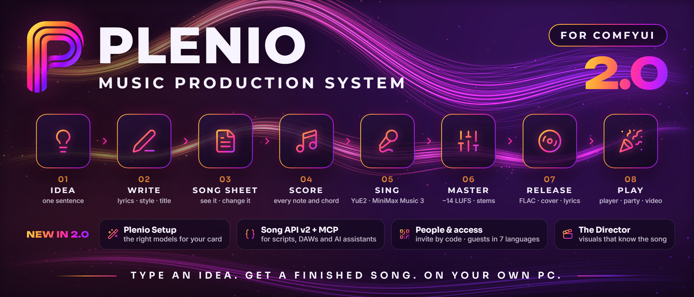
</p>

<h1 align="center">Plenio Music Production System</h1>

<p align="center"><b>Type an idea. Get a finished song. On your own PC.</b></p>

<p align="center">A song production suite for ComfyUI: from one sentence to a mastered song with YuE2 and MiniMax Music 3,<br />every word, note and chord yours to change - and a player that turns any party into a live music studio.<br /><b>Free, open source and completely local.</b></p>

<p align="center">
  <a href="https://github.com/jplenio/Plenio-Music-Production-System/releases"></a>
  
  
  <a href="LICENSE"></a>
  <a href="https://www.youtube.com/playlist?list=PLAFqTtP59fgE"></a>
  <a href="vst3/README.md"></a>
</p>

<p align="center">
  <b><a href="#-quick-start">Quick start</a></b> ·
  <a href="#-new-in-20">New in 2.0</a> ·
  <a href="#-listen-first">Listen</a> ·
  <a href="#-from-one-sentence-to-a-release">How it works</a> ·
  <a href="#-in-comfyui">In ComfyUI</a> ·
  <a href="#-the-plenio-player">The player</a> ·
  <a href="#-plenio-in-your-daw">In your DAW</a> ·
  <a href="#-for-your-own-programs">API</a> ·
  <a href="#-watch-the-tutorials">Tutorials</a> ·
  <a href="https://jplenio.github.io/Plenio-Music-Production-System/guide/">Guide</a>
</p>

<p align="center">
  <a href="https://jplenio.github.io/Plenio-Music-Production-System/#sound">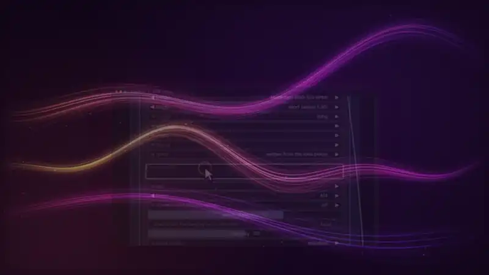</a>
  <br /><sub>A real run, shown fast: the song in this picture was made by the run you see. 🔊 <a href="https://jplenio.github.io/Plenio-Music-Production-System/#sound"><b>Hear Plenio's songs</b></a> · ▶ <a href="https://jplenio.github.io/Plenio-Music-Production-System/go/spot-your-party/"><b>Watch the spot</b></a> (54 s)</sub>
</p>

<table>
<tr>
<td width="33%" valign="top"><h3>🎚️ Finished, not generated</h3>A song comes out <b>mastered and tagged</b>, with cover art, its lyrics timed and its sheet music - ready to play, to share or to release. One brief can become a whole series.</td>
<td width="33%" valign="top"><h3>🔍 Nothing is a black box</h3>The <b>Song Sheet</b> shows the text and the notes the model gets - and a real <b>score editor</b> changes every note and chord before it is sung. The record says how every song was made.</td>
<td width="33%" valign="top"><h3>🎉 Music is for people</h3>The <b>Plenio Player</b> plays it to a room with visuals and the lyrics as they are sung - and at a party every guest makes a song of their own, <b>from their phone</b>.</td>
</tr>
</table>

Everything runs on your own machine, inside ComfyUI's own nodes: **no cloud service, no account, no API key, no extra Python packages.** Plenio costs nothing and its code is Apache 2.0.

## ⚡ Quick start

**1 · Install** - in the ComfyUI Manager search for *Plenio Music Production System*, or:

```bash
comfy node install comfyui-plenio-music     # or: git clone https://github.com/jplenio/Plenio-Music-Production-System into ComfyUI/custom_nodes
```

**2 · Restart ComfyUI.** **Plenio Setup** opens: it reads your graphics card, plans the model files that suit it, downloads them after you confirm and checks every one.

**3 · Make a song.** Setup's *test song* proves your files work; then *Home* has a button for each kind of song. Open **1 · YuE2 · Song**, type what the song is about, press **Run**.

<p align="center">
  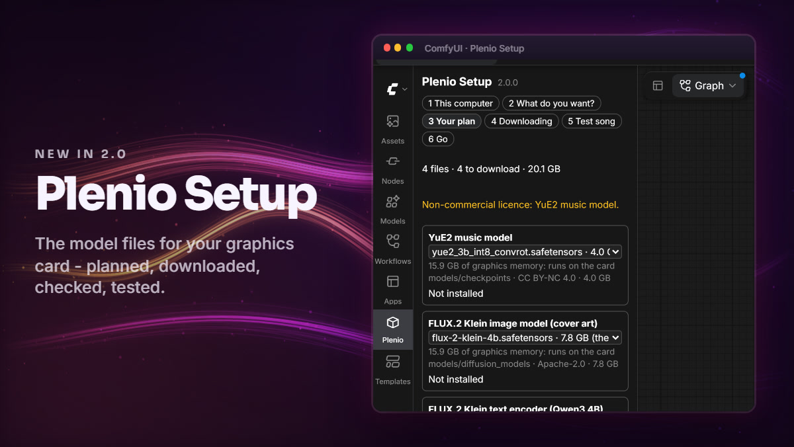
</p>

Needs **ComfyUI <!--fact:comfyui.minimum-->0.41.0<!--/fact--> or newer** (tested with <!--fact:comfyui.tested-->0.41.0, 0.44.2<!--/fact-->) and a graphics card ([what each size of card runs](#-built-for-different-computers)). More: [Getting started](docs/user/getting-started.md) · [two ways to install](docs/user/getting-started.md#two-ways-to-install) · [Models and downloads](docs/user/models.md) · [Troubleshooting](docs/user/troubleshooting.md).

## 🆕 New in 2.0

**Plenio 2.0 makes the first song easy - and opens Plenio to your household, your scripts and your AI assistant.**

<table>
<tr>
<td width="50%" valign="top"><br /><b>Plenio Setup.</b> The right model files for your card: planned, downloaded with a check of every file, tested with a first song. Once set up it is <i>Home</i> - a button for each kind of song. <a href="docs/user/models.md">Models and downloads</a></td>
<td width="50%" valign="top">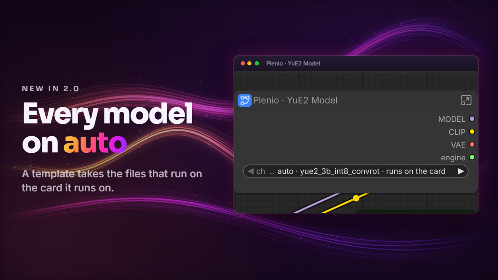<br /><b>Every model on <code>auto</code>.</b> A template made on one computer takes the right files on another. A finetune or a pin is one choice away, and the System Check names every finding with its fix. <a href="docs/user/troubleshooting.md">Troubleshooting</a></td>
</tr>
<tr>
<td width="50%" valign="top">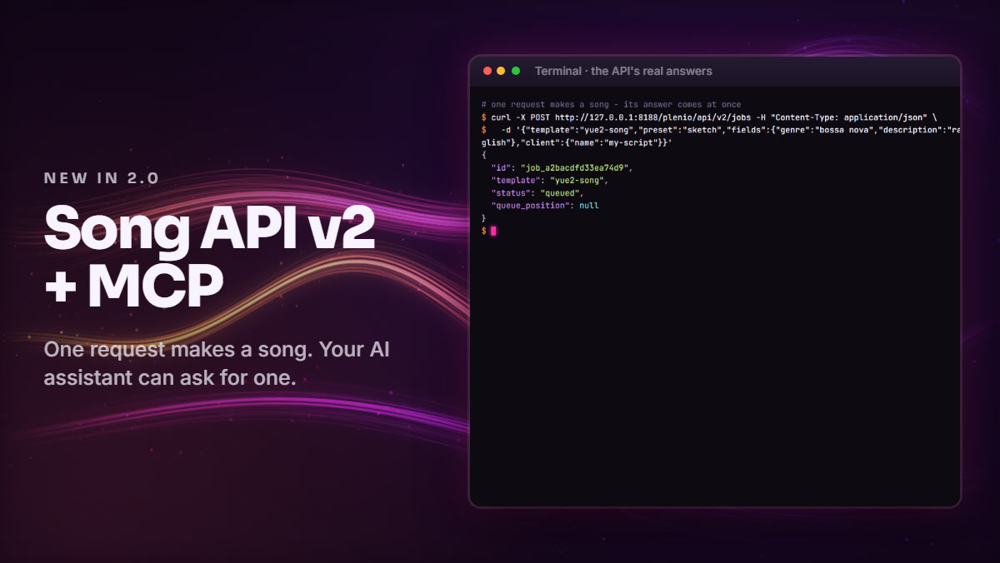<br /><b>Song API v2, a Player API and MCP.</b> Jobs that survive a restart, review stops, one stream of events, tokens for other computers - and <code>plenio_mcp.py</code>: ask an AI assistant for a song and hear it play. <a href="docs/api/README.md">API guide</a></td>
<td width="50%" valign="top">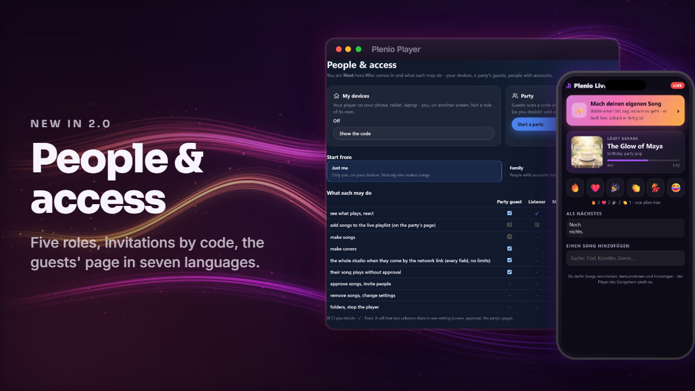<br /><b>People &amp; access.</b> Host, Co-host, Maker, Listener, Party guest - one grid for who may do what. Invite by QR code, <i>Start a party</i> in three questions, the guests' page in seven languages. <a href="docs/user/player/people.md">People &amp; access</a></td>
</tr>
<tr>
<td width="50%" valign="top">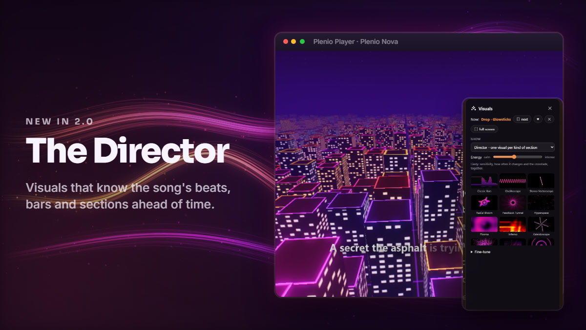<br /><b>The Director.</b> The player knows a song's beats, bars, sections and drops ahead of time: one visual per kind of section, the change on the first beat, twelve signature visuals, one light over every picture. <a href="docs/user/player/visuals.md">Visuals</a></td>
<td width="50%" valign="top">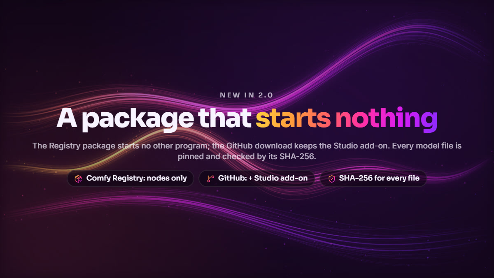<br /><b>A package that starts nothing.</b> The Comfy Registry package starts no other program; the GitHub download keeps the Studio add-on. Every model file is pinned to a commit and checked by its SHA-256. <a href="SECURITY.md#programs-plenio-starts">Security</a></td>
</tr>
</table>

Also new: six **recipes**, *Approve* goes on with the run, the same six **presets** in ComfyUI, the player and the API, a short *Make a song* form in the player, and a guide you can search. Everything: [release notes](docs/releases/2.0.0.md) · [CHANGELOG](CHANGELOG.md). Coming from 1.x? Nothing to migrate - [what changes](docs/user/from-1x-to-2.md).

## 🎧 Listen first

**▶ [Songs made with Plenio, as videos](https://www.youtube.com/playlist?list=PLBZzzh1IMZzk)** - each made in ComfyUI with Plenio and turned into a music video by the Plenio Player (its visuals, the lyrics as they are sung):

<table>
<tr><td align="center" width="33%"><a href="https://jplenio.github.io/Plenio-Music-Production-System/go/song-1/"></a><br /><b>Restrained Driving Atmosphere</b><br /><sub>Progressive Trance</sub></td><td align="center" width="33%"><a href="https://jplenio.github.io/Plenio-Music-Production-System/go/song-2/"></a><br /><b>Hypnotic Rolling Progression</b><br /><sub>Progressive Trance</sub></td><td align="center" width="33%"><a href="https://jplenio.github.io/Plenio-Music-Production-System/go/song-3/"></a><br /><b>Window Open Low</b><br /><sub>Smooth Jazz</sub></td></tr>
<tr><td align="center" width="33%"><a href="https://jplenio.github.io/Plenio-Music-Production-System/go/song-4/"></a><br /><b>Chrome Heartbeat City Glow</b><br /><sub>Synth-Pop</sub></td><td align="center" width="33%"><a href="https://jplenio.github.io/Plenio-Music-Production-System/go/song-5/"></a><br /><b>The Brass Floor</b><br /><sub>Swing / Big Band</sub></td><td align="center" width="33%"><a href="https://jplenio.github.io/Plenio-Music-Production-System/go/song-6/"></a><br /><b>Lonely Quiet Ascent</b><br /><sub>Solo Piano</sub></td></tr>
</table>

**🎧 [The demo page](https://jplenio.github.io/Plenio-Music-Production-System/)** - Plenio 2.0 in 50 seconds, twelve genres with sound, the song videos and more than seventy songs and covers to play, each with everything the model received.

## ✨ From one sentence to a release

<p align="center">
  
</p>

| | |
|---|---|
| **Write** | A Song Brief or Cover Brief with **<!--fact:brief_templates-->250<!--/fact--> genre templates** in 30 families - choosing one fills every field, and every field is a list with room for your own value. A local language model writes title, style and lyrics - Gemma 4 12B, chosen for your graphics card, or any GGUF, ComfyUI's text models, LM Studio, Ollama, llama.cpp, vLLM or Jan - or you bring **your own lyrics, sung as written**. A creativity slider goes from steady to adventurous. |
| **See and change everything** | The **Song Sheet** shows exactly what the music model gets - title, style, lyrics, score - with the exact token budget, counted by the model's own tokenizer. Your edits are never silently overwritten. |
| **Compose** | A real **score editor**: notation, piano roll, chord lane, lyrics on their notes and the notes fitted to the lyrics in one click, a MIDI keyboard, arranging like in a DAW, MIDI and MusicXML in and out, sheet music as PDF - or write the whole melody yourself (*YuE2 · DAW*). |
| **Perform** | **YuE2** for songs, covers and your own melody - with up to four **LoRAs** -, **MiniMax Music 3** for songs. *Lyrics fidelity* renders a second or third take and keeps the one that sings your words best. |
| **Cover** | Any recording becomes a new version: its score read by SheetSage2, its words heard by Qwen3-ASR, new lyrics fitted to its melody. |
| **Polish** | **Audio HQ** (stereo cleanup, UniverSR regenerating the highs of a dull take), a tone match on the curve, **-14 LUFS / -1 dBTP** with a true-peak limiter, **stems** with a mixer. |
| **Release** | FLAC, MP3 or WAV with tags and cover art (FLUX.2 Klein), lyrics subtitles timed by listening, the sheet music as PDF, **a page per song** - and the whole project inside the FLAC: drop it on ComfyUI and you are back in its workflow. |
| **Listen and share** | The **Plenio Player**: visuals, the lyrics as they are sung, Live Play and party mode, music videos, one-file players to send. |
| **Build on it** | The **Song API**, the **Player API** and an **MCP server** for your own programs and AI assistants; **[Plenio VST3](vst3/README.md)** for your DAW. |

## 🎼 In ComfyUI

<p align="center">
  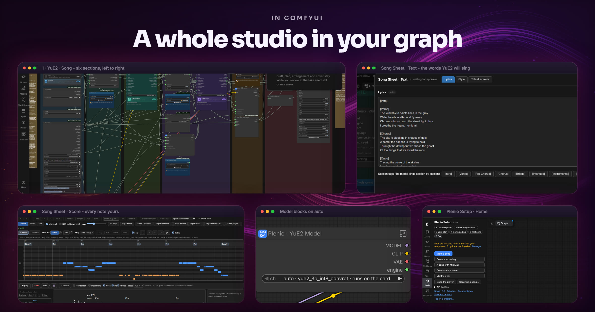
</p>

Six ready-made templates in ComfyUI's template browser, each one clear path from left to right in numbered sections:

| Template | For |
|---|---|
| **0 · System Check** | versions, GPUs, which model files each template still needs - every finding with its fix - and a hardware table with your row marked |
| **1 · YuE2 · Song** | new songs with YuE2 - sung, with sparse vocals or instrumental - with an editable score ([guide](docs/user/paths/yue2-song.md)) |
| **2 · YuE2 · Cover** | a new version of a recording you own or may use: instrumental, original or new lyrics ([guide](docs/user/paths/yue2-cover.md)) |
| **3 · MiniMax · Song** | new songs with MiniMax Music 3 and its structured caption ([guide](docs/user/paths/minimax-song.md)) |
| **4 · Enhance & Master** | Audio HQ, EQ, loudness and a release export for a file you already have - no music model, runs on the CPU ([guide](docs/user/paths/enhance-master.md)) |
| **5 · YuE2 · DAW** | compose the score yourself: piano roll, chord symbols, a MIDI keyboard - YuE2 sings exactly what you approved ([guide](docs/user/paths/yue2-daw.md)) |

**Two ways to work, chosen first in the brief.** *New song every run* turns one brief into a whole series - set the number of runs, press Run once, and every run writes and renders a different song. *One song, stop to review* is for the song you want to get right: the run stops at the Song Sheets, you check or edit the text and the score, press *Approve*, and the run goes on; every later run is a new take of exactly that song. A *Preset* sets length, vocals, lyrics fidelity, HQ mastering and cover art at once, six [recipes](docs/user/recipes.md) show series, comparisons and batches, and all six templates also run as a simple form in ComfyUI's **App mode**.

<table>
<tr>
<td width="58%"></td>
<td width="42%"><b>A real score editor.</b> YuE2's score opens as notation, piano roll and ABC text, with playback. Draw notes, set chord symbols and hear them, arrange sections and bars like in a DAW, play a melody in with a <b>MIDI keyboard</b>, fit the notes to the lyrics with one click, lock a track while you edit the other, export <b>MIDI, MusicXML and PDF</b>. For a cover the original recording runs under the notes, with the sung pitch drawn over them - so a wrong note shows at a glance. <a href="docs/user/concepts/score-editor.md">Score editor guide</a></td>
</tr>
<tr>
<td width="58%"></td>
<td width="42%"><b>LoRAs for YuE2.</b> Up to four, each with its strength. The node reads from the file whether a LoRA shapes YuE2's <i>plan</i> (structure, melody, genre) or its <i>sound</i>, applies it there, and reads m-a-p's original layout as well as ComfyUI's. A file that does not fit is left out and named - the run goes on. <a href="docs/user/concepts/loras.md">LoRA guide</a></td>
</tr>
</table>

<details>
<summary><b>More of what the templates do</b> - covers, lyrics you can trust, finishing, the release, your own language models, creative modes</summary>

- **Covers from the actual music.** SheetSage2 reads the score out of your recording and keeps its beat grid. Qwen3-ASR transcribes the sung words - from the recording or its vocal stem, whichever it hears more surely -, an aligner times them, and Plenio places them into the score's sections. Choose *instrumental*, *original lyrics* or *new lyrics* written to the phrasing of the original; *original notes* leaves out notes of the instrument line and the chords for a freer cover.
- **Your own lyrics, sung as written** - choose *my own* in the Song Brief and YuE2 sings your words exactly, long section tags such as `[Verse - Female Choir, Call and Response delivery]` included; your own tags (`[Violin Rise]`, `[Choir]` …) become sung or instrumental parts.
- **Lyrics you can trust.** Export times the lyrics by listening to the song's vocals (`.srt`, whole lines and note by note, as written and as sung), and Enhance & Master can stop at a Song Sheet with the words as heard, so a misheard one is fixed before the release.
- **Finishing built in.** Every song template ends in **Plenio · Master**: Audio HQ, a gentle tone match, compression and a true-peak limiter to -14 LUFS / -1 dBTP. **Stems** splits a song into vocals, drums, bass and other and mixes them back with a residual that keeps a neutral mix exact ([Audio HQ](docs/user/concepts/audio-hq.md), [Stems](docs/user/concepts/stems.md), [Mastering](docs/user/concepts/mastering.md)).
- **A release, not just a file.** FLAC 24-bit, MP3 V0 or WAV with tags filled from the brief (`Genre: {genre}`, `{lyrics}` …) and cover art; the unmastered take; the sheet music as PDF; the song's page as HTML; and a **release record** of the documents, seeds, settings, loudness, timings, model licences and how the song was made - inside the FLAC too. **File › Continue a Plenio song…** (or dropping the FLAC) opens the song in the workflow it was made with ([Continue a song](docs/user/concepts/continue-a-song.md)).
- **Your own language models.** The **Local LLM** node runs any GGUF in a llama.cpp server that is gone after the draft - the GPU is free again for the music - or asks a running LM Studio, Ollama, llama.cpp, vLLM or Jan ([Local LLMs](docs/user/concepts/local-llm.md)).
- **Creative modes** *(experimental)*: thirteen modes from *sterile* to *fantasy* let the writer plan every section's chords and instrument line; Plenio writes and checks every note ([guide](docs/user/concepts/creative-modes.md)).
- **Native ComfyUI all the way.** Generation, loaders and samplers are ComfyUI's own; Plenio adds <!--fact:nodes-->39<!--/fact--> nodes where ComfyUI has nothing equivalent, each explained in a tooltip.

</details>

## 🔊 The Plenio Player

<p align="center">
  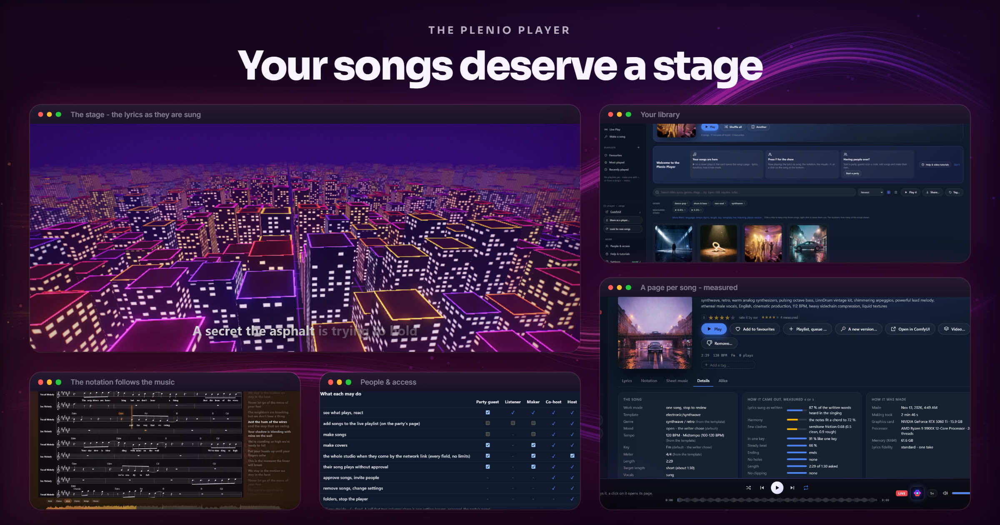
</p>

A program of its own: it runs without ComfyUI, opens at `http://127.0.0.1:8765/`, and finds every song Export Release wrote. **Plenio Player** beside *Run* in ComfyUI opens it; or run `python plenio_player.py` in the Plenio folder - with Plenio from GitHub, double-click `Plenio Player.bat` (`./plenio_player.sh` on macOS and Linux). Five places - **Songs, Playlists, Live, Make, More** - the same on a desktop and in a phone's tab bar.

<table>
<tr>
<td width="56%"></td>
<td width="44%"><b>Party mode - what makes Plenio unique.</b> <i>Start a party</i>, and everyone on the Wi-Fi scans a QR code: the live playlist on their phones, songs to add - and with <b>party songs</b> they order a song of their own: a style, a few words, <i>Generate</i>. It plays when it is ready, with who made it on the big screen. Their reactions 🔥 ❤️ 🎉 float up the screen, and the page speaks <b>seven languages</b>. <a href="docs/user/player/party.md#guests-in-your-network">Party guide</a></td>
</tr>
</table>

- **The lyrics as they are sung** - lit up syllable by syllable, as written or as the take really sings them, and as **full lyrics to copy**. The sheet music follows the music, note by note.
- **<!--fact:visuals.all-->99<!--/fact--> visuals and the Director** - <!--fact:visuals.classic-->25<!--/fact--> classics, <!--fact:visuals.drop-->51<!--/fact--> **Plenio Drop** presets after Winamp's MilkDrop and <!--fact:visuals.nova-->22<!--/fact--> **Plenio Nova** scenes the graphics card works out for every pixel, in seven collections. The **Director** gives each kind of section its own visual and changes on the beat ([guide](docs/user/player/visuals.md)); write your own as a small JSON file of formulas ([guide](docs/user/concepts/player-visuals.md)).
- **People & access** - Host, Co-host, Maker, Listener, Party guest; invitations by QR code; *Just me*, *Family* or *House party* in one click ([guide](docs/user/player/people.md)).
- **Make songs from the player** - *What should the song be about?*, a style, *Generate*; or the full form with presets, covers and up to four takes. The player starts ComfyUI in the background, the way you last started it.
- **Find anything** - search titles, lyrics and briefs, or `genre:jazz bpm:>110 key:Am`; filters, tags of your own, smart lists, playlists, crossfades and a sleep timer - quick with thousands of songs.
- **A page per song** - its lyrics, notation, sheet music, every field of the brief, how it was made, your stars and the measured ones, its files and its other takes.
- **Songs as videos** - an MP4 of the visual with karaoke lyrics and the notation, Full HD, 4K, square or upright for Shorts, made on your graphics card faster than the song lasts.
- **Share as a player** - one HTML file with the songs you choose: anyone double-clicks it and listens, with the lyrics and the visuals. No install, no server, no account.

Guide: [Plenio Player](docs/user/player/README.md).

## 🎹 Plenio in your DAW

<table>
<tr>
<td width="50%"><a href="https://jplenio.github.io/Plenio-Music-Production-System/go/vst3-teaser/">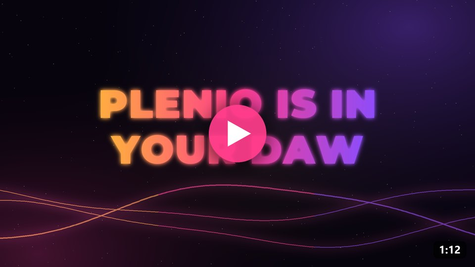</a></td>
<td width="50%"><a href="vst3/README.md">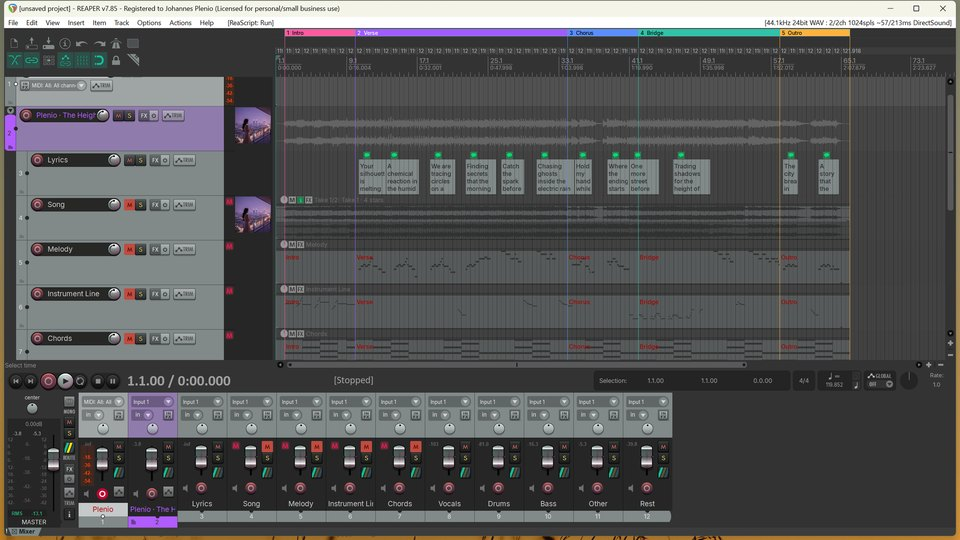</a></td>
</tr>
</table>

*Optional - for people who work in a DAW; ComfyUI and the player need nothing of it.*

**[Plenio VST3](vst3/README.md)** is a free VST3 instrument (with ARA 2) that brings Plenio into REAPER, Cubase, Studio One, Ableton Live, FL Studio, Bitwig and every other DAW that loads VST3 instruments. Pick a style, write an idea or your own lyrics, and your ComfyUI makes the song: up to four takes per run land on your track, in time with your project, each with its **stems**, its **MIDI** and a **tempo map** that follows the bars as they were measured in the take. Change the words, the notes or the chords in the plug-in and render again. The plug-in lives in this repository ([`vst3/`](vst3/README.md)), carries Plenio's version and speaks its Song API v2; its installer is among the files of every [release](https://github.com/jplenio/Plenio-Music-Production-System/releases/latest). ComfyUI may run on another computer than the DAW - a name and a token in the plug-in's settings.

▶ [Teaser](https://jplenio.github.io/Plenio-Music-Production-System/go/vst3-teaser/) (72 s) · ▶ [Tutorial: your first song in your DAW](https://jplenio.github.io/Plenio-Music-Production-System/go/vst3-first-song/) (2:51) · [Plenio VST3: what it does, your DAW, the tutorial](vst3/README.md)

## 🔌 For your own programs

One request makes a song; a stream of events follows it; the files come back ([API guide](docs/api/README.md) · [OpenAPI](docs/api/openapi.json) · [a typed Python client in one file](docs/api/examples/plenio_client.py)):

```bash
curl -X POST http://127.0.0.1:8188/plenio/api/v2/jobs -H "Content-Type: application/json" \
  -d '{"template": "yue2-song", "preset": "party",
       "fields": {"genre": "synthwave", "description": "a night drive through a rainy city", "vocals": "sung"},
       "client": {"name": "my-script"}}'
curl "http://127.0.0.1:8188/plenio/api/v2/jobs/<id>?wait=30"      # answers the moment something changes
```

- **Song API v2** - all five song templates, jobs that survive a restart, review stops (`"review": ["text", "score"]`) with the documents to approve or edit, presets, stems and the measured bars of a take. A program on another computer sends a token from *Plenio Setup › API access*. API v1 answers as in 1.6.0.
- **Player API v1** - what plays, play, pause, queue, Live Play and events: for remote controls, stream decks and home automation ([guide](docs/api/player.md)).
- **Plenio for AI assistants** - `plenio_mcp.py`, a Model Context Protocol server: an assistant such as Claude Desktop or Claude Code makes a song from a description, follows it and plays it in the Plenio Player ([setup](docs/api/mcp.md)).

## 🧩 Under the hood

<p align="center">
  
</p>

<details>
<summary><b>For the curious and the people who want to build on it</b></summary>

- **Nothing hidden from the model, nothing hidden from you.** Every document that conditions the music passes through a Song Sheet as *automatic*, *edited* or *manual*; manual text is never replaced, and a draft that changes under an edit stops the run instead of guessing. Budgets are exact: YuE2's shared 24 576-token context and MiniMax Music 3's 5 000-token prompt are counted with the loaded model's own tokenizer.
- **ComfyUI-native.** Plenio's nodes use ComfyUI's V3 node API; the music and cover-art models run on ComfyUI's own loaders and samplers, so ComfyUI does the memory management and the offloading, and the writer - a GGUF - runs in a llama.cpp server that is gone when the draft is done. Plenio installs no Python packages.
- **A record you can read.** Every export writes `<name>.plenio.json` - the documents with SHA-256 hashes, the executed prompt and the workflow (secrets redacted), the seeds, every report, the measured loudness (BS.1770-4, true peak, LRA), the timings, the model licences and how the song was made - validated against a [JSON schema](resources/schemas/record-1.schema.json) and embedded in the FLAC as an `APPLICATION` block.
- **Two packages, one boundary.** The Comfy Registry package starts nothing but ComfyUI's own Python with Plenio's own modules; what starts another program - the player starting ComfyUI, a `llama-server`, the file manager - lives in the Studio add-on of the GitHub download, and a gate in the CI fails the build if that line is crossed ([SECURITY.md](SECURITY.md#programs-plenio-starts)).
- **LoRAs, joined exactly.** ComfyUI's YuE2 fuses q/k/v and gate/up into one projection each; a LoRA trained on the separate ones is joined block-diagonally - `down = [A_q; A_k; A_v]`, `up = diag(B_q, B_k, B_v)` - so that `up · down` is exactly the stacked deltas ([plenio/comfy/loras.py](plenio/comfy/loras.py)).
- **The player is plain.** A Python standard-library HTTP server and a Vue page: it reads the records, serves only the files a record lists, renders the song's page, muxes the browser's video with PyAV and runs a separate, rate-limited server for the party's phones behind a random 96-bit path. What it starts, writes and opens is listed in [SECURITY.md](SECURITY.md).
- **Checked.** <!--fact:tests.all-->2 578<!--/fact--> test functions - unit, contract tests against ComfyUI in-process, host tests with real ComfyUI servers, frontend tests - run in CI on Linux and Windows, with mypy strict and ruff. [Architecture](docs/dev/architecture.md) · [Extending Plenio](docs/dev/extending.md) · [Testing](docs/dev/testing.md)

</details>

## 💻 Built for different computers

Every model block of the templates says `auto`: Plenio takes the files that run on your card - one already on your computer if it is nearly as good -, and Plenio Setup shows the plan before anything is fetched. The writer writes before the music model and leaves the card free for it. Measured on a 16 GB RTX 5060 Ti: a 1:44 instrumental - writer, plan, take, master and export, models loaded fresh - in 2½ minutes. *4 · Enhance & Master* needs no GPU.

<details>
<summary><b>What <code>auto</code> takes on each size of graphics card</b></summary>

<!--facts:hardware-table-->
| GPU memory | YuE2 | MiniMax Music 3 | Cover Art (FLUX.2 Klein 4B) | Writer (Gemma 4) |
|---|---|---|---|---|
| below 8 GB | `yue2_3b_int8_convrot` (4.0 GB) - runs with offloading: slower | `minimax_music3_dit_int8_convrot` (2.5 GB) + `minimax_music3_text_encoder_pruned_int8_convrot` (9.2 GB) - too large for this card: very slow | `flux-2-klein-4b-fp8` (4.1 GB) + `qwen_3_4b_fp4_flux2` (3.8 GB) - runs with offloading: slower | `gemma-4-12B-it-qat-UD-Q4_K_XL.gguf` (6.7 GB); without llama.cpp: `gemma4_e2b_it_int8_convrot` |
| 8-12 GB | `yue2_3b_int8_convrot` (4.0 GB) - runs with offloading: slower | `minimax_music3_dit_int8_convrot` (2.5 GB) + `minimax_music3_text_encoder_pruned_int8_convrot` (9.2 GB) - runs with offloading: slower | `flux-2-klein-4b-fp8` (4.1 GB) + `qwen_3_4b_fp4_flux2` (3.8 GB) - runs on the card | `gemma-4-12B-it-qat-UD-Q4_K_XL.gguf` (6.7 GB); without llama.cpp: `gemma4_e2b_it_int8_convrot` |
| 12-16 GB | `yue2_3b_int8_convrot` (4.0 GB) - runs on the card | `minimax_music3_dit_int8_convrot` (2.5 GB) + `minimax_music3_text_encoder_pruned_int8_convrot` (9.2 GB) - runs on the card | `flux-2-klein-4b-fp8` (4.1 GB) + `qwen_3_4b_fp4_flux2` (3.8 GB) - runs on the card | `gemma-4-12B-it-qat-UD-Q4_K_XL.gguf` (6.7 GB); without llama.cpp: `gemma4_e4b_it_fp8_scaled` |
| 16-24 GB | `yue2_3b_int8_convrot` (4.0 GB) - runs on the card | `minimax_music3_dit_fp16` (4.9 GB) + `minimax_music3_text_encoder_pruned_int8_convrot` (9.2 GB) - runs on the card | `flux-2-klein-4b` (7.8 GB) + `qwen_3_4b` (8.0 GB) - runs on the card | `gemma-4-12B-it-qat-UD-Q4_K_XL.gguf` (6.7 GB); without llama.cpp: `gemma4_12b_int8_convrot` |
| 24 GB and more | `yue2_3b_bf16` (7.8 GB) - runs on the card | `minimax_music3_dit_fp16` (4.9 GB) + `minimax_music3_text_encoder_pruned_int8_convrot` (9.2 GB) - runs on the card | `flux-2-klein-4b` (7.8 GB) + `qwen_3_4b` (8.0 GB) - runs on the card | `gemma-4-12b-it-Q6_K.gguf` (9.8 GB); without llama.cpp: `gemma4_12b_int8_convrot` |

*What `auto` takes with nothing installed. Basis: estimate (the catalogue's memory thresholds).*
<!--/facts-->

The other rows come from model sizes and the predecessor toolkit's ratings. See [Models and downloads](docs/user/models.md) for every file, folder and size.

</details>

<a id="installation"></a>
<details>
<summary><b>Installing by hand, the writer, and what is optional</b></summary>

**ComfyUI Manager:** open *Manager → Custom Nodes Manager*, search for **Plenio Music Production System** and install it. **Comfy CLI:** `comfy node install comfyui-plenio-music`. **By hand:** `git clone https://github.com/jplenio/Plenio-Music-Production-System` into `ComfyUI/custom_nodes` - this is the full download with the Studio add-on. Restart ComfyUI.

Plenio installs no Python packages. One package is optional: `python -m pip install faster-whisper`, the lyrics ASR for languages Qwen3's aligner cannot time (Dutch, Swedish, Polish, Turkish ...). The writer, Gemma 4 12B, is a GGUF file run by llama.cpp: install llama.cpp (`winget install llama.cpp`, `brew install llama.cpp`), and the first song uses the one you have or downloads the one for your graphics card ([details](docs/user/models.md#the-writer-gemma-4-12b)); without llama.cpp ComfyUI's own Gemma writes. A [YuE2 finetune](docs/user/models.md#yue2-finetunes) in ComfyUI's format goes into `models/checkpoints` and is chosen in the model block.

</details>

## 📺 Watch the tutorials

**New in 2.0 - five tutorials** (English, a synthetic narrator, subtitles and chapters), recorded in the real program with songs made by Plenio:

| | Tutorial | What you will see |
|:---:|---|---|
| <a href="https://jplenio.github.io/Plenio-Music-Production-System/go/tutorial-2-setup/">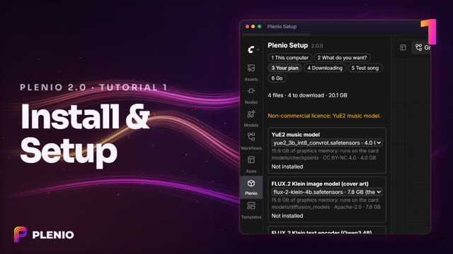</a> | **[1 · Install and Plenio Setup](https://jplenio.github.io/Plenio-Music-Production-System/go/tutorial-2-setup/)** (2:07) | Plenio installed, Plenio Setup reading your graphics card, the model files that suit it downloaded and checked, and a test song. |
| <a href="https://jplenio.github.io/Plenio-Music-Production-System/go/tutorial-2-first-song/">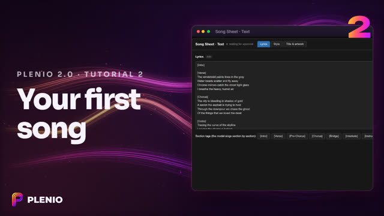</a> | **[2 · Your first song](https://jplenio.github.io/Plenio-Music-Production-System/go/tutorial-2-first-song/)** (2:44) | From one sentence to a finished, mastered song - with the two stops of the Song Sheet to see and change the words and the notes before anything is sung. |
| <a href="https://jplenio.github.io/Plenio-Music-Production-System/go/tutorial-2-player/">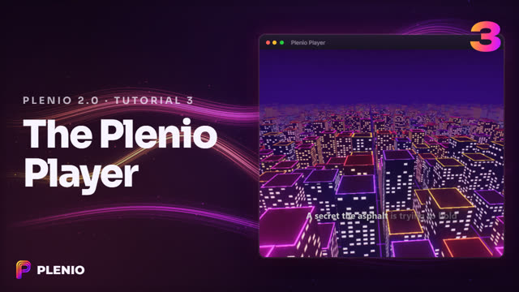</a> | **[3 · The Plenio Player](https://jplenio.github.io/Plenio-Music-Production-System/go/tutorial-2-player/)** (2:11) | Your songs on a stage: the lyrics as they are sung, notation that follows, and visuals that know the song's beats and sections. |
| <a href="https://jplenio.github.io/Plenio-Music-Production-System/go/tutorial-2-party/">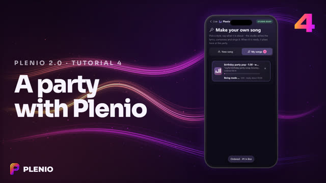</a> | **[4 · A party with Plenio](https://jplenio.github.io/Plenio-Music-Production-System/go/tutorial-2-party/)** (1:43) | *Start a party*, the guests join from their phones with a QR code - and order songs of their own. |
| <a href="https://jplenio.github.io/Plenio-Music-Production-System/go/tutorial-2-api/">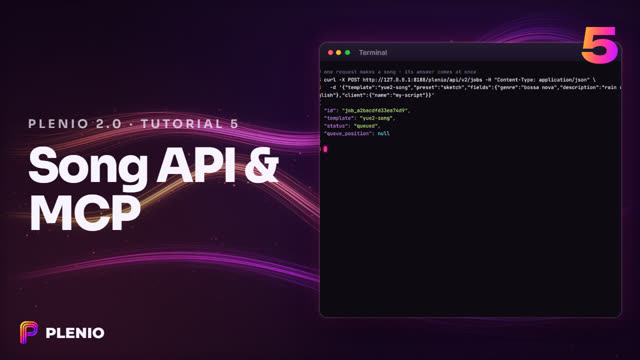</a> | **[5 · Song API and AI assistants](https://jplenio.github.io/Plenio-Music-Production-System/go/tutorial-2-api/)** (1:30) | One request makes a song: the Song API v2, the Python client, and Plenio as a tool for Claude Desktop or Claude Code. |

**The template tutorials** - one narrated video for every template, the creative modes, the Plenio Player, party songs, the Song API and LoRAs (English, with chapters). They were recorded with Plenio 1.x: the templates and the editors work as shown; installing and the model files are now Plenio Setup's job (tutorial 1 above), and the model fields say `auto`. **▶ [All tutorials as a YouTube playlist](https://www.youtube.com/playlist?list=PLAFqTtP59fgE)**

| | Tutorial | What you will see |
|:---:|---|---|
| <a href="https://jplenio.github.io/Plenio-Music-Production-System/go/tutorial-0-system-check/">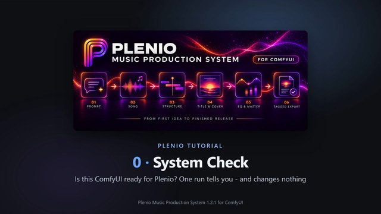</a> | **[0 · System Check](https://jplenio.github.io/Plenio-Music-Production-System/go/tutorial-0-system-check/)** | Is your ComfyUI ready? Versions, the GPU, the model files every template needs and the hardware table with your machine's row. |
| <a href="https://jplenio.github.io/Plenio-Music-Production-System/go/tutorial-1-yue2-song/">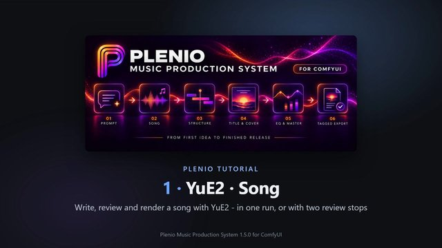</a> | **[1 · YuE2 · Song](https://jplenio.github.io/Plenio-Music-Production-System/go/tutorial-1-yue2-song/)** | From a brief to a finished song - as a series or one song with review stops - and a tour of the score editor: notes, lyrics, playback, sounds, arranging, recording with a MIDI keyboard, the files. |
| <a href="https://jplenio.github.io/Plenio-Music-Production-System/go/tutorial-2-yue2-cover/">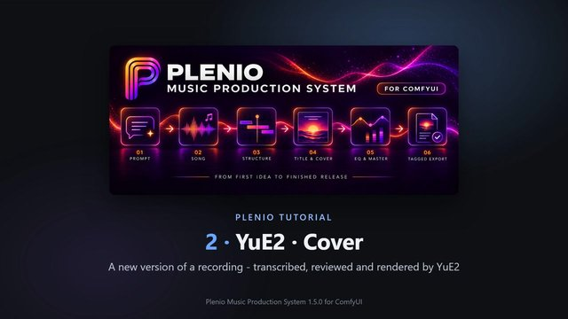</a> | **[2 · YuE2 · Cover](https://jplenio.github.io/Plenio-Music-Production-System/go/tutorial-2-yue2-cover/)** | A recording becomes a new version. The original plays under the notes (waveform, A/B), a copied chorus sings its words again, and the sheet music goes out as files. |
| <a href="https://jplenio.github.io/Plenio-Music-Production-System/go/tutorial-3-minimax-song/">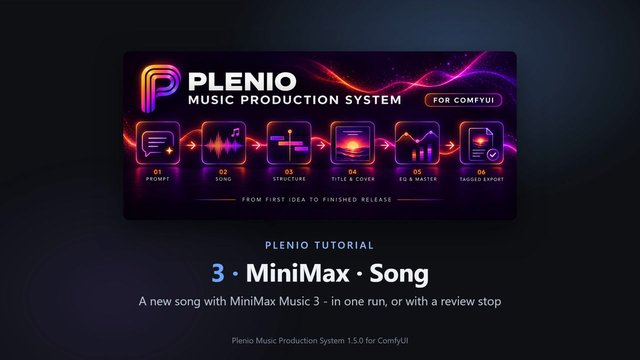</a> | **[3 · MiniMax · Song](https://jplenio.github.io/Plenio-Music-Production-System/go/tutorial-3-minimax-song/)** | Songs with MiniMax Music 3: the caption, the lyrics and the 5,000-token budget, checked before anything is rendered. |
| <a href="https://jplenio.github.io/Plenio-Music-Production-System/go/tutorial-4-enhance-master/"></a> | **[4 · Enhance & Master](https://jplenio.github.io/Plenio-Music-Production-System/go/tutorial-4-enhance-master/)** | Master any recording without a music model: Audio HQ, a warm tone match, measured loudness and the release export - your own sound - and the lyrics of a sung recording, corrected before the release. |
| <a href="https://jplenio.github.io/Plenio-Music-Production-System/go/tutorial-5-yue2-daw/">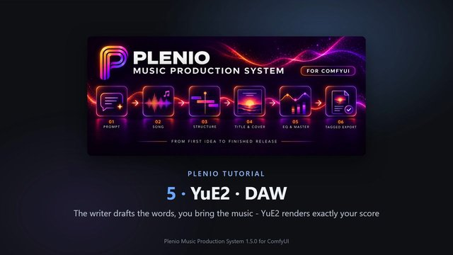</a> | **[5 · YuE2 · DAW](https://jplenio.github.io/Plenio-Music-Production-System/go/tutorial-5-yue2-daw/)** | Compose it yourself: the words first, then the music - draw the notes, import a MIDI sketch or play it in with a MIDI keyboard - and YuE2 sings your melody. |
| <a href="https://jplenio.github.io/Plenio-Music-Production-System/go/tutorial-6-yue2-song-creative/">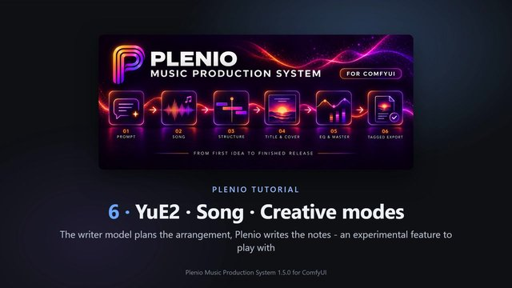</a> | **[6 · YuE2 · Song · Creative modes](https://jplenio.github.io/Plenio-Music-Production-System/go/tutorial-6-yue2-song-creative/)** *(experimental)* | The writer model plans the arrangement, Plenio writes the notes: a *dramatic* song, its arranged score, the rendered song - and another arrangement from the arrangement seed. |
| <a href="https://jplenio.github.io/Plenio-Music-Production-System/go/tutorial-7-yue2-cover-creative/">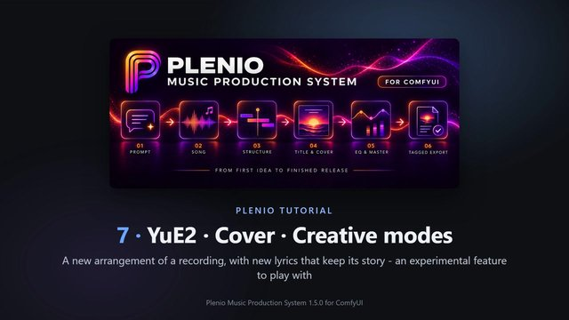</a> | **[7 · YuE2 · Cover · Creative modes](https://jplenio.github.io/Plenio-Music-Production-System/go/tutorial-7-yue2-cover-creative/)** *(experimental)* | A recording re-arranged for a full ensemble, with new lyrics that keep its story - *song flow closeness* and *lyrics closeness*, A/B against the original. |
| <a href="https://jplenio.github.io/Plenio-Music-Production-System/go/tutorial-8-player/">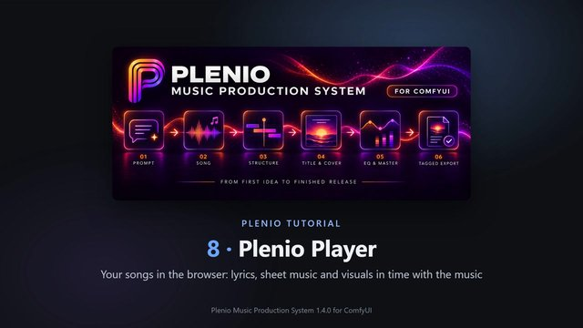</a> | **[8 · Plenio Player](https://jplenio.github.io/Plenio-Music-Production-System/go/tutorial-8-player/)** | Your songs in the browser, on the phone and on the party's big screen: search, a page per song with the full lyrics and its stars, the lyrics lit up as they are sung, the visuals with Plenio Nova, Live Play with the guests' reactions, videos - and back to ComfyUI. |
| <a href="https://jplenio.github.io/Plenio-Music-Production-System/go/tutorial-9-party-songs/"></a> | **[9 · Party songs](https://jplenio.github.io/Plenio-Music-Production-System/go/tutorial-9-party-songs/)** | Songs made from the player, no workflow to open: presets, takes, ComfyUI started for you - and the guests ordering songs on their phones, who made it and at which party, their reactions kept for every song. |
| <a href="https://jplenio.github.io/Plenio-Music-Production-System/go/tutorial-10-song-api/"></a> | **[10 · Song API](https://jplenio.github.io/Plenio-Music-Production-System/go/tutorial-10-song-api/)** | Songs from your own programs: one POST, the job followed with `?wait`, the files, the song played - and the examples in Python, JavaScript and the shell. |
| <a href="https://jplenio.github.io/Plenio-Music-Production-System/go/tutorial-11-yue2-loras/">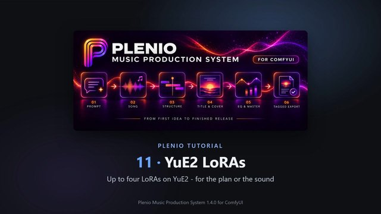</a> | **[11 · YuE2 LoRAs](https://jplenio.github.io/Plenio-Music-Production-System/go/tutorial-11-yue2-loras/)** | The LoRA node under the music model: the two halves a LoRA shapes, a LoRA chosen with its strength, an instrumental made with it, and what the node says after the run. |

**▶ [Your idea. Your song. Your party.](https://jplenio.github.io/Plenio-Music-Production-System/go/spot-your-party/)** - the spot (54 s) · **▶ [Your idea. Your song. Your control.](https://jplenio.github.io/Plenio-Music-Production-System/go/spot-your-control/)** - the first spot (54 s) · **▶ [Plenio VST3: your first song in your DAW](https://jplenio.github.io/Plenio-Music-Production-System/go/vst3-first-song/)** (2:51)

## 📚 Documentation

**[The guide as a website](https://jplenio.github.io/Plenio-Music-Production-System/guide/)**, with search - or here:

- **Start:** [Getting started](docs/user/getting-started.md) · [Models and downloads](docs/user/models.md) · [From 1.x to 2.0](docs/user/from-1x-to-2.md) · [Troubleshooting](docs/user/troubleshooting.md) · [Configuration](docs/user/configuration.md)
- **Make songs:** [YuE2 Song](docs/user/paths/yue2-song.md) · [YuE2 Cover](docs/user/paths/yue2-cover.md) · [YuE2 DAW](docs/user/paths/yue2-daw.md) · [MiniMax Song](docs/user/paths/minimax-song.md) · [Enhance & Master](docs/user/paths/enhance-master.md) · [Recipes](docs/user/recipes.md)
- **Understand:** [Song Sheet](docs/user/concepts/song-sheet.md) · [Brief templates](docs/user/concepts/brief-templates.md) · [Score editor](docs/user/concepts/score-editor.md) · [Continue a song](docs/user/concepts/continue-a-song.md) · [Seeds](docs/user/concepts/seeds.md) · [Stems](docs/user/concepts/stems.md) · [Refine (48 kHz)](docs/user/concepts/refine.md) · [Instrumental](docs/user/concepts/instrumental.md) · [Mastering](docs/user/concepts/mastering.md) · [Tags and subtitles](docs/user/concepts/tags-and-subtitles.md) · [App mode](docs/user/concepts/app-mode.md) · [Local LLMs](docs/user/concepts/local-llm.md) · [LoRAs for YuE2](docs/user/concepts/loras.md) · [Licensing](docs/user/licensing.md)
- **Play:** [Plenio Player](docs/user/player/README.md) · [People & access](docs/user/player/people.md) · [Party](docs/user/player/party.md) · [Visuals](docs/user/player/visuals.md) · [Plenio Drop presets](docs/user/concepts/player-visuals.md)
- **Build:** [Song API](docs/api/README.md) · [Player API](docs/api/player.md) · [MCP](docs/api/mcp.md) · [Architecture](docs/dev/architecture.md) · [Extending Plenio](docs/dev/extending.md) · [Testing](docs/dev/testing.md) · [Design documents](docs/design/README.md) · [Decisions](docs/adr/README.md)
- [Changelog](CHANGELOG.md): every change of the current version and the one before · [Security and privacy](SECURITY.md): what Plenio downloads, starts and writes

## A few honest limits

- YuE2 sometimes renders a take to the length ceiling and stops mid-phrase; render another take. *Instrumental* is a strong request, not a guarantee: the optional *Check Vocals* measures the take and keeps the cleanest one.
- The ASR can mishear words. Covers and Enhance & Master show them on a Song Sheet so you can correct them before the release.
- Mastering is whole-song loudness with a gentle tone match after Audio HQ. There are no fades and no multiband processing.
- The player's videos need a browser that can encode video (current Chrome or Edge), and Plenio Drop needs WebGL2; the other visuals draw everywhere.
- The model plan's memory figures are estimates until measured; the hardware table says so.
- **Stems**, **Audio HQ 3** and **Refine** are experimental: their guarantees (a neutral mix returns the input, same rate and length, no normalisation) are tested, but how the models *sound* is decided by listening checks ([test report](docs/test-reports/2026-10-21-audio-hq.md)). A LoRA's quality is its maker's - Plenio applies it, it cannot vouch for it.

## Licences

- Plenio's code: **Apache-2.0** ([LICENSE](LICENSE), [NOTICE.md](NOTICE.md)); bundled frontend libraries: [THIRD_PARTY.md](THIRD_PARTY.md).
- **Model weights have their own licences and are not included.** YuE2, YuE2-VAE, SheetSage2 and the instrumental adapter are **CC BY-NC 4.0 (non-commercial)**. MiniMax Music 3 uses the MiniMax-Music3 Community License with commercial conditions. FLUX.2 Klein 4B, the Gemma 4 writer and faster-whisper are Apache-2.0 or MIT. A LoRA has its own licence. The release record names the licences of the models a song was made with; see [Licensing](docs/user/licensing.md).

**Coming from the Music Production Toolkit?** Plenio is the successor of the [Music Production Toolkit](https://github.com/jplenio/ComfyUI-MiniMax-Music-Production-Toolkit) (formerly *MiniMax Music Production Toolkit*). Both can be installed side by side; old workflows keep working with the old toolkit, and there is no automatic migration of saved workflows.

<p align="center"><br /><sub>Created by <a href="https://github.com/jplenio">Johannes Plenio</a>. This is an independent community project.</sub></p>
