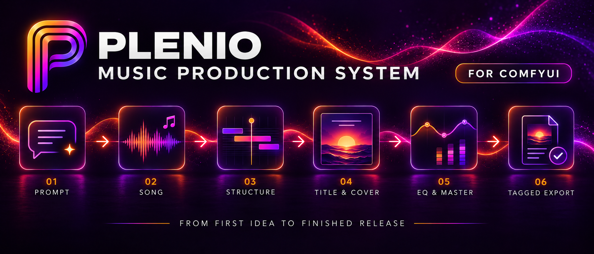
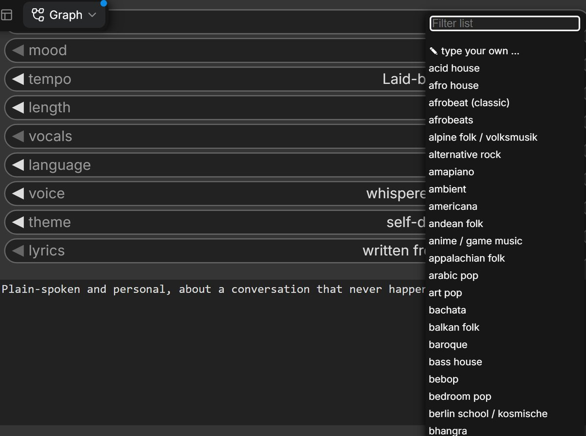
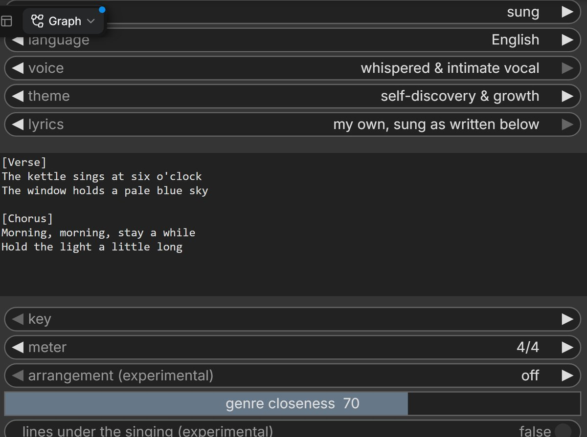
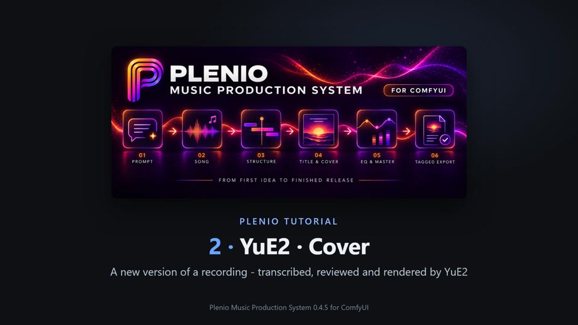
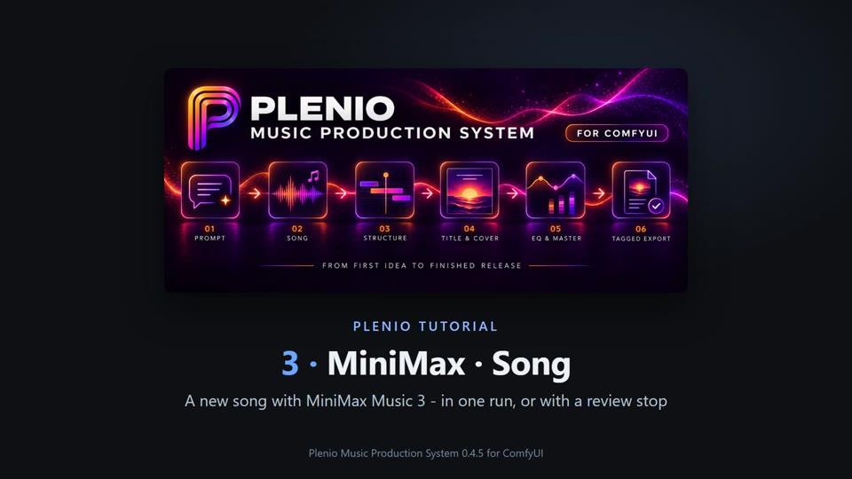
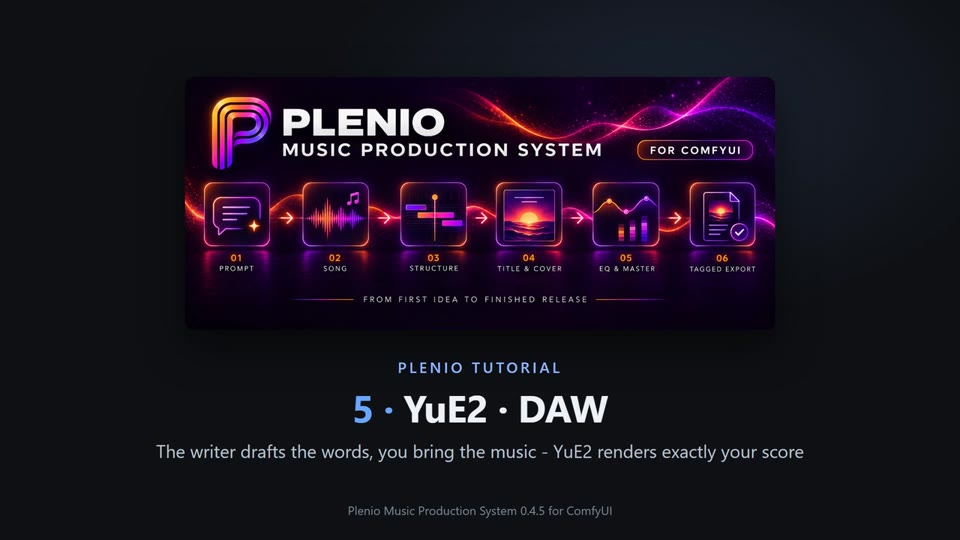
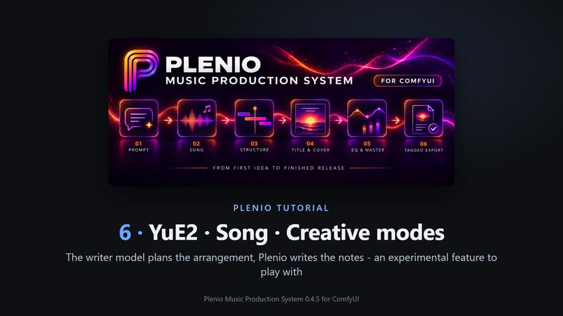
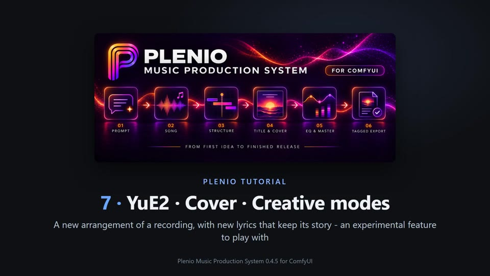

<p align="center">
  
</p>

<h1 align="center">Plenio Music Production System</h1>

<p align="center"><b>A one-of-a-kind song production suite for ComfyUI - from the idea to a mastered song with YuE2, every note under your control,<br />and a player that turns any party into a live music studio. Free, open source and completely local.</b></p>

<p align="center">
  <a href="https://github.com/jplenio/Plenio-Music-Production-System/releases"></a>
  
  
  <a href="LICENSE"></a>
  <a href="https://www.youtube.com/playlist?list=PLAFqTtP59fgE"></a>
</p>

<p align="center">
  <a href="https://jplenio.github.io/Plenio-Music-Production-System/#sound"></a>
  <br /><sub>🔊 <a href="https://jplenio.github.io/Plenio-Music-Production-System/#sound"><b>Hear it with sound</b></a> · twelve songs made with Plenio, each from its strongest moment, as the Plenio Player shows them · ▶ <a href="https://jplenio.github.io/Plenio-Music-Production-System/"><b>Plenio in 30 seconds</b></a></sub>
</p>

<p align="center">
  <a href="#-listen-first">Listen</a> ·
  <a href="#-what-plenio-does">What it does</a> ·
  <a href="#-in-comfyui">In ComfyUI</a> ·
  <a href="#-the-plenio-player">The player</a> ·
  <a href="#-new-in-15">New in 1.5</a> ·
  <a href="#-under-the-hood">Under the hood</a> ·
  <a href="#installation">Install</a> ·
  <a href="#watch-the-tutorials">Tutorials</a>
</p>

**Plenio is a one-of-a-kind extension for ComfyUI - completely free and completely local - with three things that set it apart:**

1. **Songs on autopilot.** Any song you can imagine - and any kind of cover - made with YuE2 from the first idea to a mastered, release-ready track, automatically. One brief can become a whole series of finished songs.
2. **Every note under your control.** Or shape a song exactly the way you want it: the lyrics, the melody, every note and chord that is played - in a DAW-like editor with real notation.
3. **A player made for these songs.** The **Plenio Player** is tuned to everything Plenio makes: the lyrics light up as they are sung, the sheet music follows the music, visuals move with it, and music videos are made on your graphics card.

**And then there is the party - what makes Plenio unique.** At a party or any event, every guest opens the player on their own phone or tablet: they see the live playlist and, if you allow it, change it. And it doesn't stop there - every guest can make a song of their own on the fly, through your studio, and add it to the playlist. Huge fun at any get-together.

Everything runs on your own machine, inside ComfyUI's own nodes: no cloud service, no account, no API key, no extra Python packages. Before a single note is rendered, the **Song Sheet** shows you the title, style, lyrics and score the model will receive - and you can change all of it. Plenio costs nothing and its code is Apache 2.0; saved workflows and release records keep working across every 1.x version.

## 🎧 Listen first

**▶ [Songs made with Plenio, as videos](https://www.youtube.com/playlist?list=PLBZzzh1IMZzk)** - each made in ComfyUI with Plenio and turned into a music video by the Plenio Player (its visuals, the lyrics as they are sung):

<table>
<tr><td align="center" width="33%"><a href="https://youtu.be/hPq9tUjTzr0"></a><br /><b>Restrained Driving Atmosphere</b><br /><sub>Progressive Trance</sub></td><td align="center" width="33%"><a href="https://youtu.be/hAaLnEOe6-g"></a><br /><b>Hypnotic Rolling Progression</b><br /><sub>Progressive Trance</sub></td><td align="center" width="33%"><a href="https://youtu.be/VcDpDqVAz3g"></a><br /><b>Window Open Low</b><br /><sub>Smooth Jazz</sub></td></tr>
<tr><td align="center" width="33%"><a href="https://youtu.be/UoQnC7ceOl8"></a><br /><b>Chrome Heartbeat City Glow</b><br /><sub>Synth-Pop</sub></td><td align="center" width="33%"><a href="https://youtu.be/r-X1GWI-BR0"></a><br /><b>The Brass Floor</b><br /><sub>Swing / Big Band</sub></td><td align="center" width="33%"><a href="https://youtu.be/4A_jQsZj8B4"></a><br /><b>Lonely Quiet Ascent</b><br /><sub>Solo Piano</sub></td></tr>
</table>

**🎧 [The demo page](https://jplenio.github.io/Plenio-Music-Production-System/)** - Plenio in 30 seconds, twelve genres with sound, the song videos and more than seventy songs and covers to play, each with everything the model received.

## ✨ What Plenio does

<p align="center">
  
</p>

| | |
|---|---|
| **Write** | A Song Brief or Cover Brief with **250 genre templates** in 30 families - choosing one fills every field, and every field is a list with room for your own value; a local language model writes title, style and lyrics - Gemma 4 natively, or any GGUF, LM Studio, Ollama, llama.cpp, vLLM or Jan - or you bring your own lyrics, sung as written. A creativity slider goes from steady to adventurous. |
| **See and change everything** | The **Song Sheet** shows exactly what the music model gets - title, style, lyrics, score - with the exact token budget, counted by the model's own tokenizer. Your edits are never silently overwritten. |
| **Compose** | A real **score editor**: notation, piano roll, chord lane, lyrics on their notes, a MIDI keyboard, arranging like in a DAW, MIDI and MusicXML in and out, sheet music as PDF - or write the whole melody yourself (*YuE2 · DAW*). |
| **Perform** | **YuE2** for songs, covers and your own melody - with up to four **LoRAs** -, **MiniMax Music 3** for songs. *Lyrics fidelity* renders a second or third take and keeps the one that sings your words best. |
| **Cover** | Any recording becomes a new version: its score read by SheetSage2, its words heard by Qwen3-ASR, new lyrics fitted to its melody. |
| **Polish** | **Audio HQ** (stereo cleanup, UniverSR regenerating the highs of a dull take), a tone match on the curve, **-14 LUFS / -1 dBTP** with a true-peak limiter, **stems** with a mixer. |
| **Release** | FLAC, MP3 or WAV with tags and cover art (FLUX.2 Klein), lyrics subtitles timed by listening, the sheet music as PDF, **a page per song** with the full lyrics to copy - and the whole project inside the FLAC: drop it on ComfyUI and you are back in its workflow. |
| **Listen and share** | The **Plenio Player**: visuals, the lyrics as they are sung, Live Play and party mode, music videos, one-file players to send - and the **Song API** for your own programs. |

## 🎛️ In ComfyUI

<p align="center">
  
</p>

Six ready-made templates in ComfyUI's template browser, each one clear path from left to right in numbered sections:

| Template | For |
|---|---|
| **0 · System Check** | versions, GPUs, which model files each template still needs, and a hardware table with your row marked |
| **1 · YuE2 · Song** | new songs with YuE2 - sung, with sparse vocals or instrumental - with an editable score ([guide](docs/user/paths/yue2-song.md)) |
| **2 · YuE2 · Cover** | a new version of a recording you own or may use: instrumental, original or new lyrics ([guide](docs/user/paths/yue2-cover.md)) |
| **3 · MiniMax · Song** | new songs with MiniMax Music 3 and its structured caption ([guide](docs/user/paths/minimax-song.md)) |
| **4 · Enhance & Master** | Audio HQ, EQ, loudness and a release export for a file you already have - no music model, runs on the CPU ([guide](docs/user/paths/enhance-master.md)) |
| **5 · YuE2 · DAW** | compose the score yourself: piano roll, chord symbols, a MIDI keyboard - YuE2 sings exactly what you approved ([guide](docs/user/paths/yue2-daw.md)) |

**Two ways to work, chosen first in the brief.** *New song every run* turns one brief into a whole series - set the number of runs, press Run once, and every run writes and renders a different song. *One song, stop to review* is for the song you want to get right: the run stops at the Song Sheets, you check or edit the text and the score, approve, and every later run is a new take of exactly that song. All six templates also run as a simple form in ComfyUI's **App mode**.

<table>
<tr>
<td width="58%"></td>
<td width="42%"><b>A real score editor.</b> YuE2's score opens as notation, piano roll and ABC text, with playback. Draw notes, set chord symbols, arrange sections and bars like in a DAW, play a melody in with a <b>MIDI keyboard</b>, hear every track in its own sound, export <b>MIDI, MusicXML and PDF</b>. For a cover the original recording runs under the notes, with the sung pitch drawn over them - so a wrong note shows at a glance. <a href="docs/user/concepts/score-editor.md">Score editor guide</a></td>
</tr>
<tr>
<td width="58%"></td>
<td width="42%"><b>LoRAs for YuE2.</b> Up to four, each with its strength. The node reads from the file whether a LoRA shapes YuE2's <i>plan</i> (structure, melody, genre) or its <i>sound</i>, applies it there, and reads m-a-p's original layout as well as ComfyUI's. A file that does not fit is left out and named - the run goes on. Empty, YuE2 runs as loaded. <a href="docs/user/concepts/loras.md">LoRA guide</a></td>
</tr>
</table>

- **Covers from the actual music.** SheetSage2 reads the score out of your recording and keeps its beat grid. Qwen3-ASR transcribes the sung words - from the recording or its vocal stem, whichever it hears more surely -, an aligner times them, and Plenio places them into the score's sections. Choose *instrumental*, *original lyrics* or *new lyrics* written to the phrasing of the original.
- **Lyrics you can trust.** Export times the lyrics by listening (`.srt`, whole lines and note by note, as written and as sung) and Enhance & Master can stop at a Song Sheet with the words as heard, so a misheard one is fixed before the release.
- **Finishing built in.** Every song template ends in **Plenio · Master**: Audio HQ, a gentle tone match, compression and a true-peak limiter to -14 LUFS / -1 dBTP. **Stems** splits a song into vocals, drums, bass and other and mixes them back with a residual that keeps a neutral mix exact ([Audio HQ](docs/user/concepts/audio-hq.md), [Stems](docs/user/concepts/stems.md), [Mastering](docs/user/concepts/mastering.md)).
- **A release, not just a file.** FLAC 24-bit, MP3 V0 or WAV with tags filled from the brief (`Genre: {genre}`, `{lyrics}` …) and cover art; the unmastered take; the sheet music as PDF; the song's page as HTML; and a **release record** of the documents, seeds, settings, loudness, model licences and how the song was made - inside the FLAC too. **File › Continue a Plenio song…** (or dropping the FLAC) opens the song in the workflow it was made with ([Continue a song](docs/user/concepts/continue-a-song.md)).
- **Your own language models.** The **Local LLM** node runs any GGUF in a llama.cpp server that is gone after the draft - the GPU is free again for the music - or asks a running LM Studio, Ollama, llama.cpp, vLLM or Jan ([Local LLMs](docs/user/concepts/local-llm.md)).
- **Creative modes** *(experimental)*: thirteen modes from *sterile* to *fantasy* let the writer plan every section's chords and instrument line; Plenio writes and checks every note ([guide](docs/user/concepts/creative-modes.md)).
- **Native ComfyUI all the way.** Generation, loaders and samplers are ComfyUI's own; Plenio adds 35 nodes where ComfyUI has nothing equivalent, each explained in a tooltip, and ComfyUI manages memory and offers missing model downloads.

## ▶️ The Plenio Player

<p align="center">
  
</p>

A program of its own: it runs without ComfyUI, opens at `http://127.0.0.1:8765/`, and finds every song Export Release wrote. **Plenio Player** beside *Run* in ComfyUI opens it; or double-click `Plenio Player.bat` (`./plenio_player.sh` on macOS and Linux).

<table>
<tr>
<td width="56%"></td>
<td width="44%"><b>Party mode.</b> Everyone on the party's Wi-Fi scans a QR code: the live playlist on their phones, songs to add - and with <b>party songs</b> they order a song of their own: a style, a few words, <i>Generate</i>. It plays when it is ready, with who made it and at which party on the big screen. Their reactions 🔥 ❤️ 🎉 float up the screen and are kept for every song, and the songs made at the party play again on their phones. <a href="docs/user/concepts/player.md#guests-in-your-network">Party guide</a></td>
</tr>
</table>

- **The lyrics as they are sung** - lit up syllable by syllable, as written or as the take really sings them, and as **full lyrics to copy** with their sections. The sheet music follows the music, note by note.
- **99 visuals** - 25 classics, 51 **Plenio Drop** presets after Winamp's MilkDrop and 22 **Plenio Nova** scenes the graphics card works out for every pixel (a black hole, a galaxy, northern lights, the Mandelbulb, liquid chrome), all moving with the music, plus one made up fresh each time - and only the ones a device draws smoothly are offered. Write your own as a small JSON file of formulas ([guide](docs/user/concepts/player-visuals.md)).
- **Find anything** - search titles, lyrics and briefs, or `genre:jazz bpm:>110 key:Am`; filters, saved filters, tags of your own, smart lists, playlists, crossfades and a sleep timer - quick with thousands of songs.
- **A page per song** - its lyrics, notation, sheet music, every field of the brief, how it was made (when, how long, on which graphics card, with which lyrics fidelity), your stars and the measured ones, its files and its other takes.
- **Make songs from the player** - presets for the whole form, up to four takes at once, users who listen, make songs or help as admins, and new songs released after their maker heard them or an admin approved them; the player starts ComfyUI in the background, the way you last started it.
- **Songs as videos** - an MP4 of the visual with karaoke lyrics and the notation, Full HD, 4K, square or upright for Shorts, from *Low* to *Best* or a bitrate of your own, made on your graphics card faster than the song lasts.
- **Share as a player** - one HTML file with the songs you choose: anyone double-clicks it and listens, with the lyrics and the visuals. No install, no server, no account.
- **On every screen** - phone, tablet and the big screen, with *Add to Home screen*; *In your network* opens the whole player on another device at home.

Guide: [Plenio Player](docs/user/concepts/player.md).

## 🆕 New in 1.5

<table>
<tr>
<td width="50%"></td>
<td width="50%"></td>
</tr>
</table>

- **Your own lyrics, sung as written** - choose *my own* in the Song Brief and YuE2 sings your words exactly; the writer adds only the style, the cover-art prompt and a title taken from your words. Or give an idea, and it writes the lyrics from it.
- **Templates you can see** - choosing one of 250 templates fills the brief's fields; every field is a list of what the templates know, and *✎ type your own …* takes anything else. Another template replaces what a template put there and keeps what you changed.
- **Creativity up to 200** - 100, the bold setting that sounded best, is the new default; above it the writer and YuE2 dare more. Up to 100 every value means what it always did.
- **Freer covers** - *original notes* leaves out notes of the instrument line and the chords, down to about a quarter; nothing new is written, and a sung melody keeps every note, so its words stay sung.
- **Titles from the lyrics**, not from the genre - and **11 new templates**: birthday songs, a wedding first dance, a carnival song, party Schlager, a Liedermacher song, pop rock, melodic trap, Latin pop, J-rock and Italian pop.

Every change, in detail: [CHANGELOG](CHANGELOG.md).

## 🧩 Under the hood

<p align="center">
  
</p>

For the curious and the people who want to build on it:

- **Nothing hidden from the model, nothing hidden from you.** Every document that conditions the music passes through a Song Sheet as *automatic*, *edited* or *manual*; manual text is never replaced, and a draft that changes under an edit stops the run instead of guessing. Budgets are exact: YuE2's shared 24 576-token context and MiniMax Music 3's 5 000-token prompt are counted with the loaded model's own tokenizer.
- **ComfyUI-native.** Plenio's nodes use ComfyUI's V3 node API; the music, cover-art and writer models are ComfyUI's own loaders and samplers, so ComfyUI does the memory management, the offloading and the missing-model downloads. Plenio installs no Python packages.
- **A record you can read.** Every export writes `<name>.plenio.json` - the documents with SHA-256 hashes, the executed prompt and the workflow (secrets redacted), the seeds, every report, the measured loudness (BS.1770-4, true peak, LRA), the model licences and how the song was made - validated against a [JSON schema](resources/schemas/record-1.schema.json) and embedded in the FLAC as an `APPLICATION` block. Drop the FLAC on ComfyUI: the workflow, the seeds and the sheets are back.
- **The Song API.** `/plenio/api/v1` on your running ComfyUI makes songs from a template's fields - OpenAPI 3.1, idempotency keys, long-polling with `?wait`, file downloads ([guide](docs/api/README.md)):

```bash
curl -X POST http://127.0.0.1:8188/plenio/api/v1/jobs -H "Content-Type: application/json" \
  -d '{"template": "yue2-song",
       "fields": {"genre": "synthwave", "description": "a night drive through a rainy city", "length": "short (about 1:30)"},
       "client": {"name": "my-script"}}'
curl "http://127.0.0.1:8188/plenio/api/v1/jobs/<id>?wait=30"      # answers the moment something changes
```

- **LoRAs, joined exactly.** ComfyUI's YuE2 fuses q/k/v and gate/up into one projection each; a LoRA trained on the separate ones is joined block-diagonally - `down = [A_q; A_k; A_v]`, `up = diag(B_q, B_k, B_v)` - so that `up · down` is exactly the stacked deltas ([plenio/comfy/loras.py](plenio/comfy/loras.py)).
- **The player is plain.** A Python standard-library HTTP server and a Vue page: it reads the records, serves only the files a record lists, renders the song's page, muxes the browser's video with PyAV and runs a separate, rate-limited server for the party's phones behind a random 96-bit path. What it starts, writes and opens is listed in [SECURITY.md](SECURITY.md).
- **Checked.** Over 2 700 tests - unit, contract tests against ComfyUI in-process, host tests with real ComfyUI servers, frontend tests - run in CI on Ubuntu and Windows, with mypy strict and ruff. [Architecture](docs/dev/architecture.md) · [Extending Plenio](docs/dev/extending.md) · [Testing](docs/dev/testing.md)

## Built for different computers

The **0 · System Check** template reads your GPU and marks your row. Nothing is switched automatically; you choose the model files in the loaders.

| GPU memory | YuE2 | MiniMax Music 3 | Cover Art (FLUX.2 Klein 4B) |
|---|---|---|---|
| below 8 GB | only with heavy offloading (the int8 model alone is 4 GB): very slow, keep songs short | only with heavy offloading: very slow | not practical |
| 8-12 GB | int8 checkpoint (template default); keep songs short | int8 DiT `minimax_music3_dit_int8_convrot` (2.5 GB) and *tiled decode* | `flux-2-klein-4b-fp8` with the text encoder `qwen_3_4b_fp4_flux2` |
| 12-16 GB | int8 checkpoint (template default) | the defaults may offload; the int8 DiT is the safer choice | fp8 model and fp4 text encoder |
| 16-24 GB | int8 checkpoint with the Gemma 4 E4B writer | template defaults (fp16 DiT, int8 text encoder) | template defaults (bf16) |
| 24 GB and more | the bf16 checkpoint `yue2_3b_bf16` (7.8 GB) is possible; int8 stays the faster default | template defaults | template defaults |

Measured on a 16 GB RTX 5060 Ti: a 1:44 instrumental - writer, plan, take, master and export, models loaded fresh - in 2½ minutes. The other rows come from model sizes and the predecessor toolkit's ratings. *4 · Enhance & Master* needs no GPU. See [Models and downloads](docs/user/models.md) for every file, folder and size.

## Installation

Requires **ComfyUI 0.37.0 or newer** (tested with 0.41.0); it provides the native YuE2, SheetSage2, MiniMax Music 3, FLUX.2 and text-generation nodes Plenio builds on.

**ComfyUI Manager:** open *Manager → Custom Nodes Manager*, search for **Plenio Music Production System** and install it. Restart ComfyUI.

**Comfy CLI:**

```bash
comfy node install comfyui-plenio-music
```

**By hand:**

```bash
cd ComfyUI/custom_nodes
git clone https://github.com/jplenio/Plenio-Music-Production-System
```

Restart ComfyUI, open **0 · System Check** from the template browser and run it. Plenio installs no Python packages. One feature is optional and tells you the command when you use it: `python -m pip install faster-whisper` for covers with lyrics. Model files come through ComfyUI's missing-model dialog when you open a template, or [by hand](docs/user/models.md).

## Watch the tutorials

**▶ [All tutorials as a YouTube playlist](https://www.youtube.com/playlist?list=PLAFqTtP59fgE)** - one narrated video for every template, the creative modes, the Plenio Player, party songs, the Song API and LoRAs (English, 2 to 18 minutes, with chapters), recorded in ComfyUI with the real models: every song you hear in them was made right there.

| | Tutorial | What you will see |
|:---:|---|---|
| <a href="https://youtu.be/lEHF3W37e8c"></a> | **[0 · System Check](https://youtu.be/lEHF3W37e8c)** | Is your ComfyUI ready? Versions, the GPU, the model files every template needs and the hardware table with your machine's row. |
| <a href="https://youtu.be/RSwSbaR6VO8"></a> | **[1 · YuE2 · Song](https://youtu.be/RSwSbaR6VO8)** | From a brief to a finished song - as a series or one song with review stops - and a tour of the score editor: notes, lyrics, playback, sounds, arranging, recording with a MIDI keyboard, the files. |
| <a href="https://youtu.be/Si4d-o8LpZ0"></a> | **[2 · YuE2 · Cover](https://youtu.be/Si4d-o8LpZ0)** | A recording becomes a new version. The original plays under the notes (waveform, A/B), a copied chorus sings its words again, and the sheet music goes out as files. |
| <a href="https://youtu.be/nKSPEGlG0XI"></a> | **[3 · MiniMax · Song](https://youtu.be/nKSPEGlG0XI)** | Songs with MiniMax Music 3: the caption, the lyrics and the 5,000-token budget, checked before anything is rendered. |
| <a href="https://youtu.be/zVDg9RIUBxI"></a> | **[4 · Enhance & Master](https://youtu.be/zVDg9RIUBxI)** | Master any recording without a music model: Audio HQ, a warm tone match, measured loudness and the release export - your own sound - and the lyrics of a sung recording, corrected before the release. |
| <a href="https://youtu.be/Ki2wbk9sGWQ"></a> | **[5 · YuE2 · DAW](https://youtu.be/Ki2wbk9sGWQ)** | Compose it yourself: the words first, then the music - draw the notes, import a MIDI sketch or play it in with a MIDI keyboard - and YuE2 sings your melody. |
| <a href="https://youtu.be/gB-mpQkk-z4"></a> | **[6 · YuE2 · Song · Creative modes](https://youtu.be/gB-mpQkk-z4)** *(experimental)* | The writer model plans the arrangement, Plenio writes the notes: a *dramatic* song, its arranged score, the rendered song - and another arrangement from the arrangement seed. |
| <a href="https://youtu.be/jiF_e5CSjKM"></a> | **[7 · YuE2 · Cover · Creative modes](https://youtu.be/jiF_e5CSjKM)** *(experimental)* | A recording re-arranged for a full ensemble, with new lyrics that keep its story - *song flow closeness* and *lyrics closeness*, A/B against the original. |
| <a href="https://youtu.be/V7irEvnbKhU"></a> | **[8 · Plenio Player](https://youtu.be/V7irEvnbKhU)** | Your songs in the browser, on the phone and on the party's big screen: search, a page per song with the full lyrics and its stars, the lyrics lit up as they are sung, the visuals with Plenio Nova, Live Play with the guests' reactions, videos - and back to ComfyUI. |
| <a href="https://youtu.be/zlfVKXzPj_c"></a> | **[9 · Party songs](https://youtu.be/zlfVKXzPj_c)** | Songs made from the player, no workflow to open: presets, takes, ComfyUI started for you - and the guests ordering songs on their phones, who made it and at which party, their reactions kept for every song. |
| <a href="https://youtu.be/MBfM8vOynT4"></a> | **[10 · Song API](https://youtu.be/MBfM8vOynT4)** | Songs from your own programs: one POST, the job followed with `?wait`, the files, the song played - and the examples in Python, JavaScript and the shell. |
| <a href="https://youtu.be/rMzZDr9HpvM"></a> | **[11 · YuE2 LoRAs](https://youtu.be/rMzZDr9HpvM)** | The LoRA node under the music model: the two halves a LoRA shapes, a LoRA chosen with its strength, an instrumental made with it, and what the node says after the run. |

**▶ [Plenio in 75 seconds](https://youtu.be/q_dMH834E1o)** - the promo · **▶ [Your idea. Your song. Your control.](https://youtu.be/XpNpks9ZCgE)** - the spot (54 s)

## Documentation

- Users: [Getting started](docs/user/getting-started.md) · [YuE2 Song](docs/user/paths/yue2-song.md) · [YuE2 Cover](docs/user/paths/yue2-cover.md) · [YuE2 DAW](docs/user/paths/yue2-daw.md) · [MiniMax Song](docs/user/paths/minimax-song.md) · [Enhance & Master](docs/user/paths/enhance-master.md) · [Song Sheet](docs/user/concepts/song-sheet.md) · [Continue a song](docs/user/concepts/continue-a-song.md) · [Brief templates](docs/user/concepts/brief-templates.md) · [Score editor](docs/user/concepts/score-editor.md) · [Stems](docs/user/concepts/stems.md) · [Refine (48 kHz)](docs/user/concepts/refine.md) · [Instrumental](docs/user/concepts/instrumental.md) · [Mastering](docs/user/concepts/mastering.md) · [Plenio Player](docs/user/concepts/player.md) · [Plenio Drop presets](docs/user/concepts/player-visuals.md) · [Tags and subtitles](docs/user/concepts/tags-and-subtitles.md) · [Seeds](docs/user/concepts/seeds.md) · [App mode](docs/user/concepts/app-mode.md) · [Local LLMs](docs/user/concepts/local-llm.md) · [LoRAs for YuE2](docs/user/concepts/loras.md) · [Models](docs/user/models.md) · [Configuration](docs/user/configuration.md) · [Licensing](docs/user/licensing.md) · [Troubleshooting](docs/user/troubleshooting.md)
- Developers: [Song API](docs/api/README.md) · [Architecture](docs/dev/architecture.md) · [Extending Plenio](docs/dev/extending.md) · [Testing](docs/dev/testing.md) · [Design documents](docs/design/README.md) · [Decisions](docs/adr/README.md)
- [Changelog](CHANGELOG.md): every change of the current version and the one before · [Security and privacy](SECURITY.md): what Plenio downloads, starts and writes

## Coming from the Music Production Toolkit?

Plenio is the successor of the [Music Production Toolkit](https://github.com/jplenio/ComfyUI-MiniMax-Music-Production-Toolkit) (formerly *MiniMax Music Production Toolkit*) - so much changed that it became a new project. Both can be installed side by side; old workflows keep working with the old toolkit, and there is no automatic migration of saved workflows. The prompt template library, the EQ and loudness presets and the compressor and limiter were carried over deliberately (verified sample by sample against the toolkit's output).

## A few honest limits

- YuE2 sometimes renders a take to the length ceiling and stops mid-phrase; render another take. *Instrumental* is a strong request, not a guarantee: the optional *Check Vocals* measures the take and keeps the cleanest one.
- The ASR can mishear words. Covers and Enhance & Master show them on a Song Sheet so you can correct them before the release.
- Mastering is whole-song loudness with a gentle tone match after Audio HQ. There are no fades and no multiband processing.
- The player's videos need a browser that can encode video (current Chrome or Edge), and Plenio Drop needs WebGL2; the other visuals draw everywhere.
- **Stems**, **Audio HQ 3** and **Refine** are experimental: their guarantees (a neutral mix returns the input, same rate and length, no normalisation) are tested, but how the models *sound* is decided by listening checks ([test report](docs/test-reports/2026-10-21-audio-hq.md)). A LoRA's quality is its maker's - Plenio applies it, it cannot vouch for it.

## Licences

- Plenio's code: **Apache-2.0** ([LICENSE](LICENSE), [NOTICE.md](NOTICE.md)); bundled frontend libraries: [THIRD_PARTY.md](THIRD_PARTY.md).
- **Model weights have their own licences and are not included.** YuE2, YuE2-VAE, SheetSage2 and the instrumental adapter are **CC BY-NC 4.0 (non-commercial)**. MiniMax Music 3 uses the MiniMax-Music3 Community License with commercial conditions. FLUX.2 Klein 4B, the Gemma 4 writer and faster-whisper are Apache-2.0 or MIT. A LoRA has its own licence. The release record names the licences of the models a song was made with; see [Licensing](docs/user/licensing.md).

Created by [Johannes Plenio](https://github.com/jplenio). This is an independent community project.
