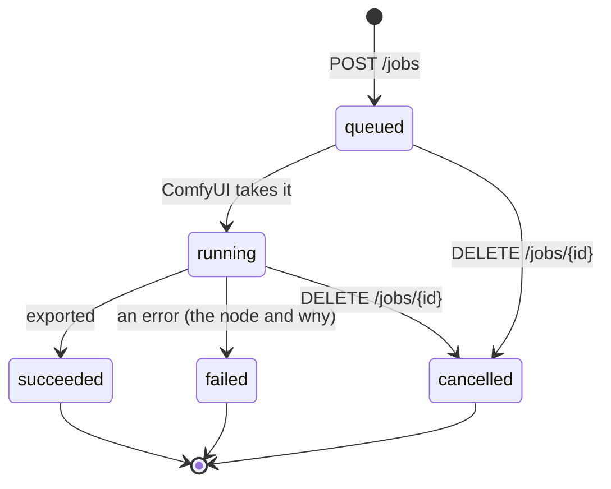

# Plenio Song API

Make songs with Plenio from any program: a script, a game, a chat bot, a home-automation scene, your own app. One
HTTP request orders a song from a template; the API follows it through ComfyUI's queue and hands you the finished
files - audio, cover, lyrics subtitles, sheet music and a record of how it was made.

The API runs inside ComfyUI (Plenio is a ComfyUI extension), on the computer that makes the music. It is free and
open source like the rest of Plenio (Apache 2.0); the music models have licences of their own (see
[Licences of what you make](#licences-of-what-you-make)).

▶ **Video:** [Tutorial 10 · Song API](https://youtu.be/MBfM8vOynT4) - a song ordered with one POST, followed with `?wait`, its files downloaded and played, and the examples, narrated.

| | |
|---|---|
| **Base address** | `http://127.0.0.1:8188/plenio/api/v1` - ComfyUI's own address and port (ComfyUI Desktop: `8000`) |
| **Format** | JSON in and out (`Content-Type: application/json`); times are seconds since 1970 (UTC) |
| **Version** | 1.3 - the path carries the major version; a minor version only adds ([policy](#versions-and-compatibility)) |
| **Machine-readable** | `GET /plenio/api/v1/openapi.json` (OpenAPI 3.1) - a copy: [openapi.json](openapi.json), [browse it](https://jplenio.github.io/Plenio-Music-Production-System/api/) |
| **Every field** | [fields.md](fields.md) - generated from the templates |
| **Examples** | [examples/](examples/) - Python, JavaScript and shell, ready to run |

## Contents

1. [Quick start](#quick-start)
2. [How a song is made](#how-a-song-is-made)
3. [The endpoints](#the-endpoints)
4. [A job request](#a-job-request)
5. [Following a job](#following-a-job)
6. [The finished song and its files](#the-finished-song-and-its-files)
7. [Covers: a new version of a recording](#covers-a-new-version-of-a-recording)
8. [Again: a new take, a new song of the same brief](#again-a-new-take-a-new-song-of-the-same-brief)
9. [Errors and retries](#errors-and-retries)
10. [Access from other computers and from web pages](#access-from-other-computers-and-from-web-pages)
11. [Versions and compatibility](#versions-and-compatibility)
12. [OpenAPI and client generators](#openapi-and-client-generators)
13. [Limits](#limits)
14. [Licences of what you make](#licences-of-what-you-make)

## Quick start

You need ComfyUI with Plenio running and the models of the *1 · YuE2 · Song* template installed (open the template
once: ComfyUI offers the downloads; its *Models* note lists every file). Check that the API answers:

```bash
curl http://127.0.0.1:8188/plenio/api/v1
```

```json
{"api": "plenio-song-api", "version": "1.3", "plenio": "1.5.0", "comfyui": "0.41.0",
 "templates": [{"id": "yue2-song", "title": "YuE2 · Song", "kind": "song", "needs": []},
               {"id": "yue2-cover", "title": "YuE2 · Cover", "kind": "cover", "needs": ["source.audio"]}],
 "paths": {"jobs": "/plenio/api/v1/jobs", "...": "..."}}
```

### With curl

```bash
# 1. order a song
curl -X POST http://127.0.0.1:8188/plenio/api/v1/jobs \
  -H "Content-Type: application/json" \
  -H "Idempotency-Key: night-drive-001" \
  -d '{"template": "yue2-song",
       "fields": {"genre": "synthwave", "description": "a night drive through a rainy city",
                  "length": "short (about 1:30)", "vocals": "sung", "language": "English"},
       "release": {"album": "Night drives", "artist": "Me"},
       "client": {"name": "my-script"}}'

# 2. follow it - the answer comes when something changes, or after 30 s
curl "http://127.0.0.1:8188/plenio/api/v1/jobs/<id>?wait=30"

# 3. when it succeeded: download a file listed in result.files
curl -OJ "http://127.0.0.1:8188/plenio/api/v1/jobs/<id>/files/2026-10-26%20Night%20Drive.flac"
```

### With Python (standard library only)

```python
import json, time, urllib.request

API = "http://127.0.0.1:8188/plenio/api/v1"

def call(method, path, body=None, **headers):
    data = json.dumps(body).encode() if body is not None else None
    request = urllib.request.Request(API + path, data=data, method=method,
                                     headers={"Content-Type": "application/json", **headers})
    with urllib.request.urlopen(request, timeout=90) as answer:
        return json.load(answer)

job = call("POST", "/jobs", {
    "template": "yue2-song",
    "fields": {"genre": "synthwave", "description": "a night drive through a rainy city", "vocals": "sung"},
    "client": {"name": "my-script"},
}, **{"Idempotency-Key": "night-drive-001"})

while job["status"] not in ("succeeded", "failed", "cancelled"):
    job = call("GET", f"/jobs/{job['id']}?wait=30")
    print(job["status"], (job.get("stage") or {}).get("text", ""))

if job["status"] == "succeeded":
    for file in job["result"]["files"]:
        urllib.request.urlretrieve("http://127.0.0.1:8188" + file["url"], file["name"])
        print("saved", file["name"])
else:
    print("no song:", job["error"])
```

The complete script, with error handling: [examples/make_song.py](examples/make_song.py) ·
JavaScript (Node 18+): [examples/make_song.mjs](examples/make_song.mjs) · shell: [examples/make_song.sh](examples/make_song.sh).

## How a song is made

A **template** is a ComfyUI workflow that Plenio ships: `yue2-song` (a new song by YuE2) and `yue2-cover` (a new
version of a recording). Its **fields** are the inputs of its song part - the brief's genre, mood, length, vocals …,
the writer model, HQ mastering, cover art. The API reads them from the template and the node definitions of the
running ComfyUI on every request, so a field a later Plenio adds is in the API at once.

A **job** is one ComfyUI run of the template with your fields: its id is ComfyUI's prompt id. It writes the lyrics
(a local language model), composes a score, sings and plays it (YuE2), masters it, paints the cover and exports the
song - where the template's *Export Release* saves it, below ComfyUI's output folder.



While it runs, a job says what the studio does (its **stage**: the template's group of the node that runs) - for a
song, roughly in this order:

| Stage (`stage.text`) | The template's group | What happens |
|---|---|---|
| reading the brief | 1 · SONG | the fields become the brief |
| writing the lyrics | 2 · WRITE | the writer model drafts title, style, lyrics and a cover prompt |
| checking the lyrics | 3 · TEXT | the Song Sheet takes the documents |
| composing | 4 · SCORE | YuE2 plans the score |
| singing and playing | 5 · RENDER | YuE2 renders the take (the longest stage) |
| painting the cover | COVER ART | FLUX.2 Klein paints the cover |
| mastering and saving | 6 · FINISH | Audio HQ, EQ, loudness, export with tags, subtitles, sheet music |

A cover has groups of its own first: *reading the original* (1 · SOURCE), *planning the cover* (2 · COVER), *reading
the melody* (3 · SCORE), *hearing the lyrics* (4 · LYRICS). How long it takes, measured on an RTX 5060 Ti (16 GB): a
song of 1:00 to 1:30 in 1.5 to 3 minutes while the models are loaded, up to 7 minutes for the first run after ComfyUI
started; a cover about 4 to 5 minutes. `GET /queue` tells how long the API's runs took lately on your computer.

## The endpoints

| Method and path | What it does |
|---|---|
| `GET /` | The API: its name and version, Plenio's and ComfyUI's versions, the templates, the paths |
| `GET /openapi.json` | The API described for programs (OpenAPI 3.1), the templates' fields included |
| `GET /templates` | The templates the API runs, with what they need |
| `GET /templates/{id}` | A template's fields - type, default, choices or range, description, the choice it depends on -, its release fields, seeds and documents |
| `GET /briefs?kind=song` | The style templates of the brief (id, name, group, fields) and, per field, every value they have - the lists of a simple form |
| `POST /uploads?name=<file>` | A source recording for a cover (the body: the audio file); the answer's `name` goes into `source.audio` |
| `POST /jobs` | Make a song |
| `GET /jobs` | The API's jobs ComfyUI still knows, newest first - filter with `status`, `client`, `template`, `limit` |
| `GET /jobs/{id}` | One job - with `?wait=<s>` it answers when the job changes |
| `GET /jobs/{id}/files/{name}` | A file of a finished job's song |
| `DELETE /jobs/{id}` | Cancel a job: out of the queue while it waits, interrupted while it runs |
| `POST /from-record` | The request that makes a released song again, from its release record |
| `GET /queue` | How busy ComfyUI is, and how long the API's runs took lately |

All paths are below the base address `/plenio/api/v1`.

## A job request

```json
{
  "template": "yue2-song",
  "fields": {"template": "pop/art-pop-vocal", "genre": "art pop", "vocals": "sung", "theme": "dreams",
             "length": 200, "finish.cover_art": true, "finish.hq_mastering": false},
  "release": {"folder": "plenio/My-App", "album": "Dreams", "artist": "Anna", "mp3": true},
  "seeds": {"take": 1234},
  "client": {"name": "My app", "user": "anna"},
  "strict": true
}
```

| Part | What it is |
|---|---|
| `template` | **Required.** `yue2-song` or `yue2-cover` (`GET /templates` lists them). |
| `fields` | The song part of the template. The brief's fields by their name (`genre`, `mood`, `length`, `vocals`, `language`, `voice`, `theme`, `creativity`, `lyrics_fidelity` …), the other nodes' as `<node>.<input>`: `writer.model`, `finish.hq_mastering`, `finish.cover_art`, a cover's `source.audio` and `excerpt.*`. A field you leave out keeps the template's value; a brief's text field left out takes the chosen style template's (`template`) value. Every field: [fields.md](fields.md). |
| `release` | Export Release's fields: `folder` (below ComfyUI's output folder; it is made when missing), `naming`, `collision`, `flac`, `mp3`, `wav`, `artist`, `album`, `date`, `genre`, `comment`, `sheet_music`, `lyrics_srt` … |
| `seeds` | A seed per part (`draft`, `plan`, `arrangement`, `take`, `cover`; 0 … 4294967295). The same fields and seeds make the same song; a seed you leave out is drawn anew. The job's answer names the seeds it used. |
| `documents` | The Song Sheets' documents (`title`, `style`, `lyrics`, `score`, `artwork_prompt`). A document you give is kept as *manual*: the run uses it instead of writing or planning it - your own lyrics, your own title. |
| `client` | Who asks: up to 12 short texts, kept with the job and shown in its listing (`GET /jobs?client=My%20app`). |
| `strict` | `true` (default): a field the template does not have is refused. `false`: it is left out and named in the job's `warnings`. |

**Friendly values.** `length` takes seconds (`200`) or a time (`"3:15"`) and picks the nearest length the template
offers; choices are matched without regard to case (`"SUNG"` is `sung`). A field that does not apply to your choices
- a `voice` for an `instrumental` - is left out with a warning.

**Your own lyrics:** give `documents.lyrics` (with section tags such as `[verse]`, `[chorus]`) and, if you like,
`documents.title` and `documents.style`. The writer then writes only what you left out, and YuE2 composes and sings your
words.

**Safe to repeat:** send an `Idempotency-Key` header (any text up to 200 characters, unique per song you want). The
same key again within 24 hours returns the first job (`200`) instead of making a second song - so a program that lost
an answer can simply ask again. Two requests with one key at the same time make one job too.

**Not in v1: review stops.** The templates can stop at the Song Sheets so a person checks the lyrics and the score
first. The API runs straight through: the brief's `mode` is fixed to *new song every run* (or *new cover every run*),
and asking for the review mode is refused (`not_supported`). The status `waiting_for_review` is reserved for a later
version.

## Following a job

`POST /jobs` answers `201` with the job (and its address in the `Location` header):

```json
{"id": "4f6c1d0e-8a3b-4e55-9d2c-0b7e2a1f9c33", "template": "yue2-song", "status": "queued", "queue_position": 1,
 "created_at": 1761484800.0, "started_at": null, "finished_at": null, "stage": null, "progress": null,
 "seeds": {"draft": 11, "plan": 12, "arrangement": 13, "take": 14, "cover": 15}, "documents": [],
 "client": {"name": "My app"}, "result": null, "error": null, "warnings": [],
 "links": {"self": "/plenio/api/v1/jobs/4f6c1d0e-8a3b-4e55-9d2c-0b7e2a1f9c33"}}
```

| `status` | Meaning | Also there |
|---|---|---|
| `queued` | waiting in ComfyUI's queue | `queue_position` (1: next) |
| `running` | being made | `stage` (`group`, `text`, `index`, `of`), `progress` (`nodes_done`, `nodes`, a sampler's `step` of `steps`) |
| `succeeded` | exported | `result` with the title, the record and the files |
| `failed` | stopped by an error | `error` with the `message`, the exception `type`, the `node` and its `title` |
| `cancelled` | taken out or interrupted | |

**Waiting instead of asking every second:** `GET /jobs/{id}?wait=30` answers as soon as the job's status, its place in
the queue or its stage changes - or after 30 seconds (at most 60) with the job as it is. A loop of such requests follows
a song with a handful of calls. Without `wait`, ask every 2 to 5 seconds.

**Your jobs:** `GET /jobs?client=My%20app&status=queued,running` lists what your program has in the making
(`status` takes several values, comma-separated; `limit` up to 200).

**ComfyUI keeps jobs in memory:** after ComfyUI restarts, an old job id answers `404` - the song itself, if it was
exported, is in the output folder.

## The finished song and its files

```json
{"status": "succeeded",
 "result": {"title": "Night Drive", "seconds": 92.4,
            "record": "D:/ComfyUI/output/plenio/My-App/2026-10-26 Night Drive.plenio.json",
            "folder": "D:/ComfyUI/output/plenio/My-App",
            "files": [
              {"name": "2026-10-26 Night Drive.flac",
               "url": "/plenio/api/v1/jobs/4f6c…/files/2026-10-26%20Night%20Drive.flac"},
              {"name": "2026-10-26 Night Drive (original).flac", "role": "original", "url": "…"},
              {"name": "2026-10-26 Night Drive.jpg", "role": "cover", "url": "…"},
              {"name": "2026-10-26 Night Drive.pdf", "role": "sheet_music", "url": "…"},
              {"name": "2026-10-26 Night Drive (lines).srt", "role": "subtitles", "url": "…"},
              {"name": "2026-10-26 Night Drive.plenio.json", "role": "record", "url": "…"}]}}
```

`GET` a file's `url` (on the same ComfyUI) to download it; byte ranges work, so an audio player can stream and seek.
Only the files the song's release record lists can be fetched this way - nothing else of the computer. The record
(`role: record`) holds everything: the documents (title, style, lyrics, score), the seeds, every setting, the
loudness, the lyrics' timing and the models' licences - and, since Plenio 1.4.0, how the song was made (`made`: when,
how long, on what) and how well it came out, measured (`quality`: 0 to 5 `stars` in halves and every measure in
`parts` - the lyrics sung as written, the harmony, the beat, and what went wrong; a hint where to listen first).

Which files there are follows the `release` fields: the song as FLAC (default), MP3 (`"mp3": true`) or WAV (no
`role`), the unmastered take (`original`), the cover (`cover`, with Cover Art on), the sheet music (`sheet_music`,
YuE2), the lyrics subtitles (`subtitles`: whole lines, on the notes, as sung), the release record (`record`).

## Covers: a new version of a recording

```bash
# 1. upload the original (MP3, FLAC, WAV, OGG, M4A, OPUS, AAC, AIFF; up to 200 MB)
curl -X POST "http://127.0.0.1:8188/plenio/api/v1/uploads?name=My%20Song.mp3" \
  -H "Content-Type: audio/mpeg" --data-binary @"My Song.mp3"
# -> {"name": "plenio-api-3fa2b0c1d4e5-My-Song.mp3", "bytes": 4810233}

# 2. the cover: its name goes into source.audio
curl -X POST http://127.0.0.1:8188/plenio/api/v1/jobs -H "Content-Type: application/json" \
  -d '{"template": "yue2-cover",
       "fields": {"source.audio": "plenio-api-3fa2b0c1d4e5-My-Song.mp3", "genre": "jazz fusion",
                  "vocals": "original lyrics", "harmony": "keep original chords"}}'
```

The upload goes into ComfyUI's input folder under a name of the API's own (the same file uploaded twice is kept
once). A cover keeps the original's melody, form and tempo; `vocals` chooses the original lyrics, new lyrics or an
instrumental; `excerpt.enabled` with `excerpt.start_index` and `excerpt.duration` takes a part of a long recording.
Use only recordings you own or may use.

## Again: a new take, a new song of the same brief

`POST /from-record` turns a song's release record (`<name>.plenio.json`, also downloadable as a job's file) back into
the request that made it:

```bash
curl -X POST http://127.0.0.1:8188/plenio/api/v1/from-record \
  -H "Content-Type: application/json" --data-binary @"2026-10-26 Night Drive.plenio.json"
```

```json
{"template": "yue2-song", "kind": "song", "title": "Night Drive", "model": "YuE2",
 "fields": {"genre": "synthwave", "length": "short (about 1:30)", "vocals": "sung"},
 "release": {"folder": "plenio/My-App", "album": "Night drives"},
 "seeds": {"draft": 11, "plan": 12, "take": 13, "cover": 14},
 "documents": {"title": "Night Drive", "style": "synthwave …", "lyrics": "[verse] …", "score": "X:1 …"},
 "take": {"possible": true, "why": ""}, "warnings": []}
```

- **The same song again:** send `template`, `fields`, `release`, `seeds` and `documents` to `POST /jobs` as they are.
- **A new take** - the same title, words and notes, sung and played anew: the same without `seeds.take`. Change a
  document to make a take with other words (leave out the `score` when you change the `lyrics`: new words need new
  notes).
- **A new song of the same brief:** send only `template`, `fields` and `release`.

`take.possible` says whether the record's documents make a new take here, and why not: the song was made with another
music model, its record has no score or lyrics, or a cover's original recording is no longer in ComfyUI's input
folder. The call reads nothing but the record in its body.

## Errors and retries

Every error has the same shape:

```json
{"error": {"code": "invalid_value", "message": "'rap' is not a choice of the field 'vocals'.",
           "hint": "Choices: ['sung', 'sparse vocals', 'instrumental']", "field": "vocals"}}
```

| HTTP | `code` | Meaning | What to do |
|---|---|---|---|
| 400 | `bad_request` | the body is not a JSON object | fix the request |
| 400 | `unknown_field` | the template has no such field (`field` names it) | check [fields.md](fields.md), or send `"strict": false` |
| 400 | `invalid_value` | a value the field does not take (`hint`: its choices or range) | fix the value |
| 400 | `missing_field` | a field the template needs (a cover's `source.audio`) | add it |
| 400 | `not_supported` | not in this version (the review mode) | leave it out |
| 400 | `comfyui_rejected` | ComfyUI's own check refused the run; `details` names the nodes and why - usually a model file that is missing | install the file (the template's *Models* note) |
| 404 | `unknown_template`, `not_found` | no such template, job or file | |
| 413 | `too_large` | an upload over 200 MB | |
| 415 | `unsupported_media_type` | not JSON, or not an audio file | |
| 422 | `unknown_template` | `POST /from-record`: no template makes the record's song | |
| 500 | `internal` | a bug in Plenio - the message says what, ComfyUI's log has the details | report it |
| 503 | `not_ready` | ComfyUI's queue did not answer | retry after a few seconds |

**Retrying safely:** a request that timed out or failed with `503` may be repeated with the same `Idempotency-Key` - it
never makes a second song. Wait a little longer each time (2 s, 4 s, 8 s …).

## Access from other computers and from web pages

The API is as open as ComfyUI itself - and ComfyUI has no login:

- **On this computer** (ComfyUI's default, `127.0.0.1`): only programs on this computer reach it. Web pages of other
  sites cannot use it: ComfyUI refuses a request whose `Origin` is not its own address.
- **From another computer:** do not just start ComfyUI with `--listen` on a network you do not trust - everybody there
  could use it. Put it behind a gateway that asks for a password, for example [Caddy](https://caddyserver.com) with
  `basic_auth` in front of `127.0.0.1:8188`, or reach it through an SSH tunnel
  (`ssh -L 8188:127.0.0.1:8188 studio-pc`). The Plenio Player's *In your network* link opens ComfyUI to the browsers
  that came with the link - it is meant for people, not for programs.
- **From a web app of another origin:** start ComfyUI with `--enable-cors-header https://your.app` (only the origins you
  trust); otherwise ComfyUI refuses the requests.

What a request may do is limited either way: an upload goes only into ComfyUI's input folder under a name of Plenio's
own, the release folder cannot leave ComfyUI's output folder, a job's files are only those its record lists.

## Versions and compatibility

- The path carries the major version (`/v1`). A minor version (1.1, 1.2 …) **only adds** - endpoints, fields,
  values, answer keys. A program written for 1.0 works with 1.1 unchanged.
- **Ignore what you do not know:** a new key in an answer, a new `stage.text`, a new `role` of a file.
- The fields are named after the node types and their inputs, not after titles. When a later Plenio renames one, the
  old name keeps working (`GET /templates/{id}` lists the `aliases`).
- A change that would break a program gets a new path (`/v2`), and `/v1` stays for a while beside it.

| API | Plenio | What changed |
|---|---|---|
| 1.3 | 1.5.0 | the Song Brief's `lyrics_from` and `lyrics` (an idea for the writer, or one's own lyrics, sung as written), the Cover Brief's `original_notes`; `creativity` up to 200; a brief's text fields you leave out take the chosen style template's values - another template replaces what the template had filled |
| 1.2 | 1.4.0 | the release field `song_page`: the song's page (`<name>.html`) beside it - on unless set to `false` |
| 1.1 | 1.3.1 | `GET /jobs/{id}/files/{name}` and a `url` per result file; `GET /jobs/{id}?wait=<s>`; `GET /jobs` filters (`status`, `client`, `template`, `limit`); one job per `Idempotency-Key` also for requests at the same time; an `operationId` per call and answer schemas in the OpenAPI document |
| 1.0 | 1.3.0 | the first version: templates, briefs, uploads, jobs, from-record, queue |

## OpenAPI and client generators

`GET /plenio/api/v1/openapi.json` describes this ComfyUI's API: every path, its parameters and answers, and a request
schema per template with every field, its type, choices and default (`JobRequest_yue2_song`,
`JobRequest_yue2_cover`). Each call has an `operationId` (`createJob`, `getJob`, `getJobFile` …) that client
generators name their functions by:

```bash
# TypeScript types
npx openapi-typescript http://127.0.0.1:8188/plenio/api/v1/openapi.json -o plenio.d.ts
# a Python client
openapi-generator-cli generate -i http://127.0.0.1:8188/plenio/api/v1/openapi.json -g python -o plenio-client
```

A copy made from the shipped templates is in this folder ([openapi.json](openapi.json)) and readable in the browser
on the project's [API page](https://jplenio.github.io/Plenio-Music-Production-System/api/).

## Limits

| | |
|---|---|
| Upload | 200 MB per recording |
| Text fields | 400 characters on one line; descriptions 4,000 characters; documents 200,000 |
| `client` | 12 entries; names 40, values 200 characters |
| `GET /jobs` | the 200 newest of ComfyUI's history |
| `wait` | 60 seconds at most |
| `Idempotency-Key` | 200 characters; kept 24 hours |
| Jobs | in ComfyUI's memory until it restarts; one song is made at a time (ComfyUI's queue) |

## Licences of what you make

The music models decide what you may do with the songs: **YuE2 and SheetSage2 are CC BY-NC 4.0 - non-commercial**;
MiniMax Music 3 has its own community licence. The release record lists the licences of the models a song was made
with. Plenio's code is Apache 2.0. Details: [Licensing](../user/licensing.md).

---

More: the design and its reasons - [docs/design/party-songs.md](../design/party-songs.md) · the user's view -
[docs/user/concepts/song-api.md](../user/concepts/song-api.md) · the Plenio Player, which makes its party songs through
this API - [docs/user/concepts/player.md](../user/concepts/player.md).
