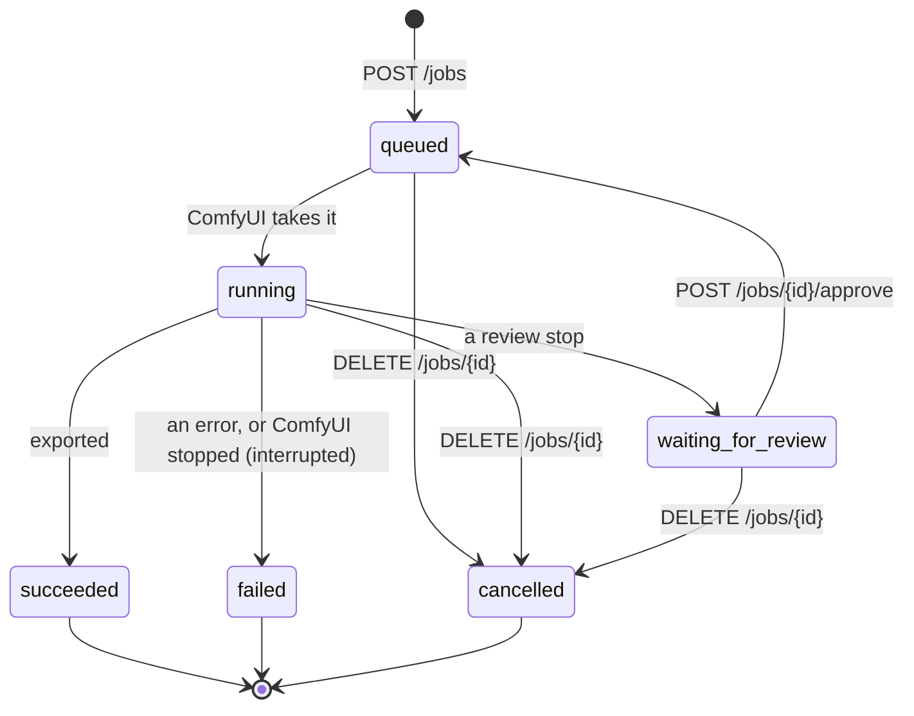

# Plenio Song API

Make songs with Plenio from any program: a script, a game, a chat bot, a DAW plug-in, your own app. One HTTP request
orders a song from one of Plenio's templates; the API follows it through ComfyUI's queue, can stop it where the Song
Sheet stops so your program reads or edits the lyrics and the score, and hands you the finished files - audio, stems,
cover, lyrics subtitles, sheet music and a record of how it was made.

The API runs inside ComfyUI (Plenio is a ComfyUI extension), on the computer that makes the music. It is free and
open source like the rest of Plenio (Apache 2.0); the music models have licences of their own (see
[Licences of what you make](#licences-of-what-you-make)).

| | |
|---|---|
| **Base address** | `http://127.0.0.1:8188/plenio/api/v2` - ComfyUI's own address and port (ComfyUI Desktop: `8000`) |
| **Format** | JSON in and out (`Content-Type: application/json`); times are seconds since 1970 (UTC) |
| **Version** | 2.0 - the path carries the major version; a minor version only adds ([policy](#versions-and-compatibility)) |
| **Machine-readable** | `GET /plenio/api/v2/openapi.json` (OpenAPI 3.1) - a copy: [openapi.json](openapi.json), [browse it](https://jplenio.github.io/Plenio-Music-Production-System/api/) |
| **Every field** | [fields.md](fields.md) - generated from the five templates |
| **Examples** | [examples/](examples/) - Python, JavaScript and shell, ready to run |
| **API v1** | frozen, still served at `/plenio/api/v1`: [v1/README.md](v1/README.md) - see [Coming from v1](#coming-from-v1) |

## Contents

1. [Quick start](#quick-start)
2. [How a song is made](#how-a-song-is-made)
3. [The endpoints](#the-endpoints)
4. [A job request](#a-job-request)
5. [Following a job](#following-a-job)
6. [Review stops: read and edit before it sings](#review-stops-read-and-edit-before-it-sings)
7. [The finished song and its files](#the-finished-song-and-its-files)
8. [Songs: the library, and making one again](#songs-the-library-and-making-one-again)
9. [Covers and mastering a recording](#covers-and-mastering-a-recording)
10. [Events](#events)
11. [Models](#models)
12. [Scores and lyrics](#scores-and-lyrics)
13. [Errors and retries](#errors-and-retries)
14. [Access from other computers and from web pages](#access-from-other-computers-and-from-web-pages)
15. [Versions and compatibility](#versions-and-compatibility)
16. [Coming from v1](#coming-from-v1)
17. [OpenAPI and client generators](#openapi-and-client-generators)
18. [Limits](#limits)
19. [Licences of what you make](#licences-of-what-you-make)

## Quick start

You need ComfyUI with Plenio running and the models of the template you use; **Plenio Setup** (the sidebar tab)
downloads them. Check that the API answers:

```bash
curl http://127.0.0.1:8188/plenio/api/v2
```

```json
{"api": "plenio-song-api", "version": "2.0", "plenio": "2.0.0", "comfyui": "0.41.0",
 "templates": [{"id": "yue2-song", "title": "YuE2 · Song", "kind": "song", "needs": []}, "..."],
 "paths": {"openapi": "/plenio/api/v2/openapi.json", "jobs": "/plenio/api/v2/jobs", "...": "..."}}
```

### With curl

```bash
# 1. order a song
curl -X POST http://127.0.0.1:8188/plenio/api/v2/jobs \
  -H "Content-Type: application/json" \
  -H "Idempotency-Key: night-drive-001" \
  -d '{"template": "yue2-song",
       "fields": {"genre": "synthwave", "description": "a night drive through a rainy city",
                  "length": "short (about 1:30)", "vocals": "sung", "language": "English"},
       "client": {"name": "my-script"}}'

# 2. follow it - the answer comes when something changes, or after 30 s
curl "http://127.0.0.1:8188/plenio/api/v2/jobs/<id>?wait=30"

# 3. when it succeeded: download a file listed in result.files
curl -OJ "http://127.0.0.1:8188/plenio/api/v2/jobs/<id>/files/2026-11-11%20Night%20Drive.flac"
```

### With Python (standard library only)

```python
import json, urllib.request

API = "http://127.0.0.1:8188/plenio/api/v2"

def call(method, path, body=None, **headers):
    data = json.dumps(body).encode() if body is not None else None
    request = urllib.request.Request(API + path, data=data, method=method,
                                     headers={"Content-Type": "application/json", **headers})
    with urllib.request.urlopen(request, timeout=90) as answer:
        return json.load(answer)

job = call("POST", "/jobs", {
    "template": "yue2-song",
    "fields": {"genre": "synthwave", "description": "a night drive through a rainy city", "vocals": "sung"},
    "review": ["text"],                      # stop when the lyrics are written
}, **{"Idempotency-Key": "night-drive-001"})

while job["status"] not in ("succeeded", "failed", "cancelled"):
    if job["status"] == "waiting_for_review":
        print(job["documents"]["lyrics"]["text"])
        job = call("POST", f"/jobs/{job['id']}/approve", {})   # or {"documents": {"title": "..."}}
    job = call("GET", f"/jobs/{job['id']}?wait=30")
    print(job["status"], (job.get("stage") or {}).get("text", ""))

if job["status"] == "succeeded":
    for file in job["result"]["files"]:
        urllib.request.urlretrieve("http://127.0.0.1:8188" + file["url"], file["name"].split("/")[-1])
else:
    print("no song:", job["error"])
```

The complete scripts, with error handling, a token for another computer and review stops:
[examples/make_song.py](examples/make_song.py) · JavaScript (Node 18+): [examples/make_song.mjs](examples/make_song.mjs)
· shell: [examples/make_song.sh](examples/make_song.sh).

## How a song is made

A **template** is a ComfyUI workflow that Plenio ships. The API runs all five:

| `template` | `kind` | What it makes |
|---|---|---|
| `yue2-song` | song | a new song: lyrics by a local writer model, score and take by YuE2 |
| `yue2-cover` | cover | a new version of a recording (its melody, form and tempo kept) |
| `yue2-daw` | daw | a song for a DAW: the take with its stems and sheet music; its Song Sheets stop for review |
| `minimax-song` | song | a new song sung by MiniMax Music 3 |
| `enhance-master` | master | an existing recording mastered: Audio HQ, de-reverb, EQ, loudness |

Its **fields** are the inputs of its song part - the brief's genre, mood, length, vocals …, the writer model, HQ
mastering, cover art. The API reads them from the template and the node definitions of the running ComfyUI on every
request, so a field a later Plenio adds is in the API at once.

A **job** is a song in the making: it has an id of its own (`job_` and 16 hex digits) and is **kept on disk**, so it
is still there after ComfyUI restarts. It writes the lyrics, composes a score, sings and plays it, masters it, paints
the cover and exports the song below ComfyUI's output folder.



While it runs, a job says what the studio does (its **stage**: the template's group of the node that runs) - for a
song, roughly: *reading the brief* (1 · SONG), *writing the lyrics* (2 · WRITE), *checking the lyrics* (3 · TEXT),
*composing* (4 · SCORE), *singing and playing* (5 · RENDER, the longest), *painting the cover* (COVER ART),
*mastering and saving* (6 · FINISH). How long it takes, measured with YuE2 on an RTX 5060 Ti (16 GB): a song of 1:00
to 1:30 in 1.5 to 3 minutes while the models are loaded, up to 7 minutes for the first run after ComfyUI started.
`GET /jobs/{id}/timings` tells where a finished job's time went.

## The endpoints

All paths are below the base address `/plenio/api/v2`.

| Method and path | What it does |
|---|---|
| `GET /` | The API: its name and version, Plenio's and ComfyUI's versions, the templates, the paths |
| `GET /openapi.json` | The API described for programs (OpenAPI 3.1), the five templates' fields included |
| `GET /templates` | The templates the API runs, with what they need |
| `GET /templates/{id}` | A template's fields - type, default, choices or range, description, the choice it depends on -, its release fields, seeds and documents |
| `GET /briefs` | The style templates of the brief and, per field, every value they have (`?kind=song` or `cover`) |
| `GET /presets` | The player's six presets and what each sets |
| `GET /models` | The model files the templates need: installed or missing, sizes, licences |
| `GET /models/plan` | The model plan for this computer: the variants each template would use |
| `GET /writers` | The writer models a form may offer |
| `GET /loras` | The LoRA files in ComfyUI's `models/loras` |
| `POST /jobs` | Make a song - with review stops, a preset, your own documents |
| `GET /jobs` | Your jobs, newest first - filter with `status`, `limit` |
| `GET /jobs/{id}` | One job - with `?wait=<s>` it answers when the job changes |
| `DELETE /jobs/{id}` | Cancel a job: out of the queue, interrupted while it runs, or ended at its review stop |
| `POST /jobs/{id}/approve` | Let a job that waits at a review stop go on, its documents edited or not |
| `GET /jobs/{id}/documents` | The documents at its review stop, or of its song once made |
| `GET /jobs/{id}/files/{name}` | A file of a finished job's song (a stem too: `<name>-stems/vocals.flac`) |
| `GET /jobs/{id}/timings` | Where a finished job's time went |
| `GET /jobs/{id}/bars` | Where every bar of a finished take lies in its audio - a DAW's tempo map |
| `GET /songs` | The released songs in ComfyUI's output folder, newest first (`?q=` words, `?limit=`) |
| `GET /songs/{id}` | A song: its files, documents, timings |
| `GET /songs/{id}/files/{name}` | A file of a song |
| `POST /songs/{id}/again` | Make a song again: a new take, as it was, a new song like it, a cover of it |
| `POST /scores/analyze` | A score (ABC) as the Song Sheet's editor sees it |
| `POST /scores/transform` | An editor operation on a score |
| `POST /scores/import/midi` | A MIDI file as a score |
| `POST /scores/import/musicxml` | A MusicXML file Plenio wrote as a score, with its lyrics |
| `POST /scores/export/midi` | A score as a MIDI file |
| `POST /scores/export/musicxml` | A score as MusicXML 4.0 |
| `POST /lyrics/analyze` | Lyrics checked as the Song Sheet checks them |
| `POST /uploads` | A recording for a cover or for mastering (`?name=<file>`, the body: the audio file) |
| `GET /events` | Server-Sent Events of your jobs (and, on this computer, of downloads) |
| `GET /queue` | How busy ComfyUI is, and how long the API's runs took lately |

## A job request

```json
{
  "template": "yue2-song",
  "preset": "party",
  "fields": {"genre": "art pop", "vocals": "sung", "theme": "dreams", "length": 200, "finish.cover_art": true},
  "release": {"folder": "plenio/My-App", "album": "Dreams", "artist": "Anna", "mp3": true},
  "seeds": {"take": 1234},
  "documents": {"lyrics": "[verse]\nPaper boats on the window glass…"},
  "review": ["text"],
  "stems": false,
  "client": {"name": "My app", "user": "anna"},
  "strict": true
}
```

| Part | What it is |
|---|---|
| `template` | **Required.** One of the five (`GET /templates` lists them). |
| `fields` | The song part of the template. The brief's fields by their name (`genre`, `mood`, `length`, `vocals`, `language`, `voice`, `theme`, `creativity` …), the other nodes' as `<node>.<input>`: `writer.model`, `finish.hq_mastering`, `finish.cover_art`, a cover's `source.audio`. A field you leave out keeps the template's value. Every field: [fields.md](fields.md). |
| `preset` | One of the player's presets (`best`, `party`, `sketch`, `full`, `takes`, `instrumental`; `GET /presets`): its values are used where the request names none. |
| `release` | Export Release's fields: `folder` (below ComfyUI's output folder), `naming`, `flac`, `mp3`, `wav`, `artist`, `album`, `sheet_music`, `lyrics_srt` … |
| `seeds` | A seed per part (`draft`, `plan`, `arrangement`, `take`, `cover`; 0 … 4294967295). The same fields and seeds make the same song; a seed you leave out is drawn anew. |
| `documents` | The Song Sheets' documents (`title`, `style`, `lyrics`, `score`, `artwork_prompt`). A document you give is kept as *manual*: your own lyrics, your own title. |
| `review` | The stops to wait at: `text` (title, style, lyrics), `score`. See [Review stops](#review-stops-read-and-edit-before-it-sings). |
| `stems` | `true`: the take's stems are saved beside the song and listed in its files (`role: stem`). |
| `client` | Who asks: up to 12 short texts, kept with the job. |
| `strict` | `true` (default): a field the template does not have is refused. `false`: it is left out. |

**Friendly values.** `length` takes seconds (`200`) or a time (`"3:15"`) and picks the nearest length the template
offers; choices are matched without regard to case. A field that does not apply to your choices - a `voice` for an
`instrumental` - is left out.

**Safe to repeat:** send an `Idempotency-Key` header (up to 200 characters, unique per song you want). The same key
again returns your first job (`200`) instead of making a second song, as long as the job is kept (the newest 500
jobs, 30 days) - unless that job was interrupted by a restart of ComfyUI: then the key makes a new run.

## Following a job

`POST /jobs` answers `201` with the job (and its address in the `Location` header):

```json
{"id": "job_5d0c4e1b9a7f42c0", "template": "yue2-song", "kind": "song", "status": "queued",
 "queue_position": 1, "stage": null, "progress": null, "created_at": 1762858800.0, "updated_at": 1762858800.0,
 "ended_at": null, "seeds": {"draft": 11, "plan": 12, "arrangement": 13, "take": 14}, "client": {"name": "My app"},
 "review": ["text"], "waiting_at": null, "documents": null, "result": null, "error": null,
 "links": {"self": "/plenio/api/v2/jobs/job_5d0c4e1b9a7f42c0"}}
```

| `status` | Meaning | Also there |
|---|---|---|
| `queued` | waiting in ComfyUI's queue | `queue_position` (1: next) |
| `running` | being made | `stage` (`group`, `text`, `index`, `of`), `progress` (`nodes_done`, `nodes`, a sampler's `step` of `steps`) |
| `waiting_for_review` | stopped at a review stop | `waiting_at` (`text`, `score`), `documents` |
| `succeeded` | exported | `result` with the title and the files |
| `failed` | stopped by an error | `error` with its `message`, the `node` and its `title`; `code: interrupted` when ComfyUI stopped while it ran, `code: lost` when ComfyUI no longer knows the run |
| `cancelled` | taken out or interrupted | |

**Waiting instead of asking every second:** `GET /jobs/{id}?wait=30` answers as soon as the job's status, its place in
the queue or its stage changes - or after 30 seconds (at most 60). A program that can hold a connection open follows
every job at once with [the event stream](#events).

**Jobs survive a restart.** Each job is a file in ComfyUI's user folder, written at every change. A job that was
running when ComfyUI stopped is `failed` with `error.code = "interrupted"` afterwards; post the request again.

## Review stops: read and edit before it sings

A job may stop where the templates' Song Sheets stop, so your program - or the person using it - reads the lyrics
before YuE2 sings them, or the score before it is played:

```json
POST /jobs
{"template": "yue2-song", "fields": {"genre": "bossa nova", "description": "rain on a tin roof"},
 "review": ["text", "score"]}
```

```text
queued → running → waiting_for_review (text) --approve--> queued → running → waiting_for_review (score)
       --approve--> queued → running → succeeded
```

At a stop the job carries the documents as the Song Sheet shows them, each with its SHA-256:

```json
{"status": "waiting_for_review", "waiting_at": "text",
 "documents": {"title": {"text": "Paper Lanterns", "sha256": "4c1f…"},
               "lyrics": {"text": "[verse]\nPaper lanterns on the river…", "sha256": "9b2e…"}}}
```

`POST /jobs/{id}/approve` lets it go on. Send the documents you changed - `{"documents": {"title": "Paper Lanterns at
Dawn"}}` - or nothing (`{}`) to keep them as they are; an edited document becomes the Song Sheet's *manual* text, as an
edit in the Song Sheet does. The continuing run is queued under the same job id (`202`). An approval of a job that
waits at no stop answers `409` (`needs_review`). The `yue2-daw` template stops at its sheets by itself; send
`"review": []` to run it straight through.

## The finished song and its files

```json
{"status": "succeeded",
 "result": {"title": "Night Drive", "seconds": 92.4,
            "files": [
              {"name": "2026-11-11 Night Drive.flac",
               "url": "/plenio/api/v2/jobs/job_5d0c…/files/2026-11-11%20Night%20Drive.flac"},
              {"name": "2026-11-11 Night Drive.jpg", "role": "cover", "url": "…"},
              {"name": "2026-11-11 Night Drive.pdf", "role": "sheet_music", "url": "…"},
              {"name": "2026-11-11 Night Drive (lines).srt", "role": "subtitles", "url": "…"},
              {"name": "2026-11-11 Night Drive-stems/vocals.flac", "role": "stem", "stem": "vocals", "url": "…"},
              {"name": "2026-11-11 Night Drive.plenio.json", "role": "record", "url": "…"}]}}
```

`GET` a file's `url` to download it; byte ranges work, so an audio player can stream and seek. Only the files the
song's release record lists can be fetched - nothing else of the computer. The record (`role: record`) holds
everything: the documents, the seeds, every setting, the loudness, the lyrics' timing, the models' licences, how it was
made and how well it came out, measured. `GET /jobs/{id}/documents` gives the documents alone, `GET /jobs/{id}/timings`
the seconds per group, `GET /jobs/{id}/bars` where every bar of the score lies in the take's audio (a YuE2 take keeps no
steady tempo; a DAW sets a tempo per measure from it).

## Songs: the library, and making one again

`GET /songs` lists the songs in ComfyUI's output folder - made by the API, by the templates in ComfyUI or by the
player -, newest first; `?q=night` finds words of the title, the date or the folder. `GET /songs/{id}` has a song's
files, documents and timings.

`POST /songs/{id}/again` makes a song again, as a new job:

| `as` | What it makes |
|---|---|
| `take` (default) | a new take: the same title, words and notes, sung and played anew |
| `again` | the song as it was made: its documents and seeds |
| `like` | a new song of the same brief |
| `cover` | a cover of the song's audio (`yue2-cover`); `fields` are the cover's |

```bash
curl -X POST http://127.0.0.1:8188/plenio/api/v2/songs/<id>/again -H "Content-Type: application/json" \
  -d '{"as": "take", "fields": {"finish.cover_art": false}}'
```

A take is refused (`invalid_value`) when the record cannot make one here - the song was made with another music
model, or its record has no score or lyrics; `422` (`unknown_template`) when no template of the API makes the song.

## Covers and mastering a recording

```bash
# 1. upload the original (MP3, FLAC, WAV, OGG, M4A, OPUS, AAC, AIFF; up to 200 MB)
curl -X POST "http://127.0.0.1:8188/plenio/api/v2/uploads?name=My%20Song.mp3" \
  -H "Content-Type: audio/mpeg" --data-binary @"My Song.mp3"
# -> {"name": "plenio-api-3fa2b0c1d4e5-My-Song.mp3", "bytes": 4810233}

# 2. its name goes into source.audio - a cover, or the recording mastered
curl -X POST http://127.0.0.1:8188/plenio/api/v2/jobs -H "Content-Type: application/json" \
  -d '{"template": "yue2-cover",
       "fields": {"source.audio": "plenio-api-3fa2b0c1d4e5-My-Song.mp3", "genre": "jazz fusion"}}'
```

The upload goes into ComfyUI's input folder under a name of the API's own. A cover keeps the original's melody, form
and tempo; `enhance-master` masters the recording as it is. Use only recordings you own or may use.

## Events

`GET /events` is one Server-Sent Events stream for all your jobs - and, on the computer ComfyUI runs on, for model
downloads. A program that cannot hold a stream keeps using `?wait`.

```text
id: 7f3a19c2-41
event: job.waiting
data: {"id": "job_5d0c…", "status": "waiting_for_review", "waiting_at": "text", "stage": "3 · TEXT"}
```

| Event | When |
|---|---|
| `job.queued`, `job.running` | queued (also after an approval), taken by ComfyUI |
| `job.progress` | a running job's stage or progress moved (not replayed: only the newest matters) |
| `job.waiting` | it stopped at a review stop |
| `job.succeeded`, `job.failed`, `job.cancelled` | it ended |
| `download.queued`, `download.progress`, `download.verifying`, `download.done` | a model download on its way (this computer only) |
| `download.paused`, `download.blocked`, `download.failed`, `download.cancelled` | a model download stopped: `blocked` needs access or a token on Hugging Face |
| `sync` | what you missed is no longer kept: read `GET /jobs` again |

An event carries a job's id and state, never its content: read the job for its documents and files. Reconnect with the
last `id` you saw as `Last-Event-ID` and the stream sends what you missed first (`sync` when it is no longer kept, or
when ComfyUI restarted). A comment line every 15 seconds keeps the connection open through proxies.

## Models

`GET /models` lists every model file the templates need or may use - installed, missing or of another size - and per
template whether it can run; `GET /models/plan` is Plenio Setup's plan for this computer: which variant of each model a
template would use on this graphics card. A job whose model files are missing is refused before it is queued
(`models_missing`, with the files); Plenio Setup downloads them, or `[models] downloads = "auto"` in Plenio's
`config.toml` lets a run fetch them. `GET /writers` and `GET /loras` are the lists a form needs for `writer.model` and a
LoRA field.

## Scores and lyrics

The Song Sheet editor's functions, for a program that edits a score itself: `POST /scores/analyze` (a score in ABC as
the editor sees it: measures, findings, the lyrics under the notes), `POST /scores/transform` (an editor operation:
`{"abc": "...", "operation": {...}}`), `POST /scores/import/midi` and `POST /scores/import/musicxml`,
`POST /scores/export/midi` and `POST /scores/export/musicxml`, `POST /lyrics/analyze` (lyrics checked as the Song Sheet
checks them). A score given back to a job as `documents.score` is kept as written.

## Errors and retries

Every error has the same shape:

```json
{"error": {"code": "invalid_value", "message": "'rap' is not a choice of the field 'vocals'.",
           "hint": "Choices: ['sung', 'sparse vocals', 'instrumental']", "field": "vocals"}}
```

| HTTP | `code` | Meaning | What to do |
|---|---|---|---|
| 400 | `bad_request` | the body is not a JSON object | fix the request |
| 400 | `unknown_field` | the template has no such field (`field` names it) | check [fields.md](fields.md), or send `"strict": false` |
| 400 | `invalid_value` | a value the field does not take (`hint`: its choices or range); a review stop the template has not | fix the value |
| 400 | `missing_field` | a field the template needs (a cover's `source.audio`) | add it |
| 400 | `models_missing` | model files the run needs are not there; `details` names them | Plenio Setup downloads them |
| 400 | `comfyui_rejected` | ComfyUI's own check refused the run; `details` names the nodes and why | |
| 401 | `unauthorized` | another computer without a valid token | see [Access](#access-from-other-computers-and-from-web-pages) |
| 403 | `remote_off` | this ComfyUI answers no other computer | |
| 404 | `unknown_template`, `not_found` | no such template, job, song or file - or another caller's job | |
| 409 | `needs_review` | an approval of a job that waits at no review stop | read the job |
| 413 | `too_large` | an upload over 200 MB | |
| 415 | `unsupported_media_type` | not JSON, or not an audio file | |
| 422 | `unknown_template` | `POST /songs/{id}/again`: no template makes the song | |
| 500 | `internal` | a bug in Plenio - the message says what, ComfyUI's log has the details | report it |
| 503 | `not_ready`, `busy` | ComfyUI's queue did not answer; too many event streams | retry after a few seconds |

**Retrying safely:** a request that timed out or failed with `503` may be repeated with the same `Idempotency-Key` - it
never makes a second song. Wait a little longer each time (2 s, 4 s, 8 s …).

## Access from other computers and from web pages

A program on the computer ComfyUI runs on needs no token. **Another computer needs one.** Make it in **Plenio Setup >
API access** on that computer - it is shown once - and send it with every request:

```bash
curl -H "Authorization: Bearer plenio_..." http://studio-pc:8188/plenio/api/v2/templates
```

Without one the API answers `401` (`unauthorized`) and says how to get one. `[api] remote` in Plenio's `config.toml`
(or `PLENIO_API_REMOTE`) decides: `"token"` (the default), `"open"` - every computer, no token, as before 2.0 - or
`"off"` - this computer only (`403`, `remote_off`). Tokens are kept only as their SHA-256; Setup lists their names and
when they were last used, and takes one back. A token sees its own jobs and their events only; the songs of the output
folder (`/songs`) are open to every token. The token protects Plenio's routes only - ComfyUI's own `/prompt` and
`/history` stay as open as ComfyUI is, so start ComfyUI with `--listen` only on a network you trust, or behind a
gateway that asks for a password ([Caddy](https://caddyserver.com) with `basic_auth`, or an SSH tunnel:
`ssh -L 8188:127.0.0.1:8188 studio-pc`). A tunnel or gateway that hands requests on from `127.0.0.1` with this
computer's address counts as this computer.

**In a container or behind a reverse proxy** ComfyUI may see even a program on the same machine as another computer:
make a token in Setup from a browser on that machine, or set `PLENIO_API_REMOTE=open` where only you reach it.

**From a web app of another origin:** start ComfyUI with `--enable-cors-header https://your.app` (only the origins you
trust); otherwise ComfyUI refuses the requests. Web pages of other sites cannot use the API of a ComfyUI on this
computer: a request whose `Origin` is not ComfyUI's own is refused.

What a request may do is limited either way: an upload goes only into ComfyUI's input folder under a name of Plenio's
own, the release folder cannot leave ComfyUI's output folder, a job's or song's files are only those its record lists,
and no answer to another computer names a folder of this one.

## Versions and compatibility

- The path carries the major version (`/v2`). A minor version (2.1, 2.2 …) **only adds** - endpoints, fields, values,
  answer keys, event kinds. A program written for 2.0 works with 2.1 unchanged.
- **Ignore what you do not know:** a new key in an answer, a new `stage.text`, a new `role` of a file, a new event.
- The fields are named after the node types and their inputs, not after titles. When a later Plenio renames one, the
  old name keeps working (`GET /templates/{id}` lists the `aliases`).
- `/v1` stays beside `/v2`, frozen: it answers as in Plenio 1.6.0.

| API | Plenio | What changed |
|---|---|---|
| 2.0 | 2.0.0 | all five templates; review stops and `POST /jobs/{id}/approve`; jobs with ids of their own, kept on disk across restarts; `/songs` and making a song again; `/events`; `/models/plan`, `/writers`, `/loras`; the editor's `/scores` and `/lyrics`; `/presets` and a job's `preset`; tokens for other computers; the codes `models_missing`, `needs_review`, `interrupted`, `unauthorized`, `remote_off`, `busy` |

## Coming from v1

v1 keeps working as it did - same paths, same answers - for the two templates it had. Moving to v2 is mostly the base
address:

| v1 | v2 |
|---|---|
| `/plenio/api/v1` | `/plenio/api/v2` |
| a job's id is ComfyUI's prompt id; gone after a restart | `job_…`, its own; kept on disk, `interrupted` after a restart |
| `yue2-song`, `yue2-cover` | and `yue2-daw`, `minimax-song`, `enhance-master` |
| the review mode refused (`not_supported`) | `"review": ["text", "score"]` and `POST /jobs/{id}/approve` |
| `started_at`, `finished_at` | `updated_at`, `ended_at` |
| `documents`: the names of the documents given | `documents`: at a review stop, the documents with their SHA-256 |
| `warnings` | not in the job's answer |
| `GET /jobs?client=…&template=…` | `GET /jobs?status=…&limit=…`: your jobs |
| `POST /from-record` with the record in the body | `POST /songs/{id}/again` with `as`: `take`, `again`, `like`, `cover` |
| `GET /jobs/{id}?wait` only | `?wait`, or `GET /events` |

The fields, the release fields, seeds, documents, uploads, files and bars are the same. A program on another computer
needs a token for v1 too since Plenio 2.0. The v1 guide stays at [v1/README.md](v1/README.md).

## OpenAPI and client generators

`GET /plenio/api/v2/openapi.json` describes this ComfyUI's API: every path, its parameters and answers, a request schema
per template with every field, its type, choices and default (`JobRequest_yue2_song`, `JobRequest_enhance_master` …),
and the token as a bearer scheme. Each call has an `operationId` (`createJob`, `approveJob`, `getJobFile` …) that client
generators name their functions by:

```bash
# TypeScript types
npx openapi-typescript http://127.0.0.1:8188/plenio/api/v2/openapi.json -o plenio.d.ts
# a Python client
openapi-generator-cli generate -i http://127.0.0.1:8188/plenio/api/v2/openapi.json -g python -o plenio-client
```

A copy made from the shipped templates is in this folder ([openapi.json](openapi.json); v1's in
[v1/openapi.json](v1/openapi.json)) and readable in the browser on the project's
[API page](https://jplenio.github.io/Plenio-Music-Production-System/api/).

## Limits

| | |
|---|---|
| Upload | 200 MB per recording |
| Text fields | 400 characters on one line; descriptions 4,000 characters; documents 200,000 |
| `client` | 12 entries; names 40, values 200 characters |
| `GET /jobs`, `GET /songs` | 200 at most |
| `wait` | 60 seconds at most |
| `Idempotency-Key` | 200 characters; kept with its job |
| Jobs | the newest 500, none older than 30 days once ended; one song is made at a time (ComfyUI's queue) |
| Event streams | 32 open at once, 4 of them per token; a stream that falls 200 events behind is closed (reconnect with `Last-Event-ID`) |

## Licences of what you make

The music models decide what you may do with the songs: **YuE2 and SheetSage2 are CC BY-NC 4.0 - non-commercial**;
MiniMax Music 3 has its own community licence. The release record lists the licences of the models a song was made
with. Plenio's code is Apache 2.0. Details: [Licensing](../user/licensing.md).

---

More: the design and its reasons - [docs/design/v2-product-design.md](../design/v2-product-design.md) (section 8) · the
user's view - [docs/user/concepts/song-api.md](../user/concepts/song-api.md).
