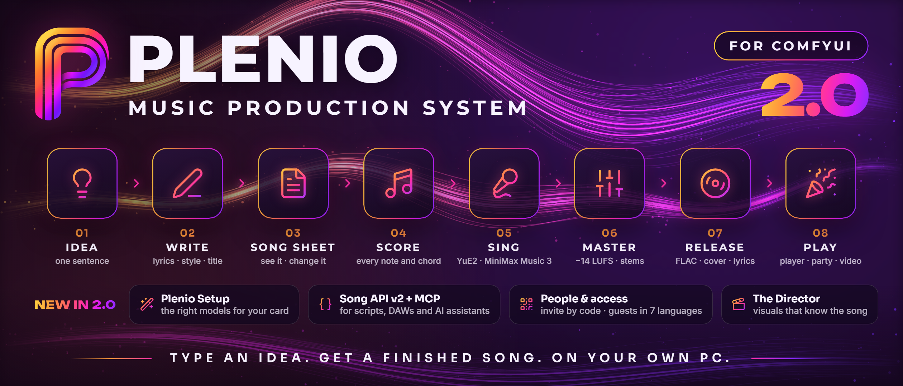
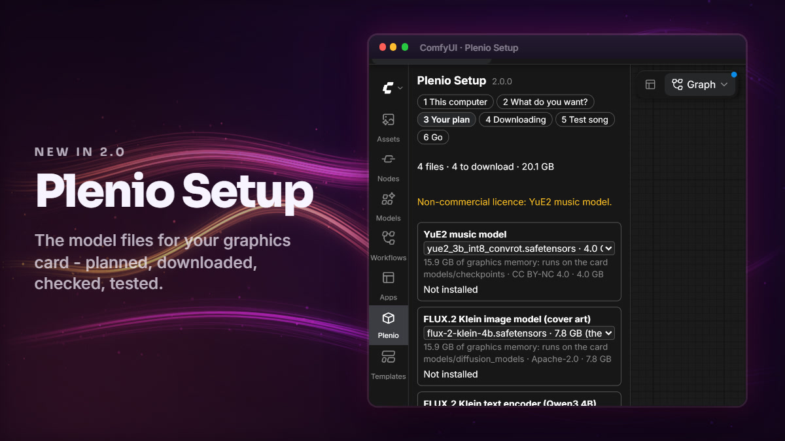
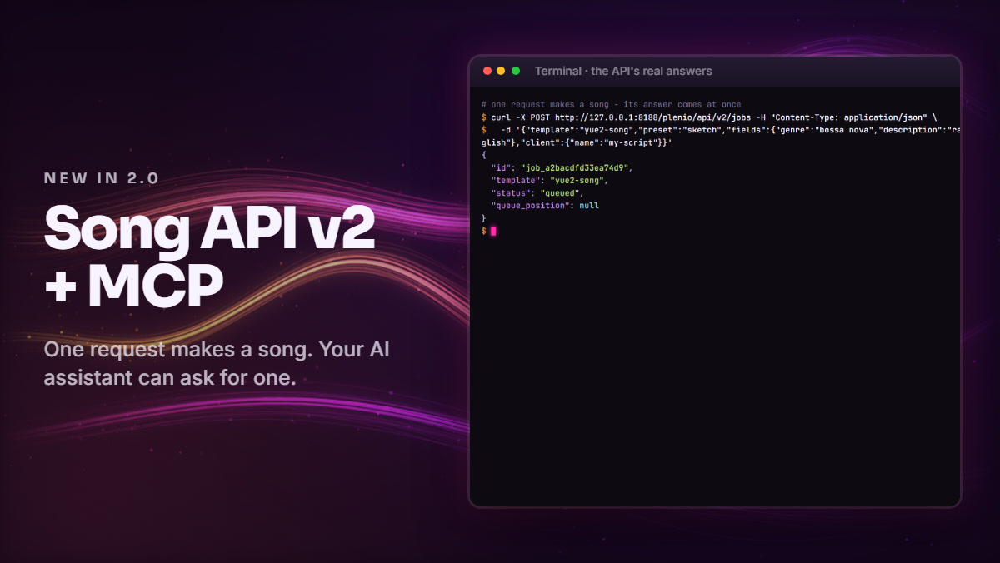
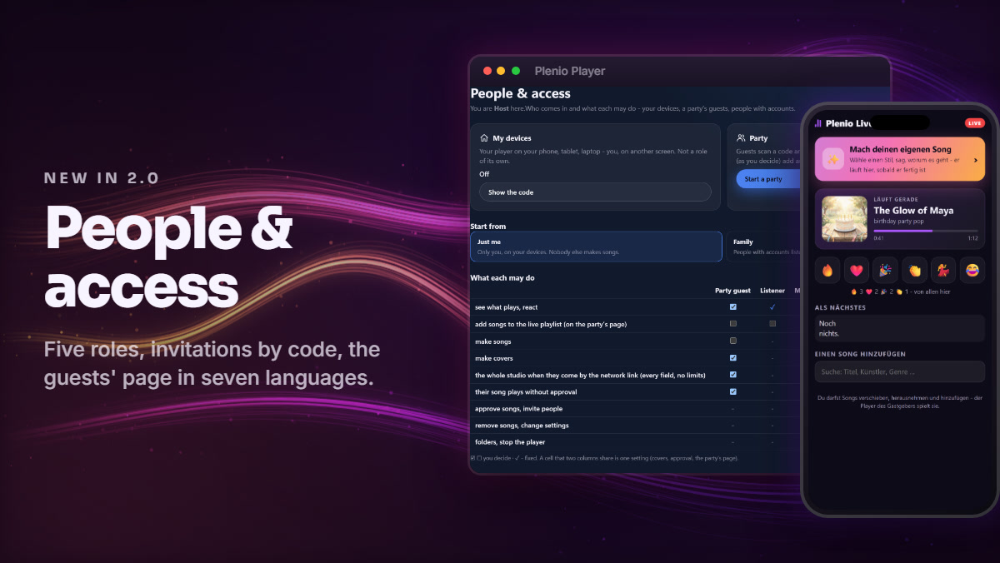
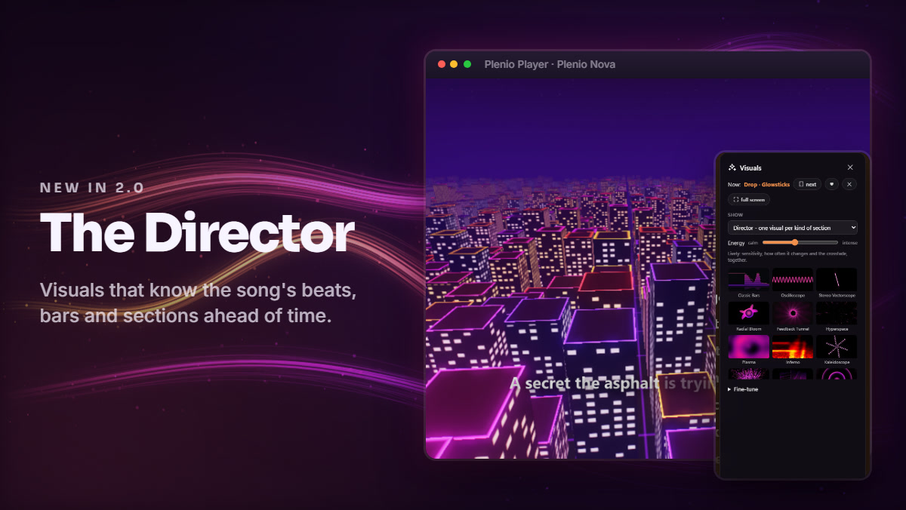
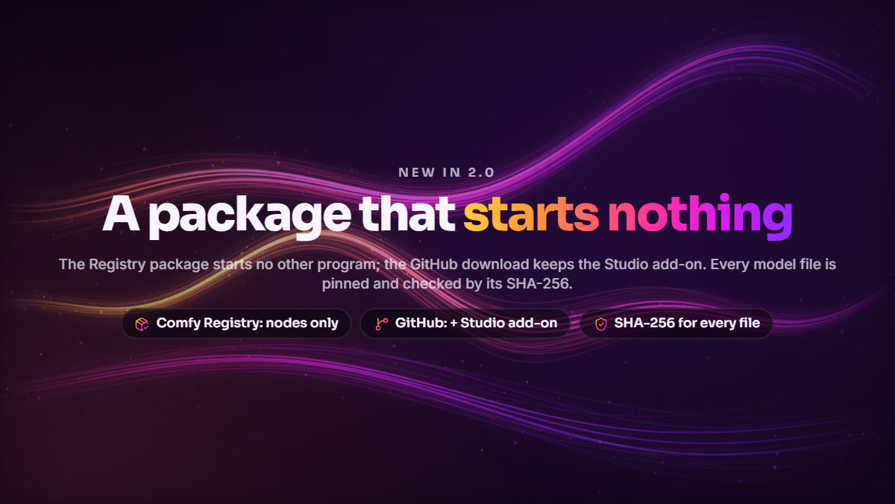

# Plenio 2.0.0

**Plenio 2.0 makes the first song easy - and opens Plenio to your household, your scripts and your AI assistant.** **Plenio Setup** plans the model files for your graphics card, downloads and checks them and tests them with a first song; every model field of the templates says `auto`. The **Song API v2** keeps its jobs across a restart, stops for review and streams events; the player gets an API of its own, and an MCP server lets an AI assistant make songs. In the **Plenio Player**, *People & access* says who may do what, people are invited by a code, guests read their page in their own language, and the **Director** changes the picture with the song's sections. The **Comfy Registry package starts no other program**. Workflows saved with 1.x open and run, the Song API v1 answers as before on this computer, and the player keeps everything it kept.

▶ **[Plenio 2.0 in 50 seconds](https://jplenio.github.io/Plenio-Music-Production-System/go/film-hero/)** · ▶ **[What is new](https://jplenio.github.io/Plenio-Music-Production-System/go/film-whats-new-2/)** · ▶ **[Your party.](https://jplenio.github.io/Plenio-Music-Production-System/go/film-party-2/)** · ▶ **[Install and Plenio Setup](https://jplenio.github.io/Plenio-Music-Production-System/go/tutorial-2-setup/)**

> **New to Plenio?** Plenio is a free, open-source song production suite for ComfyUI that runs on your own PC: type an idea and get a finished, mastered song with cover art, timed lyrics and sheet music - sung by YuE2 or MiniMax Music 3. See and change every word, note and chord before it is sung, and play it to a room from the Plenio Player. [Listen first](https://jplenio.github.io/Plenio-Music-Production-System/) · [README](https://github.com/jplenio/Plenio-Music-Production-System#readme) · [Guide](https://jplenio.github.io/Plenio-Music-Production-System/guide/)

## Highlights

<table>
<tr><td width="42%"></td><td>

**Plenio Setup** - a tab in ComfyUI that knows your graphics card: it plans the model files that suit it, shows their sizes, folders and licences, downloads them after you confirm, checks every file against its hash and makes a one-minute test song. Once set up it is *Home*: a button for each kind of song, the player and your newest songs.

</td></tr>
<tr><td width="42%"></td><td>

**Every model on `auto`** - the templates' model blocks take the file that suits the computer that runs them, so a workflow made on one computer takes the right files on another. A finetune or a pin is still one choice away.

</td></tr>
<tr><td width="42%"></td><td>

**Song API v2** - all five templates, jobs that survive a restart of ComfyUI, review stops with the documents to approve or edit, one stream of events, presets, and tokens for programs on other computers. A typed Python client in one file comes with it.

</td></tr>
<tr><td colspan="2">

**An API for the player, and Plenio for AI assistants** - play, pause, queue and Live Play by HTTP for remote controls, stream decks and home automation; and `plenio_mcp.py`, a Model Context Protocol server: ask Claude Desktop or Claude Code for a song and it plays in the Plenio Player.

</td></tr>
<tr><td width="42%"></td><td>

**People & access** - one page for who comes in and what each may do: Host, Co-host, Maker, Listener, Party guest. Invite someone with a QR code instead of typing a password for them; *Start a party* asks three things and switches everything on; the guests' page speaks seven languages.

</td></tr>
<tr><td width="42%"></td><td>

**The Director** - the player now knows each song's beats, bars, sections and drops ahead of time. The Director gives every kind of section its own visual and changes on the section's first beat; twelve signature visuals lean in before a beat and flash on it, and one light lies over every visual.

</td></tr>
<tr><td width="42%"></td><td>

**A package that starts nothing** - the package of the ComfyUI Manager and the Comfy Registry starts no other program; the three conveniences that do live in the Studio add-on of the GitHub download. Every model file is pinned to a commit and checked by its SHA-256.

</td></tr>
</table>

## Updating from 1.x

- **Nothing to migrate.** Saved workflows, release records, the player's library, its accounts and their rights work as they are. *File › Bring the model blocks up to date* gives a 1.x workflow the new model fields and keeps the files it named.
- **ComfyUI 0.41.0 is the minimum** (was 0.37.0); 1.6.0 stays installable for an older ComfyUI.
- **A program on another computer needs a token for the Song API** (*Plenio Setup › API access*). Programs on the computer ComfyUI runs on need none; `[api] remote = "open"` answers every computer as before.
- **A player started with `--host` asks another computer to log in.** The admin logs in on the player's own computer.
- The guide for the update: [From 1.x to 2.0](https://github.com/jplenio/Plenio-Music-Production-System/blob/v2.0.0/docs/user/from-1x-to-2.md).

## Install

- **ComfyUI Manager**: search for *Plenio Music Production System* - or `comfy node install comfyui-plenio-music`.
- **The full download**: `git clone https://github.com/jplenio/Plenio-Music-Production-System` into `ComfyUI/custom_nodes`, or the zip below. It also carries the Studio add-on: the player starts ComfyUI, a `llama-server` runs a GGUF writer, *Open the folder* opens the file manager.

Restart ComfyUI: **Plenio Setup** opens and plans the model files for your graphics card.

## Every change

<b>Added</b> (47)

#### Setup and models

- **Plenio Setup**, a tab in ComfyUI's sidebar: what this computer has, which templates you want, the files that suit your graphics card with their sizes, folders and licences, *Download all* with progress, pause and resume per file, and where to go next. Nothing is fetched before you confirm; the total size is on the button, and a download that would not fit on its drive (with 2 GB to spare) does not start. You can choose another folder ComfyUI searches for a kind of model. A file whose makers ask for an OK on Hugging Face gets three checked steps instead of an error. Setup opens by itself once after an install or an update when a template you want lacks files, later from the *Plenio* menu; a run that stops at a missing file opens it at that file, and a dot on the tab says that the open workflow lacks one. Setup remembers where you were (`user/plenio/setup.json`).
- ***Home***: once set up, the tab has a button for each kind of song, the player, *Continue a song*, your newest songs and whether every model file is there.
- **A test song**: Setup makes a one-minute instrumental with your files before your first song, so that a problem shows in Setup with its fix.
- ***Report a problem…*** makes a zip to attach to an issue - the System Check, the Plenio lines of the log, the last error and the workflow without its texts - with every path cut to its last two parts and your user name replaced; you read it before it is saved.
- **A model plan**: for every model a template needs, Plenio works out which file suits the graphics card - the best that runs on it, keeping an installed file that is nearly as good - and says why in a sentence. `[models] prefer` (`balanced`, `quality`, `speed`, `small`) and `[models.pins]` in `config.toml` override it. The memory figures are estimates until measured.
- **Model Choice** (`Plenio/Model`): one node per model that hands its file's name to the loader beside it. `auto` takes the file that suits the computer that runs the workflow, when it runs - a pin in `config.toml` comes first; any other entry is your own choice, a finetune too. Its summary says which file and why; a missing file stops the run with its name, folder and address. The model blocks of the templates - *Plenio · YuE2 Model*, *Plenio · MiniMax Model*, *Plenio · Cover Art* - have one such field per model, set to `auto`. Their loaders no longer ask ComfyUI's missing-model dialog for the default file, which was the wrong file on a computer whose card suits another. The release record notes the file each Model Choice took (`models`), and the player's song page names it.
- **The default writer takes the best Gemma 4 that can write on the computer, in a fixed order**: a Gemma 4 12B of a running app (LM Studio, Ollama - loaded already), then a Gemma 4 12B GGUF (on the computer, or the one for the card downloaded; llama.cpp), then - without llama.cpp - ComfyUI's own Gemma 4 12B, or its E4B or E2B on smaller cards, chosen like every model file. Before, a computer without llama.cpp wrote with whatever Gemma text model it had, or stopped. *Writer model* says which step wrote and why. Which of the GGUF and ComfyUI's 12B writes better on a 16 GB card is not measured yet.
- **A 16 GB card writes with the QAT Q4 GGUF instead of the Q6_K**, about 2.4 times faster: measured on a 16 GB card, the Q6_K and the writer's context filled the card (23 s a song's text against 9 s). Plenio downloads the Q6_K from 20 GB of graphics memory, and a GGUF already on the computer is used when it leaves 7.5 GB of the card free. Whether the Q6_K writes better words was not judged.
- **The System Check names its findings with an id and a fix** (`comfyui.too_old`, `model.misplaced`, `disk.low` ...): the report lists them first, each with what to do - the line to copy into `extra_model_paths.yaml`, the install command, the download - and the [troubleshooting guide](https://github.com/jplenio/Plenio-Music-Production-System/blob/v2.0.0/docs/user/troubleshooting.md) explains every id. Setup shows the same list with buttons.
- **The hardware table is made from the model catalogue**: the System Check and the templates' *Models* notes show, per graphics card size, the files the model fields on `auto` take there and the writer's file - the same answer as the model plan. Its memory figures are estimates until measured, and the table says so.
- **A download manager for model files**: a queue, two at a time, pause, resume from a partial file, size and SHA-256 checked before a file is put in place, and every refusal of the host in words - terms to accept, a missing token, a moved file, a busy host, a full disk. A Hugging Face token is sent to huggingface.co only, never along a redirect. A different file that already has the catalogued name is left as it is and named, never deleted or replaced. Plenio Setup's routes (`/plenio/setup/*`) answer this computer only.
- **`[models] downloads = "auto"` fetches a missing model file during the run** and goes on: for an unattended party host or an API server. The default stays *ask*: the run stops and Plenio Setup opens at the file. Interrupting the run cancels the download.
- **Downloads follow `HF_ENDPOINT`**, the mirror setting of Hugging Face's own tools. Every file is still checked against the catalogue's size and SHA-256, and a token is never sent to a mirror.

#### Song API v2, the Player API and AI assistants

- **Song API v2** (`/plenio/api/v2`): all five templates - also *5 · YuE2 · DAW*, *3 · MiniMax · Song* and *4 · Enhance & Master*, which masters an uploaded file -, the presets, and jobs kept on disk: a job has an id of its own, survives a restart of ComfyUI as `failed`/`interrupted`, and its `Idempotency-Key` then starts a new run.
- **Review stops in the API**: a job can stop for review (`"review": ["text", "score"]`); it waits with the documents as the Song Sheet shows them, and `POST /jobs/{id}/approve` goes on - with edited documents, which become the sheet's manual text.
- **One stream of events** (`GET /plenio/api/v2/events`, Server-Sent Events) for jobs and downloads; a reconnect with `Last-Event-ID` gets what it missed.
- **A typed Python client in one file** (`docs/api/examples/plenio_client.py`, standard library only): make a song, wait, approve with edits, download, songs, uploads, events; a refusal raises an error with the API's code and hint. The [guide](https://github.com/jplenio/Plenio-Music-Production-System/blob/v2.0.0/docs/api/README.md) describes v2 with every endpoint and a table for programs coming from v1; `GET /plenio/api/v2/openapi.json` describes all five templates. API v1 answers as in 1.6.0 (a test replays 1.6.0's answers); its guide, reference and examples stay in `docs/api/v1/`.
- **Player API v1** (`/api/v1` on the Plenio Player): what plays, play, pause, next, previous and seek, a song added next or at the end, Live Play on or off with its rules, a stream of events (`now`, `queue`, `live`, a guest's `reaction`), and `GET /api/v1/songs?q=`, which searches the library as the page's search field does. Commands reach the page that plays within a second (measured in a browser: about a quarter of a second, the page's answer included). This computer needs nothing; another device logs in to the player. Guide: `docs/api/player.md`; reference: `docs/api/player-openapi.json`.
- **Plenio for AI assistants**: `plenio_mcp.py`, a Model Context Protocol server (standard library only), lets an assistant such as Claude Desktop or Claude Code make a song from a description, follow it, list the songs and play one in the Plenio Player. It talks only to this computer and opens no port; it ships with a git clone and the release download, not in the Registry package. Setup: `docs/api/mcp.md`. A finished v2 job's `result` carries `song`, the song's id in `/songs`, and the Player API finds a song by its record (`/api/v1/songs?record=`).
- **The player's party songs use Song API v2** where ComfyUI's Plenio has it: a song that finished while the player looked away is still found after a restart of ComfyUI, a run ComfyUI lost is made again once, and the job's events wake the player at once instead of at its next look. Jobs saved before the update, and a ComfyUI with an older Plenio, stay on v1. `docs/api/coming-from-v1.md` lists what a program such as a DAW plug-in changes to move to v2, the token for another computer first.
- **The same six presets everywhere**: the player's *Best quality*, *Party - fast*, *Quick sketch*, *Full song*, *Three takes* and *Instrumental* come from one file. The song templates have a *Preset* field: choosing one sets the length, vocals, lyrics fidelity, HQ mastering and cover art in the nodes, where you see them, and Ctrl+Z takes it back. The Song API takes `"preset": "party"` in a job request; the fields a request names itself win.

#### The player: people, places, languages

- **People & access**, one page for who comes in and what each may do: *My devices* (the player on your own phone or laptop), *Party* (guests scan a code, no account) and *People* (accounts). The roles have plain names - Host, Co-host, Maker, Listener, Party guest - for the groups that exist (stored as before, nothing to migrate), and one grid shows and sets what each may do, in place of switches on three pages. Three starting points set it at once: *Just me*, *Family*, *House party*.
- **Invite someone instead of typing a password for them**: a name and a role give a QR code; the invited person opens it on their phone, chooses a password or a four-digit PIN and is logged in. The code works once, for 15 minutes, and is kept only as its hash; eight wrong codes make a device wait.
- ***Start a party*** asks three things - its name, what guests may do, then the code on the big screen - and switches on the guests' access, Live Play and song making for guests together. *End the party* puts every one of them back as it was.
- **The player in five places** - Songs, Playlists (the smart lists and saved filters inside), Live, Make, More - the same on a desktop and in a phone's tab bar. Settings opens on *Basic* (eight settings), *Everything* has the sections as tabs, and *Find a setting* searches every label. A new player shows three cards once (your songs, the show, a party); an empty library says where songs come from, with *Make your first song*.
- ***Make a song* starts short**: *What should the song be about?*, a style chip, *Generate*. The song gets every value of a template of that style, and your words become the idea its lyrics are written from. *More options* opens the full form as before - every field, presets, covers, several takes.
- **The guests' page speaks the guest's language**: English, German, Spanish, French, Italian, Portuguese or Japanese, chosen from the phone's languages, English for every other. The rest of Plenio stays English.

#### Visuals

- **The player knows each song's beats, sections and drops ahead of time**: once per song it computes an analysis track (three bands of energy, onsets, beats and downbeats - from the take's measured bars where they are kept, else from the audio -, sections and drops) and keeps it in its cache; shared players carry it.
- **The Director**, a new visual mode: one visual per kind of section - every chorus the same -, the change landing on the section's first beat, a drop with a flash, a quiet bridge melting in. Where a song's beats are not sure, it plays as *Match the music*.
- **Twelve signature visuals**, shown first to a new player: seven Nova scenes, three Plenio Drop presets and two classics, chosen across the collections, each tuned to lean in before a beat lands, flash on it and build up before a louder part. Plenio Drop's own presets can do the same: they read `anticipation`, `impact`, `tension`, `beat_phase`, `bar_phase` and `section_energy`.
- **One light over every visual**: the classics and Plenio Drop get Plenio Nova's finishing - a soft glow from the bright parts, highlights rounded instead of clipped, a vignette and a fine grain - so all visuals look like one family. *Visuals › One light over every visual* switches it off.
- **Choose visuals by what they show**: every visual belongs to one or two collections - Space, Nature, Club, Retro & hi-fi, Flow, Geometry, This song. The visuals panel starts with *Show* (the Director, a collection, your favourites, one visual or none) and *Energy* (calm to intense: sensitivity, how often the picture changes and the crossfade together), with a picture of each visual to click; every setting of before is under *Fine-tune*. ♥ keeps a visual among *My favourites*, ✕ takes it out for good.
- **Lyrics, notation and visuals follow the sound you hear**: the player takes off the delay the browser reports for the way to your ears (a Bluetooth speaker or a television adds 100 to 250 ms), and *Settings › Sound › Picture and sound together* has a slider and a test - a tick and a flash - for systems that report none.
- **Plenio Nova on more devices**: a phone whose graphics render half floats by the mobile extension now draws Nova, and a graphics chip with neither draws it in eight bits, its light stored so that glow and dark gradients survive. Before, Nova was not offered there at all.

#### In ComfyUI

- **Recipes**: six short workflows from the templates in `example_workflows/recipes/` - a series from a list of briefs, two music models from one brief, a cover in three styles, the same lyrics in three genres, a song with stems for a DAW, master a folder of files ([Recipes](https://github.com/jplenio/Plenio-Music-Production-System/blob/v2.0.0/docs/user/recipes.md)). **Brief List** hands one line of a list (or of a text file in the input folder) to the next node per run; **Load Audio by Name** loads an input file named by text.
- ***Approve* goes on with the run.** When a run stopped at a Song Sheet for review, *Approve* queues the continuing run itself - no second press of *Run*. The setting *Plenio › Song Sheet › Approve goes on with the run* keeps the old way.
- **The Song Sheet editor opens at once**: once a workflow with a sheet is on the canvas, its code is fetched while the browser is idle.
- **Where a song's time went**: the release record says how many seconds each group of the template took, how much of that ComfyUI spent loading models, and the peak memory on the graphics card (`timings`, `plenio.timings/1`). A record without it reads as before.

#### Guides and checks

- **The user guide as a website** with search and a sidebar, beside the demo page; the Markdown stays the source.
- **Video links that do not break**: every video has a key in `resources/media.toml`; README, docs and the player's help go through `…/go/<key>/`, so a video uploaded anew changes one line.
- **Numbers in the docs come from the code** (`tools/facts.py`): the node and test counts, the hardware table - and a check that every link, environment variable and route of the docs exists.
- **How long a song takes, measured**: `docs/dev/performance.md` names 1.6.0's times as budgets, and `tools/bench.py --check` compares a benchmark report with them per second of song (the same seeds make songs of other lengths in another version). Every brief is as fast as on 1.6.0 or faster by that measure. The player's studio panel says the first song after ComfyUI starts takes longer (up to about one and a half times, measured).
- **Checks in tiers**: fast and IO tests on Linux and Windows, the ComfyUI tests on the oldest and the newest supported version, a weekly run against ComfyUI's development version; property tests with 25 examples on every change and 300 weekly.

#### Plenio VST3 (optional: Plenio in your DAW)

- **The DAW plug-in is part of this repository** ([`vst3/`](https://github.com/jplenio/Plenio-Music-Production-System/blob/v2.0.0/vst3/README.md)) and of every release: a VST3 instrument with ARA 2 for REAPER, Cubase, Studio One, Ableton Live, FL Studio, Bitwig and other VST3 hosts. A song or a cover from a style, an idea or your own lyrics, up to four takes per run on one track, in time with the project; stems on outputs of their own, melody, instrument line and chords as MIDI out; the take, its stems, MIDI, tempo map and a click dragged onto the timeline; in REAPER the whole song laid out on the project's tracks. Plug-in and Plenio now have one version and are tested together: a change to the Song API that would break the plug-in fails in the same check run. The Windows installer, a zip and the macOS package (experimental: built, not yet tried on a Mac) are among the release's files. ComfyUI, the player and the Registry package need nothing of it.
- **The plug-in speaks Song API v2**: a take that was being made when ComfyUI restarted is reported as cut short instead of lost, and a project saved while takes were made still gets them when it opens again. With a Plenio before 2.0 it speaks v1 as before, by itself.
- **ComfyUI on another computer**: the DAW on a laptop, the graphics card in the studio PC. The plug-in's settings take the PC's name and a token from *Plenio Setup › API access*; the token is kept in the system's password store, never in a project or a settings file. The status says *Token needed* when the PC asks for one, and a click on it opens the settings.
- **Sturdier in more hosts**: the plug-in writes silence into every buffer a host hands it when it has nothing to play there - a bus it did not ask for, more channels than stereo, a block before the song is loaded - and marks it as silent, so no host plays what was left in its buffers.

<b>Changed</b> (10)

- **ComfyUI 0.41.0 is the minimum** (was 0.37.0): the templates are checked against 0.41.0 and 0.44.2; 1.6.0 stays installable for an older ComfyUI.
- **The Song API answers another computer only with a token.** A program on the computer ComfyUI runs on needs none - the Plenio Player's songs, a script on the same machine work as before. A program that reaches ComfyUI over the network - a DAW plug-in on another computer, a script - now needs a token from *Plenio Setup › API access*, sent as `Authorization: Bearer plenio_...`; without one it gets `401` with these words. `[api] remote = "open"` in Plenio's `config.toml` answers every computer as before 2.0, `"off"` this computer only. Tokens are kept only as their hash; Setup shows when each was last used and takes one back. A token sees only the runs it made itself - in v2 and in v1, their files, the queue and the event stream -; the templates' *Preset* lists need no token. The token guards Plenio's routes only - ComfyUI's own `/prompt` and `/history` stay as open as ComfyUI is. A ComfyUI in a container or behind a reverse proxy may see a program on the same machine as another computer: make a token in Setup from a browser there, or set `PLENIO_API_REMOTE=open` where only you reach it.
- **A player started with `--host` no longer treats another computer as this one.** Before, a device that reached such a player directly had the admin's rights without logging in; now it is a guest until it logs in, as through *In your network*, and the admin logs in on the player's own computer only (by its loopback address or one of its own). Wrong passwords and invitation codes are counted by the device's own address (the browser's `Host` header could be changed for every try) and per user, so a four-digit PIN cannot be tried from many devices. Only the host and co-hosts change the guests' access; another account cannot take over or close a page that reports to the Player API, and one account holds at most four of its event streams. The gateway of *In your network* refuses a request whose header lines hide a bare line break, which could forge its own marks.
- **The Comfy Registry package starts no other program.** Plenio now comes in two forms. The package of the ComfyUI Manager and `comfy node install` starts nothing but ComfyUI's own Python with Plenio's own modules - the lyrics ASR worker, the Plenio Player opened from ComfyUI, llama-cpp-python for a GGUF file. Three conveniences that start another program moved into the *Studio add-on* (`plenio/addons`), which a `git clone` and the release zip carry: the player starting ComfyUI, an installed `llama-server` running a GGUF file, and *Open the folder* opening the file manager. Without the add-on each says what to do instead: the player finds the ComfyUI you start and says so, GGUF models run in LM Studio, Ollama or a `llama-server` you started (or with llama-cpp-python, else ComfyUI's own Gemma writes), and *Open the folder* shows the path with a *Copy* button. **0 · System Check** says which form is installed; `PLENIO_ADDONS=0` switches the add-on off. A check on the packed zip (`tools/package_gate.py`, in the CI) fails the build if a launch site comes back. [Two ways to install](https://github.com/jplenio/Plenio-Music-Production-System/blob/v2.0.0/docs/user/getting-started.md#two-ways-to-install), [SECURITY.md](https://github.com/jplenio/Plenio-Music-Production-System/blob/v2.0.0/SECURITY.md#programs-plenio-starts).
- **Every model file is pinned and has its hash.** The model catalogue lists components and their variants (`resources/models.toml`, schema 2): each file's link points at a fixed commit and carries its size and SHA-256, read from the host's headers by `tools/catalogue_check.py` and checked weekly. Twelve links pointed at a branch before; three named repositories Hugging Face has renamed since.
- **A workflow saved with 1.x keeps its model blocks** and the files they name; *File › Bring the model blocks up to date* gives them Model Choice and keeps each file as the block's choice.
- ***Open the folder* opens the folder**, no longer with the file selected in it: selecting needed a command line built as one string. Explorer now gets the folder as one argument.
- **Workers run on ComfyUI's own Python only**: the worker protocol no longer takes another interpreter.
- **Every route has an access class** (`local`, `compute`, `data`, `api`), declared in the route table and checked for every route; what the routes answer is unchanged.
- **The addresses of the player's old settings sections** lead to People & access.

<b>Security</b> (3)

- **A website open in a browser on this computer is no longer taken for this computer.** Such a page could send requests to ComfyUI's address in the network, which come from the computer's own address; Plenio's routes for this computer only now also require the request's `Origin` to match the address it was sent to.
- **Routes for this computer only also check the address a request was sent to.** A web page whose name was pointed at 127.0.0.1 (DNS rebinding) reached them from the browser of this computer; its `Host` header still names the page, and is now refused. `localhost`, loopback addresses and the computer's own address and name still work.
- **A failed job no longer tells another computer where Plenio is installed.** The Song API's job list and job answers held the error ComfyUI reported, whose type names the package's folder and whose message can name a model file's path. Answers to another computer keep the class name and a path's last two parts; this computer gets them as before.

<b>Fixed</b> (2)

- **The FLUX.2 VAE no longer counts as incomplete**: the catalogue had its size wrong by 2 kB, so the System Check and the API's `/models` said *size differs* for a correct file and the cover-art templates were *not ready*.
- **The Plenio Player opens from ComfyUI without a pause.** Looking for a running player waited two seconds for every port nobody listened on - ten seconds on Windows before a player was started. Measured: 10.2 s before, 1.3 s after.

The same list as a file: [CHANGELOG.md](https://github.com/jplenio/Plenio-Music-Production-System/blob/v2.0.0/CHANGELOG.md).
