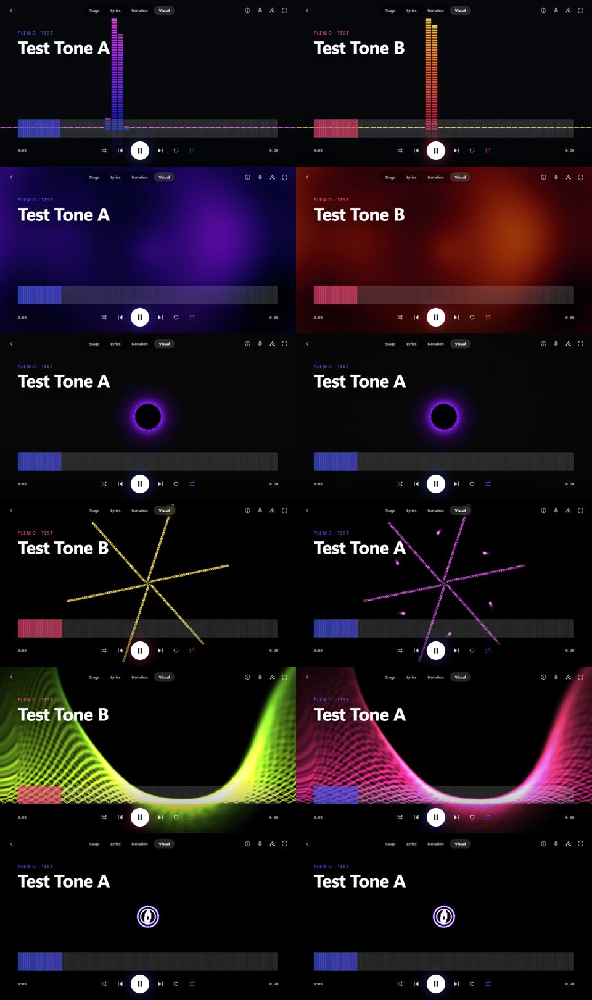

# One light: six visuals before and after (2026-11-12)

Phase 7.7. The finishing of Plenio Nova - a soft glow from the bright parts, a shoulder that rounds what the glow
pushes past white, a vignette and a still grain - as the last pass of every visual (`visuals/finish.ts`), switched
by *Visuals › One light over every visual* (on by default).

Rows: *Bars*, *Plasma*, *Tunnel*, *Kaleidoscope* (classics), *Drop · Aurora Curtain*, *Drop · Deep Dive*; left
without, right with the pass. Taken in Playwright's Chromium on the integrated AMD graphics, the player playing a
generated test tone; each pair is two moments of the song (the visual moves), and the player's *Play* took either of
two test songs, so a pair's colours can differ by the song's palette. Nova's own scenes already have the pass and
are not shown. For the owner to judge by eye; not measured.
