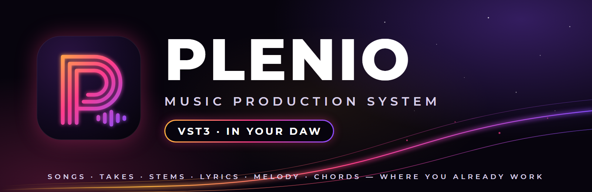
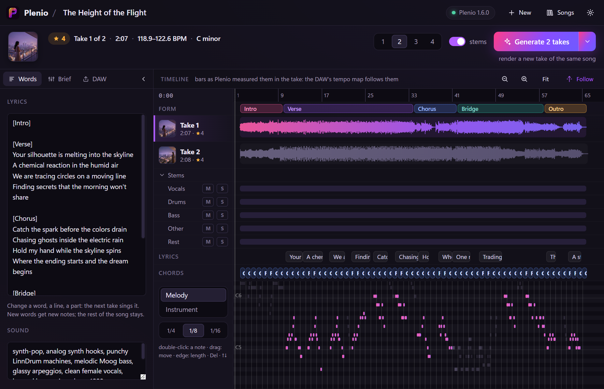
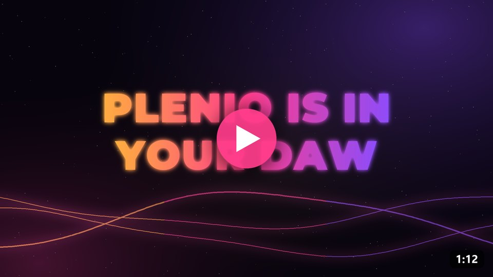
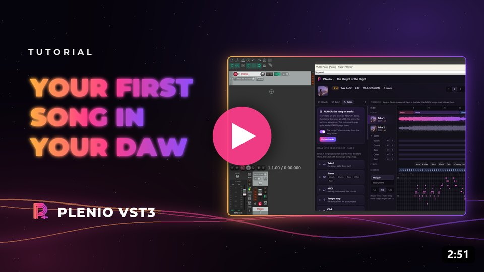
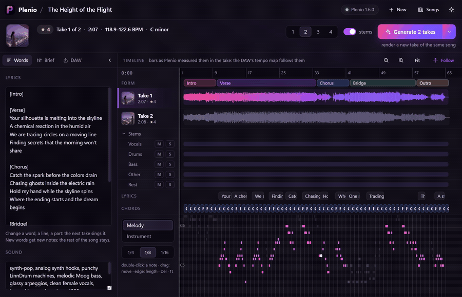
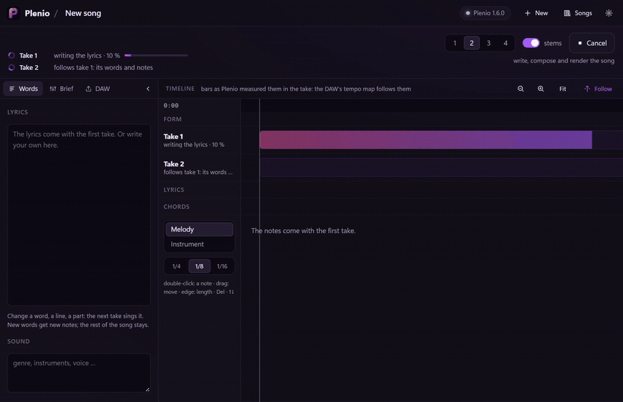
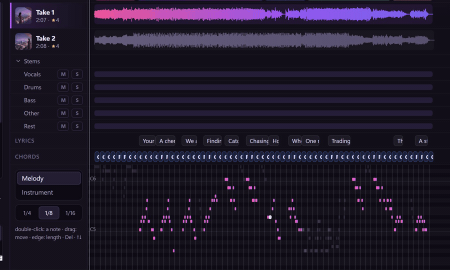
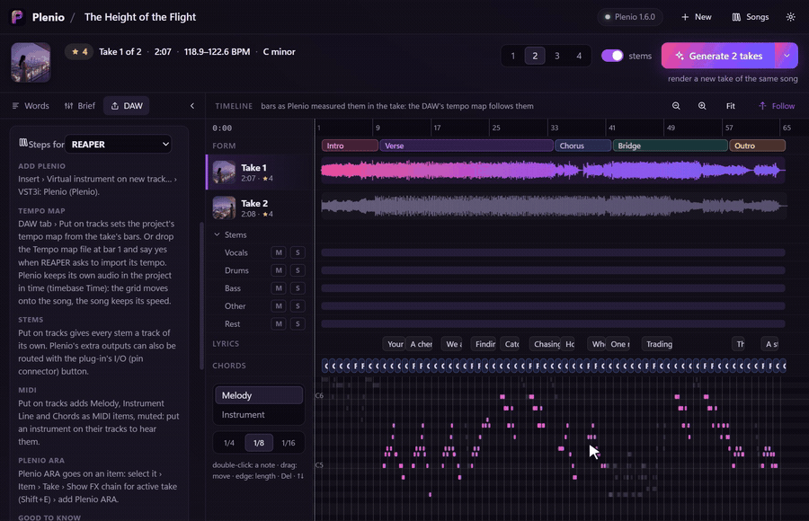
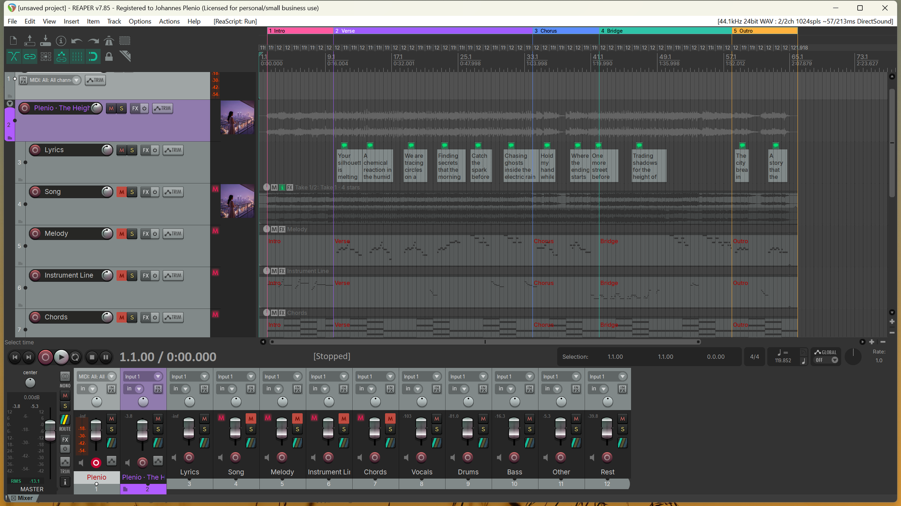

<p align="center">
  
</p>

<p align="center">
  <a href="https://github.com/jplenio/Plenio-Music-Production-System/releases/latest"></a>
  <a href="https://github.com/jplenio/Plenio-Music-Production-System/actions/workflows/vst3.yml"></a>
  
  
  <a href="../LICENSE"></a>
</p>

<h3 align="center">Generate the song. Keep working in your DAW.</h3>

**Plenio arrives where music is made: in your DAW.** Plenio VST3 is an optional part of the
[Plenio Music Production System](../README.md): it brings Plenio into REAPER, Cubase,
Studio One, Ableton Live, FL Studio, Bitwig and every other DAW that loads VST3 instruments. Pick a style, write an
idea or your own lyrics, and Plenio writes, composes, sings and plays the song on **your own graphics card**. Every
take lands right on your track, in time with your project, with its stems, its MIDI and a tempo map that fits its bars.

And then you simply keep going, with everything you already love: your plug-ins, your virtual instruments, your
mixing chain, your shortcuts. No upload, no export dance, no second app to switch to.

<p align="center">
  
</p>

> **New with Plenio 2.0** · Windows · macOS experimental · [Download](https://github.com/jplenio/Plenio-Music-Production-System/releases/latest)
> (`Plenio-VST3-…-windows-x64-setup.exe` among the release's files) ·
> [Tutorial](docs/TUTORIAL.md) · [Your DAW](docs/DAWS.md) · ▶ [Teaser](https://jplenio.github.io/Plenio-Music-Production-System/go/vst3-teaser/) ·
> ▶ [Tutorial video](https://jplenio.github.io/Plenio-Music-Production-System/go/vst3-first-song/)

<p align="center">
  <a href="https://jplenio.github.io/Plenio-Music-Production-System/go/vst3-teaser/"></a>
  <a href="https://jplenio.github.io/Plenio-Music-Production-System/go/vst3-first-song/"></a>
  <br><sub>▶ <a href="https://jplenio.github.io/Plenio-Music-Production-System/go/vst3-teaser/"><b>The teaser</b></a> (1:12) · ▶ <a href="https://jplenio.github.io/Plenio-Music-Production-System/go/vst3-first-song/"><b>Your first song in your DAW</b></a>, step by step (2:51) · <a href="https://www.youtube.com/playlist?list=PLI7BuX18HQwM">the playlist</a></sub>
</p>

## What it does

### A song in your DAW, made on your computer

Choose one of Plenio's 250 styles, change any field, give it an idea for the words or your own lyrics, and choose how
many takes one run makes. Plenio writes the lyrics, composes the melody and the chords, and sings and plays every take
with YuE2 in ComfyUI, on your own machine.

<p align="center"></p>

### Up to four takes per run, all on the same track

Takes arrive one after another while you keep working, each with its stems (vocals, drums, bass, other, the rest), its
cover art and Plenio's measured quality. Click a take to hear it: the instrument plays it in time with your project.

<p align="center"></p>

### Change the words, the notes, the chords, and render again

Change a line of the lyrics and the next take sings it, with new notes for the new words. Move a note in the piano
roll or pick another chord and the next take sings exactly that. *Generate* always says what it is about to do.
Every run adds takes, even when the song gets longer or shorter.

<p align="center"></p>

### Straight into your project

Drag the take, its stems, the MIDI, the tempo map or a click track from the plug-in onto your timeline. Every file
starts at bar 1, and the tempo map follows the bars as Plenio measured them in the take, so your DAW's grid fits the
song. **In REAPER**, one click lays the whole song out on the project's own tracks: every take as one of REAPER's
takes, the stems, the MIDI, the lyrics, the sections as regions, the tempo map and the cover as the tracks' icon.

<p align="center"></p>

<p align="center"></p>

### And more

- **Stems on their own channels**: activate Plenio's extra outputs; **MIDI out** for melody, instrument line and chords.
- **Plenio ARA** (ARA 2) on a clip in REAPER, Cubase, Studio One and other ARA hosts: the take's tempo, bars, key, sung
  notes and chords for your DAW, and any other take of the song played in the same clip.
- **Cover art** for every take, kept as `cover.jpg` with the song.
- **Your songs stay yours**: a saved project plays and edits without ComfyUI and Plenio; only *Generate* needs them.
- **Every DAW's own steps**, right in the plug-in: it knows the DAW it runs in.

## Your DAW

| DAW | Plenio | The song's tempo map | Plenio ARA |
|---|---|---|---|
| **REAPER** | ✔ deepest: *Put on tracks* | from the file, or *Put on tracks* | ✔ |
| **Cubase, Nuendo** | ✔ | from the file (*File › Import › MIDI File*) | ✔ |
| **Studio One** | ✔ | from the file (onto the tempo track) | ✔ |
| **Ableton Live** | ✔ | by hand (Live takes no tempo maps) | – |
| **FL Studio** | ✔ | by hand | – |
| **Bitwig Studio** | ✔ | by hand | – |
| **Cakewalk, Sonar** | ✔ | from the file | ✔ |
| Logic Pro, Pro Tools | no VST3 there | | |

Every DAW's own steps: [docs/DAWS.md](docs/DAWS.md), and in the plug-in's **DAW tab**.

## Quick start

1. **Install** Plenio VST3 ([Releases](https://github.com/jplenio/Plenio-Music-Production-System/releases)): the Windows installer puts it
   into `C:\Program Files\Common Files\VST3`, the macOS package into `/Library/Audio/Plug-Ins/VST3`.
2. **Put Plenio on an instrument track** in your DAW and open its window.
3. **Start ComfyUI with Plenio** (or let Plenio VST3 start it), click **New song**, pick a style, **Make 2 takes**.

ComfyUI on another computer, the studio PC next door? *Settings › ComfyUI runs on another computer*: its name and a
token from *Plenio Setup › API access* ([tutorial](docs/TUTORIAL.md#comfyui-on-another-computer)).

The [tutorial](docs/TUTORIAL.md) takes you through it step by step, with pictures, even if you have never used a DAW
before.

## What it needs

- A DAW that loads VST3 instruments, on **Windows 10/11** (64-bit) or **macOS 13.3+** (experimental in this version).
- To make songs: [ComfyUI](https://github.com/comfyanonymous/ComfyUI) with
  [Plenio](../README.md) and its models (**Plenio Setup** in ComfyUI downloads them), on a graphics card that runs
  them - on the same computer as the DAW, or on another one in your network. The plug-in comes with Plenio 2.0 and
  speaks its Song API v2; a Plenio 1.6 works too (1.5 without stems and measured bars), and Plenio VST3 says when an
  update brings more.
- Windows: the Microsoft Edge WebView2 Runtime (part of Windows 11; the installer checks).

## How it works

```
 your DAW ── Plenio VST3 ──────────────── ComfyUI + Plenio (this computer or your studio PC)
   │          the song, its takes,          writes, composes, sings, plays,
   │          words, notes, chords   ──▶    measures the bars, splits the stems
   │                                 ◀──    every take, with stems, cover, lyrics, MIDI
   │
   ├── plays the take in time, stems on extra outputs, MIDI out
   ├── WAV, MIDI, tempo map, click: dragged onto your timeline
   ├── REAPER: the song on the project's own tracks
   └── Plenio ARA: tempo, bars, notes, chords of a clip
```

The plug-in talks to Plenio's [Song API](../docs/api/README.md) (v2; v1 with a Plenio before 2.0):
the styles, fields and models come from there, so a new Plenio reaches the plug-in by itself. Every song lives in a
folder of its own (`Documents\Plenio\Songs\<title> [id]`) with all its takes, stems, files and its cover, and your
project keeps the song too: open it next year, without ComfyUI, and everything but *Generate* still works.

## Documentation

| | |
|---|---|
| [Tutorial](docs/TUTORIAL.md) | your first song, step by step, with pictures |
| [Your DAW](docs/DAWS.md) | what REAPER, Cubase, Studio One, Live, FL Studio, Bitwig and Cakewalk do differently |
| [Changelog](../CHANGELOG.md) | what changed in which version (the plug-in under *Plenio VST3*) |
| [Development](docs/DEVELOPMENT.md) | building, the architecture, testing, how it stays in step with the Song API |
| [Testing in a DAW](docs/TESTING.md) | a checklist for a DAW nobody has tried yet |

## Questions

**Does it need the internet?** No. Everything runs on your computer: ComfyUI, Plenio and its models. (The models are
downloaded once, by Plenio Setup.)

**My DAW runs on a laptop, ComfyUI on the PC with the graphics card.** That works: start ComfyUI there with
`--listen`, make a token in *Plenio Setup › API access*, and enter the PC's name and the token in the plug-in's
settings. The token is kept in your system's password store, never in a project.

**Can I use the songs commercially?** YuE2 and SheetSage2, which make the songs, are licensed **CC BY-NC 4.0**: what you
make with them is for non-commercial use. Plenio VST3 itself is open source (Apache-2.0).

**Logic Pro? Pro Tools?** Logic loads Audio Units only and Pro Tools AAX only, so Plenio VST3 does not run there. The
files Plenio makes work everywhere.

**What happens to my project without ComfyUI?** It opens with its song, its takes and your edits; playing, editing,
dragging and REAPER's tracks all work. Only *Generate* asks for ComfyUI.

**Something does not work.** Please [open an issue](https://github.com/jplenio/Plenio-Music-Production-System/issues/new/choose) with
your DAW, the versions and the end of the log (`%LOCALAPPDATA%\Plenio\VST3\plenio.log` on Windows).

## Building

```powershell
cd vst3
pwsh tools/fetch_deps.ps1     # the SDKs and libraries at pinned versions
pwsh tools/build.ps1          # web UI + Plenio.vst3 + tests (Visual Studio 2022), the validator after the build
pwsh tools/package.ps1        # installer, zip, checksums into dist\
```

macOS and Linux, the dev tools and the architecture: [docs/DEVELOPMENT.md](docs/DEVELOPMENT.md).

## Licence and credits

Plenio VST3 is licensed under the [Apache License 2.0](../LICENSE) ([NOTICE](NOTICE.md)). It is built on the
[VST3 SDK](https://github.com/steinbergmedia/vst3sdk) (MIT), the [ARA SDK](https://github.com/Celemony/ARA_SDK)
(Apache-2.0), [choc](https://github.com/Tracktion/choc) (ISC), the [REAPER extension SDK](https://github.com/justinfrankel/reaper-sdk)
(zlib) and more ([THIRD_PARTY.md](THIRD_PARTY.md)). VST is a registered trademark of Steinberg Media Technologies GmbH;
ARA is a trademark of Celemony Software GmbH. The name Plenio and its logo are not licensed as marks.
