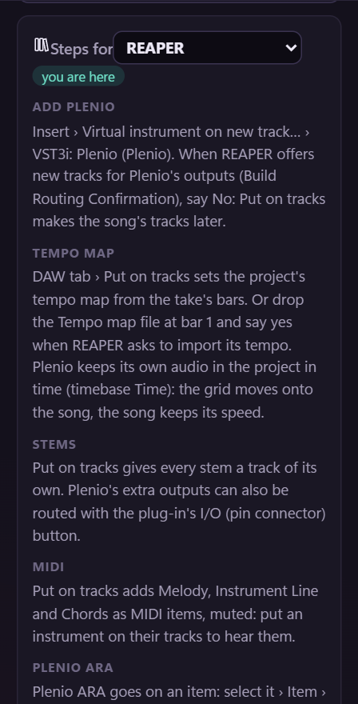

<!-- Written by tools/docs/make_daws_md.py from webui/src/daws.json: change that file, not this one. -->

# Plenio VST3 in your DAW

Plenio runs in every DAW that loads VST3 instruments. Most of it is the same everywhere; what differs is how a
DAW takes a tempo map, routes a plug-in's extra outputs and treats audio that does not follow its tempo. The
plug-in shows the same steps in its **DAW tab**, those of the DAW it runs in first.

| DAW | Plenio runs | The song's tempo map | Plenio ARA |
|---|---|---|---|
| [REAPER](#reaper) | yes | from the file, or *Put on tracks* | yes |
| [Cubase and Nuendo](#cubase-and-nuendo) | yes | from the file (*File › Import › MIDI File*) | yes (Pro, Artist, Nuendo) |
| [Studio One](#studio-one) | yes | from the file (onto the tempo track) | yes |
| [Ableton Live](#ableton-live) | yes | by hand | no |
| [FL Studio](#fl-studio) | yes | by hand | – |
| [Bitwig Studio](#bitwig-studio) | yes | by hand | – |
| [Cakewalk and Sonar](#cakewalk-and-sonar) | yes | from the file, else by hand | yes |
| [Logic Pro](#logic-pro) | no | – | – |
| [Pro Tools](#pro-tools) | no | – | – |

## In every DAW

- **Add Plenio:** Insert Plenio as an instrument (VST3) on a new track.
- **Tempo map:** Drop the Tempo map file at bar 1 and let your DAW take its tempo. If it does not, set the song's tempo by hand: the Click file shows where the bars fall.
- **Stems:** Activate Plenio's extra outputs (Vocals, Drums, Bass, Other, Rest): each stem plays on its own channel and leaves the main output. Or drag the Stems in.
- **MIDI:** Drag the MIDI file onto an instrument track, or route Plenio's MIDI out (melody on channel 1, instrument line 2, chords 3).
- **Good to know:** Drop every file at the project's start (bar 1): they all start there. If your DAW stretches audio to its tempo, switch that off for Plenio's audio: it keeps its own speed, and the tempo map makes the grid fit it.

## REAPER

- **Add Plenio:** Insert › Virtual instrument on new track… › VST3i: Plenio (Plenio). When REAPER offers new tracks for Plenio's outputs (Build Routing Confirmation), say No: Put on tracks makes the song's tracks later.
- **Tempo map:** DAW tab › Put on tracks sets the project's tempo map from the take's bars. Or drop the Tempo map file at bar 1 and say yes when REAPER asks to import its tempo. Plenio keeps its own audio in the project in time (timebase Time): the grid moves onto the song, the song keeps its speed.
- **Stems:** Put on tracks gives every stem a track of its own. Plenio's extra outputs can also be routed with the plug-in's I/O (pin connector) button.
- **MIDI:** Put on tracks adds Melody, Instrument Line and Chords as MIDI items, muted: put an instrument on their tracks to hear them.
- **Plenio ARA:** Plenio ARA goes on an item: select it › Item › Take › Show FX chain for active take (Shift+E) › add Plenio ARA.
- **Good to know:** Space plays and stops REAPER, also while Plenio's window has the focus. Choose a take on the Song track (its take lane, or T): Plenio follows, and the other way round. The cover art becomes the icon of the song's tracks.

## Cubase and Nuendo

- **Add Plenio:** Project › Add Track › Instrument › Plenio.
- **Tempo map:** File › Import › MIDI File… › the Tempo map file, with its tempo track. When you drag MIDI files in, the tempo comes along only with Preferences › MIDI › MIDI File › Ignore Master Track Events on Merge switched off.
- **Stems:** Studio › VST Instruments (F11) › Plenio › activate the outputs Vocals, Drums, Bass, Other and Rest.
- **MIDI:** A MIDI track with its input set to Plenio: melody on channel 1, instrument line 2, chords 3.
- **Plenio ARA:** Select the audio event › Audio › Extensions › Plenio ARA (Cubase Pro and Artist, Nuendo).
- **Good to know:** Audio on a musical time base only moves its start: Plenio's files start at bar 1 and keep their speed.

## Studio One

- **Add Plenio:** Browser › Instruments › drag Plenio into the arrangement.
- **Tempo map:** Drag the Tempo map file onto the tempo track: Studio One takes over its tempo.
- **Stems:** In Plenio's instrument panel, switch on its outputs Vocals, Drums, Bass, Other and Rest: each becomes a channel in the mixer.
- **MIDI:** Drag the MIDI file onto an instrument track.
- **Plenio ARA:** Right-click the audio event and choose Plenio ARA among its extensions.
- **Good to know:** Audio files without tempo information keep their speed: Plenio's carry none.

## Ableton Live

- **Add Plenio:** Settings › Plug-Ins › Use VST3 Plug-in System Folders: on. Then Browser › Plug-Ins › VST3 › drag Plenio onto a MIDI track.
- **Tempo map:** Live takes no tempo from MIDI files: set Live's tempo to the song's (shown at the top of the song). For a song whose tempo drifts, the Click file shows where the bars fall.
- **Stems:** An audio track per stem: Audio From › the Plenio track › Vocals, Drums, Bass, Other or Rest.
- **MIDI:** A MIDI track with MIDI From › the Plenio track: the melody, the instrument line and the chords.
- **Plenio ARA:** Live has no ARA: Plenio ARA does not load there.
- **Good to know:** Switch Warp off on Plenio's audio clips: with Warp on, Live stretches them to its tempo.

## FL Studio

- **Add Plenio:** Options › Manage plugins › Find plugins; then Channel rack › + › Plenio.
- **Tempo map:** Set the project's tempo to the song's (shown at the top of the song); the Click file shows where the bars fall.
- **Stems:** Plenio's wrapper › Processing (the gear) › send Plenio's outputs to mixer tracks of their own.
- **MIDI:** Drag the MIDI file onto the playlist, or into another instrument's piano roll.
- **Good to know:** Audio clips keep their speed as long as their time-stretching stays off.

## Bitwig Studio

- **Add Plenio:** Browser › Plug-ins › drag Plenio onto an instrument track.
- **Tempo map:** Set Bitwig's tempo to the song's (shown at the top of the song); the Click file shows where the bars fall.
- **Stems:** Plenio's extra outputs show as chains of the device: add the chains Vocals, Drums, Bass, Other and Rest.
- **MIDI:** A Note Receiver on another track, listening to the Plenio track.
- **Good to know:** If Bitwig stretches Plenio's audio to its tempo, switch the clip's time-stretching off in the Inspector.

## Cakewalk and Sonar

- **Add Plenio:** Insert › Soft Synth › Plenio, as an instrument track.
- **Tempo map:** Import the Tempo map file (File › Import › MIDI); if the tempo does not come along, set it by hand (the Click file helps).
- **Stems:** Synth Rack › Plenio › give its outputs Vocals, Drums, Bass, Other and Rest tracks of their own.
- **MIDI:** Drag the MIDI file onto a MIDI track.
- **Plenio ARA:** Right-click the audio clip › Region FX › Plenio ARA.
- **Good to know:** Drop every file at the project's start (bar 1): they all start there. If your DAW stretches audio to its tempo, switch that off for Plenio's audio: it keeps its own speed, and the tempo map makes the grid fit it.

## Logic Pro

Logic Pro loads Audio Units only: Plenio VST3 does not run in Logic. Plenio's files work there all the same: make the song in another DAW, or drag the files from the song's folder.

## Pro Tools

Pro Tools loads AAX plug-ins only: Plenio VST3 does not run in Pro Tools. Its files work there all the same: drag them in from the song's folder.

## Another DAW

Waveform, Ardour, Reason, Mixcraft and every other VST3 host: insert Plenio as an instrument and follow
[In every DAW](#in-every-daw). Tell us how it went, and what your DAW does differently:
[open an issue](https://github.com/jplenio/Plenio-Music-Production-System/issues/new/choose).
