# Your first song with Plenio VST3

In this tutorial you make a song in your DAW, listen to its takes, change its words and notes, and put it into your
project. You do not need to know your way around a DAW: every step has a picture. It takes about ten minutes, plus
the few minutes Plenio needs to make the takes.

The pictures show **REAPER** (it runs 60 days for free, [reaper.fm](https://www.reaper.fm)). In another DAW, only
step 3 and the files of step 9 work a little differently: [your DAW's steps](DAWS.md).

**Contents:** [1 What you need](#1-what-you-need) · [2 Install](#2-install-plenio-vst3) ·
[3 On a track](#3-put-plenio-on-a-track) · [4 First start](#4-the-first-start) · [5 Make a song](#5-make-a-song) ·
[6 While Plenio works](#6-while-plenio-works) · [7 Your song](#7-your-song) · [8 Change it](#8-change-it) ·
[9 Into your project](#9-into-your-project) · [10 Cover art](#10-cover-art) · [11 Your songs](#11-your-songs-also-offline) ·
[12 Plenio ARA](#12-plenio-ara) · [13 If something does not work](#13-if-something-does-not-work)

## 1. What you need

- **A DAW** that loads VST3 instruments: REAPER, Cubase, Studio One, Ableton Live, FL Studio, Bitwig Studio, Cakewalk …
  (Logic Pro and Pro Tools cannot load VST3).
- **ComfyUI with Plenio**, the program that makes the songs, on the same computer
  ([or on another one](#comfyui-on-another-computer)):
  [install Plenio](../../README.md#-install) and let **Plenio Setup** download the models. Plenio 1.6 or newer brings stems
  and a tempo map that fits every take.
- **A graphics card** that runs Plenio's models (Plenio's README says how much memory each needs).

## 2. Install Plenio VST3

Download the newest version from the [Releases](https://github.com/jplenio/Plenio-Music-Production-System/releases).

- **Windows:** run `Plenio-VST3-…-windows-x64-setup.exe`. It puts Plenio into `C:\Program Files\Common Files\VST3`,
  where every DAW looks. Windows may warn about an unknown publisher (the installer is not code-signed yet): *More info ›
  Run anyway*.
- **macOS** (experimental): right-click `Plenio-VST3-…-macos-universal.pkg` › *Open*, then follow the installer. Plenio
  goes into `/Library/Audio/Plug-Ins/VST3`.

## 3. Put Plenio on a track

Start your DAW. Most DAWs find new plug-ins on their own; REAPER: *Options › Preferences › Plug-ins › VST › Re-scan*.

In REAPER: **Insert › Virtual instrument on new track…**, type `plenio`, double-click **VST3i: Plenio (Plenio)**.

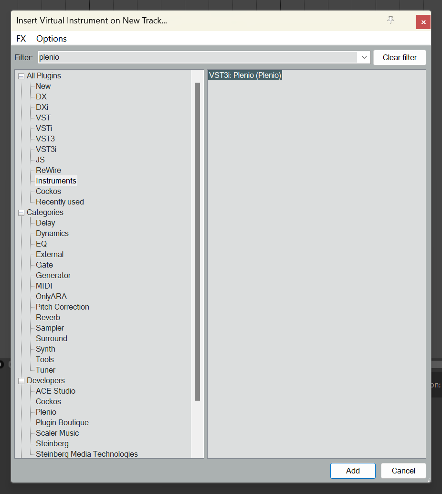

REAPER then asks whether it should add tracks for Plenio's outputs (*Build Routing Confirmation*): click **No**.
Plenio lays out the song's tracks itself later ([step 9](#9-into-your-project)).

Plenio's window opens over the track. You can close it and open it again any time (in REAPER: the track's *FX* button).

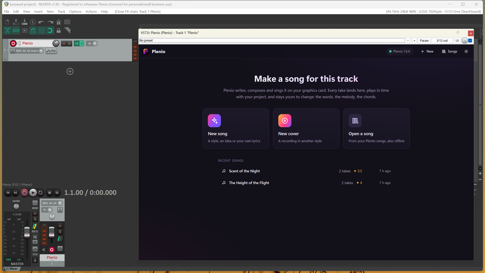

In another DAW: [how to add Plenio there](DAWS.md).

## 4. The first start

At the top right Plenio shows whether it found ComfyUI: green **Plenio** with its version means ready. *Studio offline* means
ComfyUI is not running: start it as you always do, or click **Start ComfyUI** (Plenio VST3 knows how to start it
once ComfyUI with Plenio has run on this computer).

### ComfyUI on another computer

The DAW on a laptop, ComfyUI on the PC with the graphics card? Plenio VST3 reaches it over your network:

1. On the studio PC, start ComfyUI with `--listen` (so it answers other computers), open **Plenio Setup › API
   access** and click **Make a token**. Copy it: it is shown once.
2. In Plenio VST3, open the **Settings** (the gear, or a click on *Studio offline*), switch on **ComfyUI runs on
   another computer**, and enter the PC's name or address (as you open its ComfyUI in a browser, e.g. `studio-pc`)
   and the token.

The token is kept in your computer's password store (Windows: the Credential Manager), never in a project or a
settings file. *Token needed* at the top right means the studio PC asks for one, or no longer accepts yours.

Before your first song Plenio asks you to accept the models' licences: YuE2 and SheetSage2, which make the songs, are
licensed CC BY-NC 4.0, so what you make with them is for non-commercial use.

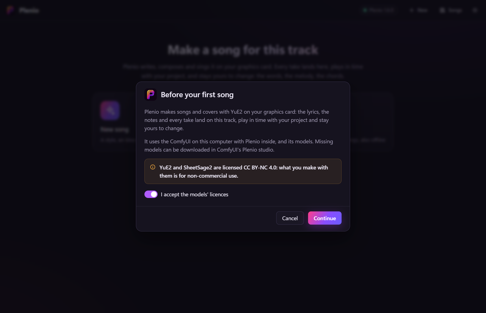

## 5. Make a song

Click **New song**.

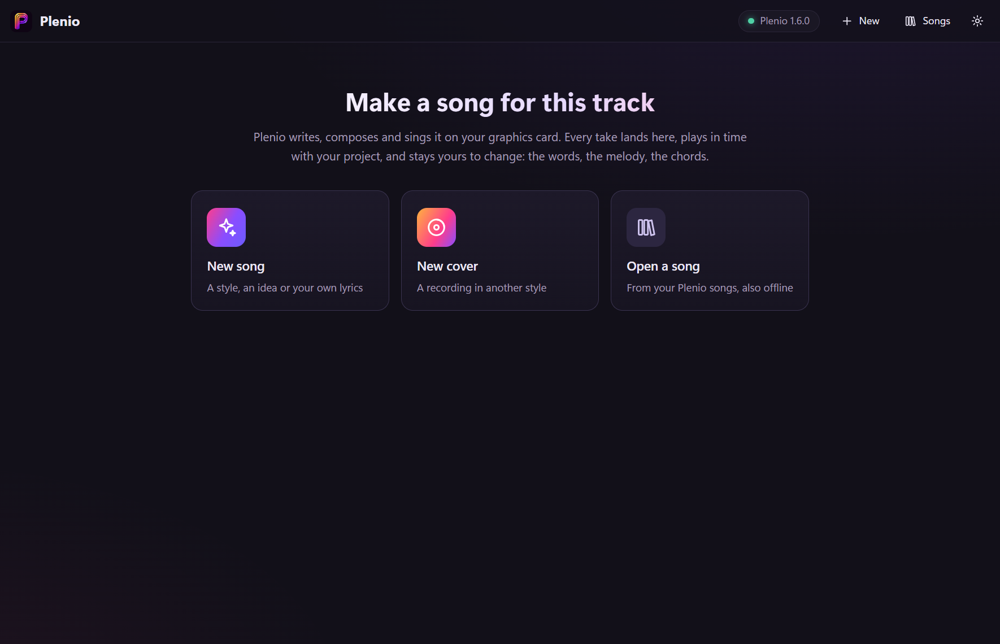

On the left are Plenio's 250 **styles**, grouped by genre; type to find one (*synth* finds *Synth pop*). A style fills
the fields on the right: the description of the sound, genre, mood, tempo, length, voice, theme. Change any of them.

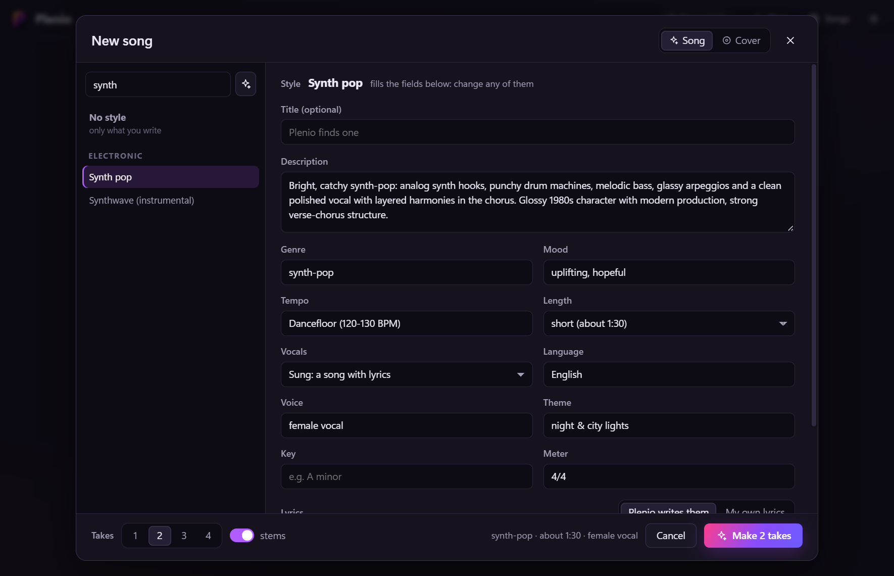

Further down, **Lyrics**: *Plenio writes them* from your idea (one sentence is enough), or *My own lyrics*, sung as you
write them. Under **More settings** you find the studio's switches: **Cover Art** paints a cover for every take (it
takes about a minute more), and the writer's model.

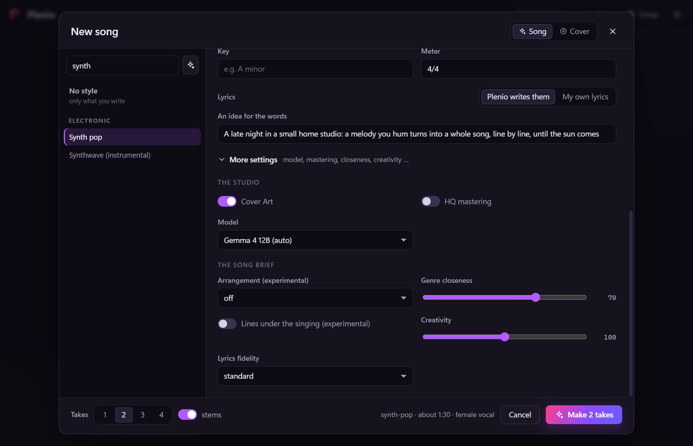

At the bottom, choose how many **takes** one run makes (1 to 4: they all land on this track) and whether every take comes
with **stems** (vocals, drums, bass, other, the rest). Then **Make 2 takes**.

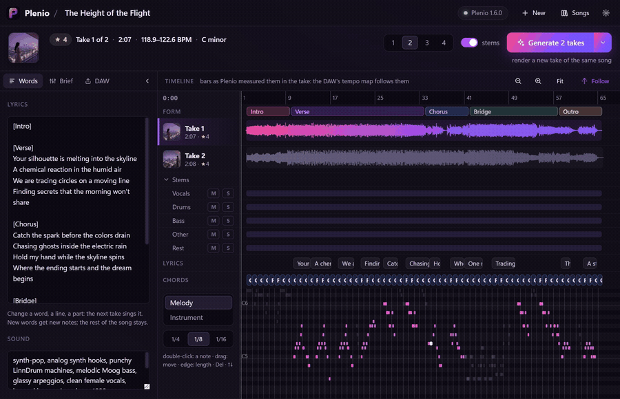

## 6. While Plenio works

The top of the window shows every take on its way: *writing the lyrics*, *singing and playing*, *mastering and saving*.
The second take uses the words and notes of the first, so the takes are versions of the same song. On a fast graphics
card a take of one and a half minutes takes about two minutes. You can keep working in your DAW meanwhile, or close
Plenio's window: the takes arrive all the same.

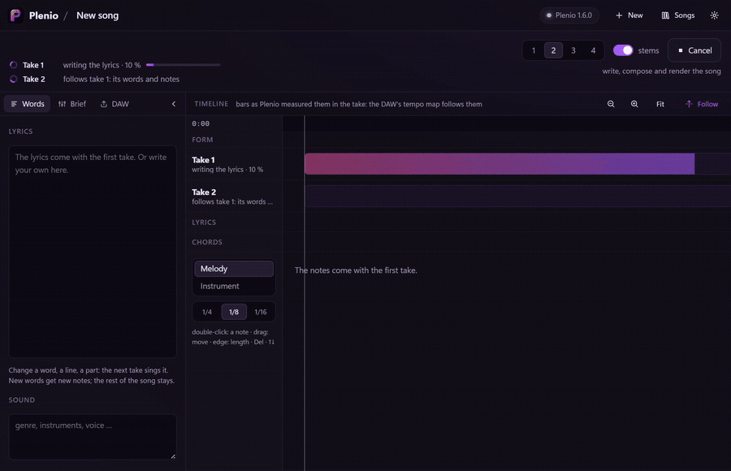

## 7. Your song

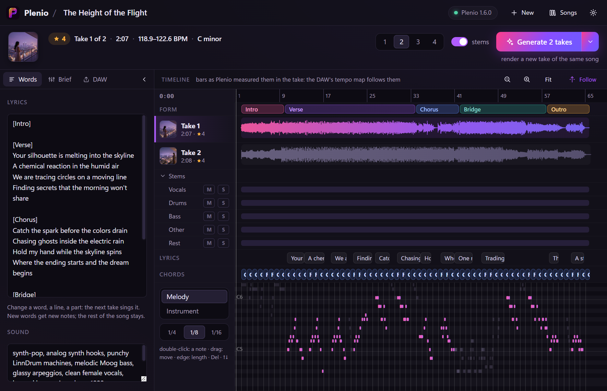

- **At the top**: the cover, Plenio's measured quality (stars), which take plays, its length, its tempo and key.
- **Takes**: click one to choose it. Its button shows its own cover; the play button listens from its start.
- **Stems**: M mutes, S solos one, for listening inside Plenio.
- **Lyrics** and **chords** where they sound, and the **melody** (or, with *Instrument*, the instrument line) in a piano
  roll.

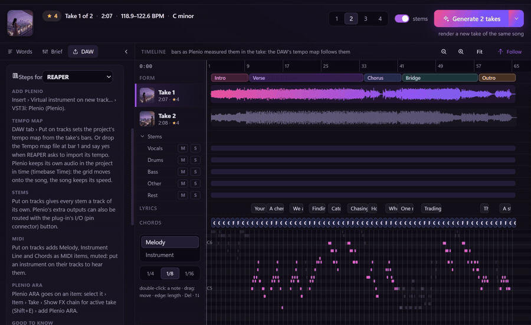

**Listen in your DAW**: press play (the space bar works in Plenio's window too). Plenio plays the chosen take in time
with your project, from bar 1. Click into Plenio's ruler while the DAW stands to listen from there.

## 8. Change it

What you change shows at the top (*lyrics changed*, *notes changed* …), and under **Generate** Plenio says what the next
run will do.

**The words.** In the *Words* tab, change a line. *Generate* now says *compose new notes for the words, then render*:
the next take sings your words with new notes; the rest of the song stays.

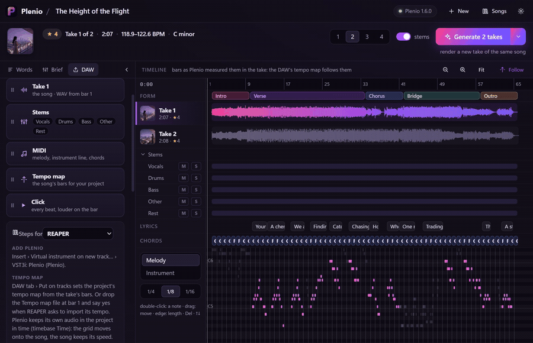

**The notes and the chords.** In the piano roll: double-click adds a note, drag moves it, its edge changes its length,
*Del* deletes, the arrow keys move it up and down. Click a chord to choose another. *Generate* now says *render a take of
your notes*: the next take sings exactly them.

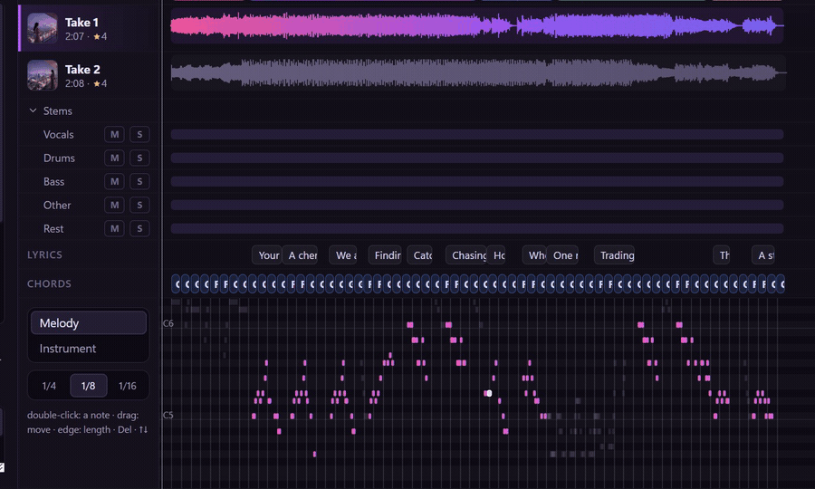

**The whole song.** In the *Brief* tab, change the style or any field: the song is written anew.

**Generate** makes the next takes; its little arrow offers *New take* (the same words and notes, sung again), *Compose
again* (the same words, new notes) and *Write anew* (a new song from the brief). Every run adds takes to the same track,
also when the new take is longer or shorter.

## 9. Into your project

The **DAW** tab holds the chosen take's files for your project. Drag one onto your DAW's timeline, at the very start
(bar 1): every file starts there.

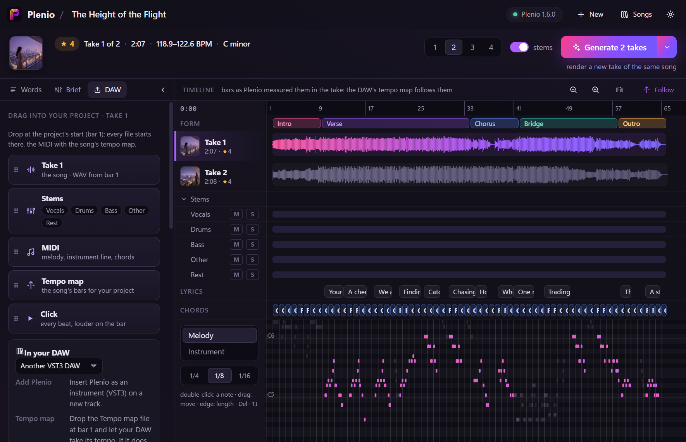

| File | What it is |
|---|---|
| **Take** | the song as a WAV |
| **Stems** | vocals, drums, bass, other and the rest, a WAV each (drag a single one by its name) |
| **MIDI** | the melody, the instrument line and the chords, with the song's tempo of every bar |
| **Tempo map** | only the tempo and meters: your DAW's bars then fall on the song's bars |
| **Click** | a click on every beat, louder on the bar, to hear where the bars are |

**REAPER** does all of it with one click: **Put on tracks** lays the song out on the project's own tracks: a folder with
the lyrics (an item per line), the song (every take as one of REAPER's takes: choose one with the take lane), the MIDI
(muted: put an instrument on it), the stems, the sections as regions, and the project's tempo map from the take's bars.
The take you choose in REAPER and in Plenio stay the same.

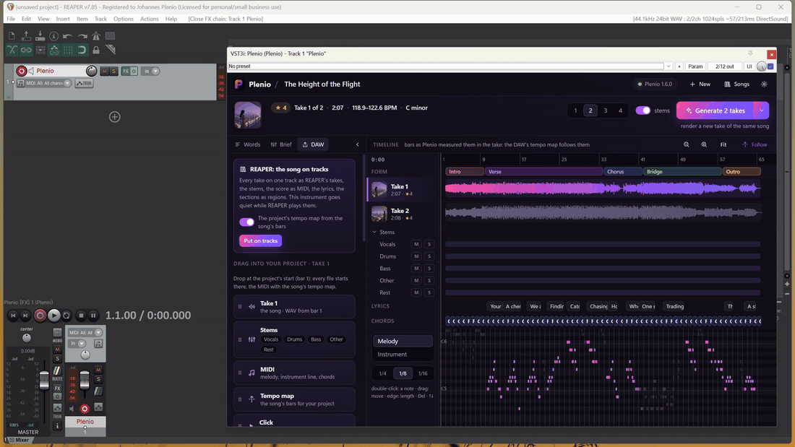

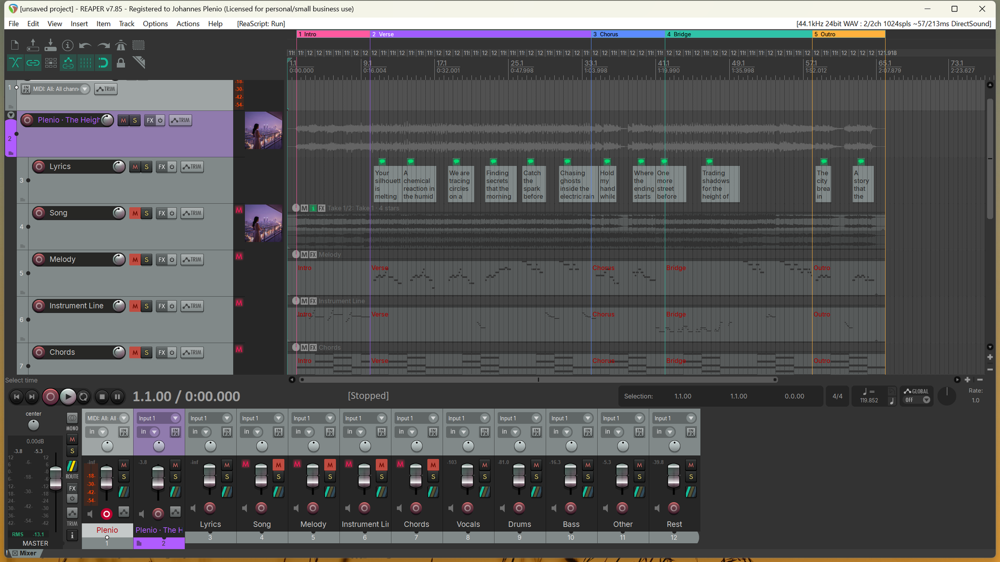

The **steps for your DAW** are at the bottom of the tab: Plenio knows the DAW it runs in and shows its steps first (how
it takes a tempo map, its outputs for the stems, its MIDI out). All of them: [DAWS.md](DAWS.md).

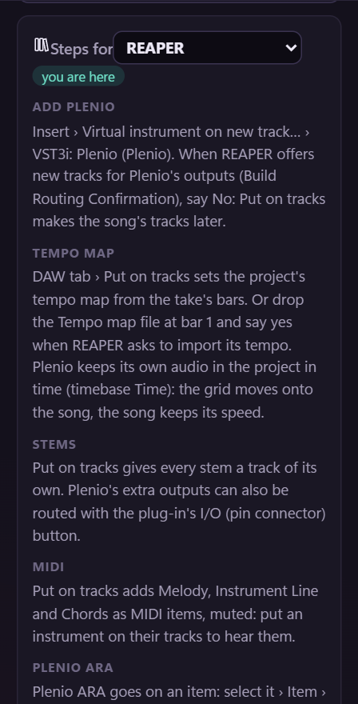

**Stems on their own channels** without dragging: activate Plenio's extra outputs (Vocals, Drums, Bass, Other, Rest) in
your DAW; each stem then plays there. **MIDI out**: Plenio sends the melody (channel 1), the instrument line (2) and the
chords (3) to a MIDI track routed from it.

## 10. Cover art

With *Cover Art* switched on, every take comes with its own cover. The song shows the chosen take's cover at the top
left; click it to see it large. The song's folder keeps it as `cover.jpg`, and in REAPER it becomes the icon of the
song's tracks.

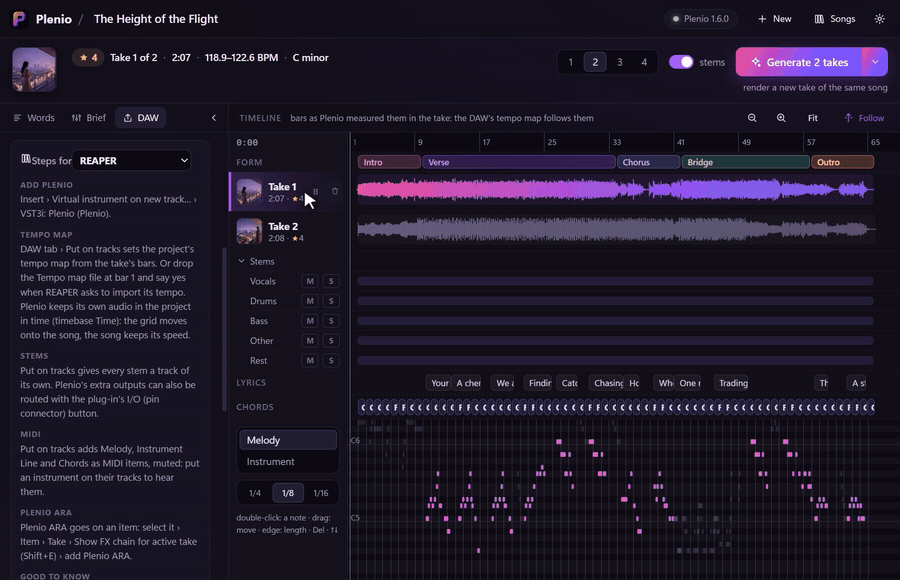

## 11. Your songs, also offline

**Songs** (top right) lists every song you made, with its cover. Plenio keeps each in a folder of its own
(`Documents\Plenio\Songs\<title> [id]`) with all its takes, stems and files; *Show the files* in the DAW tab opens it.

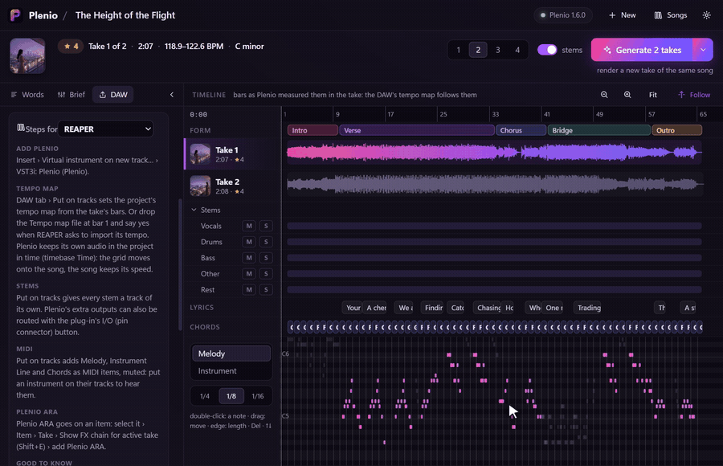

Your project keeps the song as well. Open it next week without ComfyUI: the song, its takes and your edits are all
there; playing, editing, dragging and REAPER's tracks work. Only *Generate* asks for ComfyUI.

## 12. Plenio ARA

For DAWs with ARA 2 (REAPER, Cubase, Studio One, Cakewalk …): put **Plenio ARA** on a clip that is a Plenio take (the
*Take* file from step 9). It gives your DAW the take's tempo of every bar, its meters, key, sung notes and chords, and
its window lets the clip play any other take of the song, at the same places. Where to find it in your DAW:
[DAWS.md](DAWS.md).

## 13. If something does not work

| What you see | What helps |
|---|---|
| *Studio offline* | Start ComfyUI with Plenio, or *Start ComfyUI*. Another port than 8188? Plenio's Settings. |
| *Token needed* | ComfyUI runs on another computer and asks for a token: make one there in *Plenio Setup › API access* and enter it in Plenio's Settings. |
| A take failed: *ComfyUI stopped while take … was being made* | ComfyUI was closed or restarted during the run. *Generate* makes the take again. |
| A model is missing | Open **Plenio Setup** in ComfyUI: it downloads what the song needs. |
| *update* next to Plenio's version | A newer Plenio brings more (stems, measured bars): click it for how to update. |
| Your DAW does not list Plenio | Let it look for new plug-ins again; Plenio.vst3 must be in `C:\Program Files\Common Files\VST3` (macOS: `/Library/Audio/Plug-Ins/VST3`). |
| Plenio's window stays empty (Windows) | Install the [Microsoft Edge WebView2 Runtime](https://developer.microsoft.com/microsoft-edge/webview2/). |
| The song plays slower after a tempo map came in | Your DAW stretched the audio to its tempo: switch that off for Plenio's audio ([DAWS.md](DAWS.md)); REAPER: Plenio does it itself. |
| Anything else | [Open an issue](https://github.com/jplenio/Plenio-Music-Production-System/issues/new/choose) with your DAW, the versions and the end of the log: Windows `%LOCALAPPDATA%\Plenio\VST3\plenio.log`, macOS `~/Library/Caches/Plenio/VST3/plenio.log`. |
